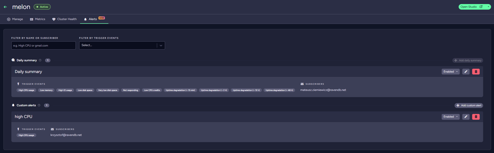
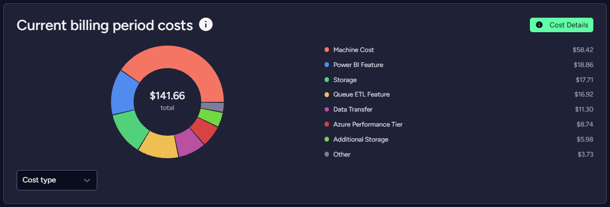
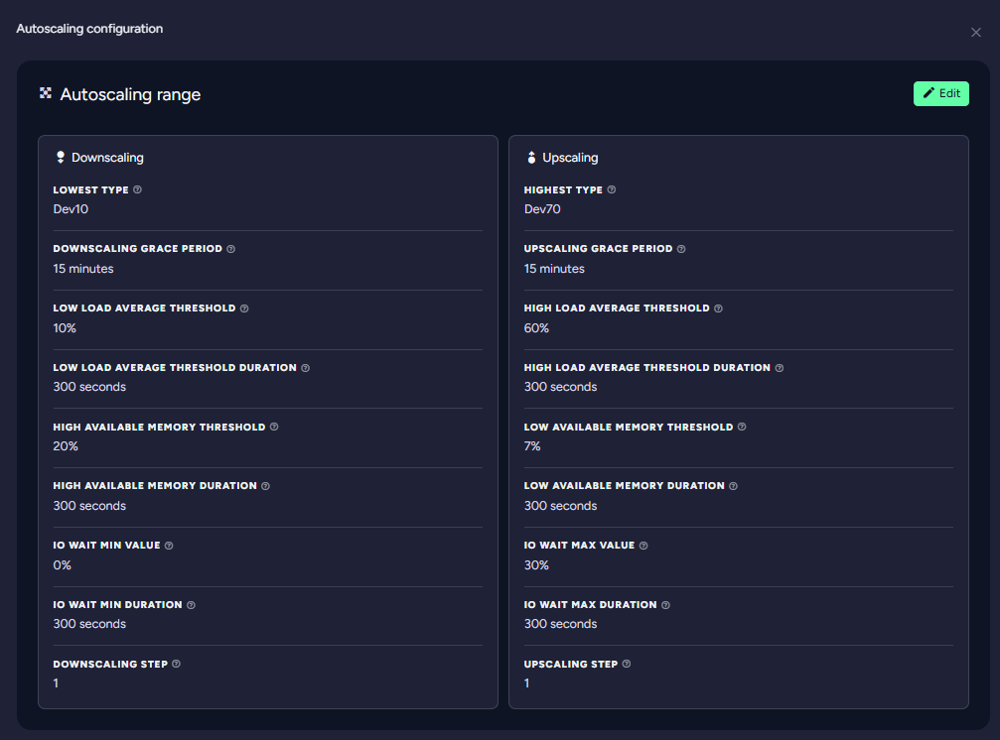

**Email alerts for your products**

Get an email when a product needs attention, as a daily summary or the moment a specific event happens.

**A clearer view of your costs**

The redesigned Billing & Costs view shows what's driving this month's bill as it builds up.

**Autoscaling that follows real load**

Autoscaling now scales on load average, available memory and IO wait, not on CPU alone.

**Sign in with Microsoft**

Sign in with your Microsoft account, next to Google and GitHub.

**Request support from the product**

Ask for help with a product right from its page, with the product already filled in.

**A new portal menu**

A collapsible sidebar with a Help center, your profile and an account switcher.

{/* truncate */}

## Email alerts for your products

Alerts email you what Cluster Health records, so you don't have to keep the dashboard open. A **daily summary** sends
one email with everything that happened to the product in the last 24 hours. **Custom alerts** fire the moment a
specific event is recorded: disk-space warnings to your operations mailbox, _Node not responding_ straight to whoever is
on call. When an incident recovers, a follow-up email tells you.

Set them up on the product's **Alerts** tab. [Set up alerts](/cloud/cloud-maintenance-troubleshooting#alerts)

## A clearer view of your costs

See the current billing period broken down by cost type or by product. **Cost Details** lists the costs behind the
numbers, and **Spending** charts your history day by day or month by month, narrowed to just the categories you care
about, like storage or a single feature.
[Explore Billing & Costs](/cloud/portal/cloud-portal-billing-tab#current-billing-period-costs)

## Autoscaling that follows real load

Each metric has its own limit and the time it has to hold, so a short spike doesn't resize your cluster. Serverless
products scale automatically within the range you set. [How autoscaling decides](/cloud/cloud-features#autoscaling)

## Sign in with Microsoft

**Sign in with Microsoft** sits on the sign-in page next to Google and GitHub, for personal and for work or school
accounts. [Sign-in options](/cloud/cloud-overview#login-with-google-github-or-microsoft)

## Request support from the product

_Request support for this instance_ on the product view opens a support request for that product. Available on paid
support plans. [Request support](/cloud/portal/cloud-portal-support-tab#request-support-from-a-product)

## A new portal menu

The account switcher names accounts by their domain, and the sidebar collapses when you need more room for your work.
[Find your way around](/cloud/portal/cloud-portal#sidebar-views)
