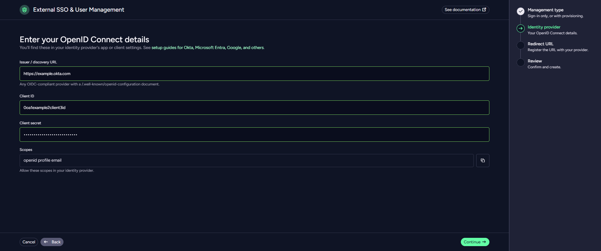
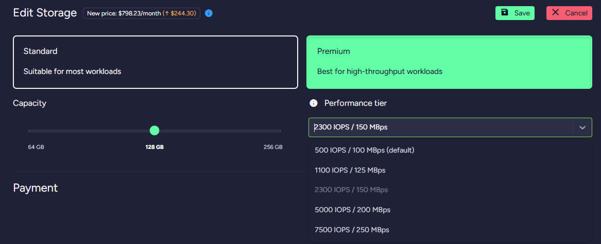
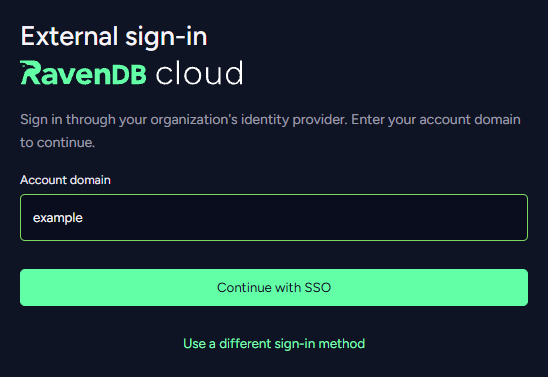

**Sign in with your own identity provider**

Let your team sign in with the work accounts they already use, and let your identity provider manage who gets in.

**Change storage without losing what you've tuned**

Switch between Standard and Premium storage at your current size, and keep your IOPS and performance tier.

**A simpler profile**

Your profile is now three pages, with two-factor authentication behind a single switch.

**Product access, set per user**

Choose each user's access to every product when you invite or edit them.

**Sharper daily summaries**

The suggestions in the daily alert email now come from that day's events only.

**Newer Azure machines**

New Azure Production products now run on current-generation v5 virtual machines.

{/* truncate */}

## Sign in with your own identity provider

**External SSO & User Management** lets your team sign in to RavenDB Cloud with the work accounts they already have:
Okta, Microsoft Entra ID, Google or any other OpenID Connect provider. Sign-in stays with your identity provider, with
its password rules and MFA, while roles and product permissions in RavenDB Cloud still decide what each person can do.

Turn on **SCIM provisioning** and your identity provider creates, updates and deactivates Cloud users for you, while
its groups map to account roles and product permissions. When someone leaves and is deactivated in your identity
provider, their SSO sign-in goes with them.

A four-step wizard connects your provider, and your team signs in with **Sign in with External SSO** and your account
domain. External SSO is activated per account: contact sales to turn it on. [Set up External SSO](/cloud/cloud-sso)

## Change storage without losing what you've tuned

Switching between **Standard** and **Premium** storage now keeps your disk at its current size, even when it is larger
than your instance type offers for new disks. Switch back and your IOPS, throughput and Azure performance tier come
back with it. Resizing keeps your IOPS within what the new size allows and holds on to a raised Azure performance tier,
and changing only the performance tier no longer stops the node. This applies to AWS and Azure products whose data is
on the main disk. [Change storage](/cloud/cloud-scaling#scaling---change-storage)

## A simpler profile

**Organizations**, **Invitations** and **Security** each have their own page. Two-factor authentication turns on with a
single switch and guides you through each step, the portal warns you before you run out of recovery codes, and pending
invitations wait under **Invitations** until you accept them.
[Set up two-factor authentication](/cloud/cloud-security#enable-mfa)

## Product access, set per user

Set the access for every product at once or one by one, and pick a default for products created later.
[Product permissions](/cloud/cloud-account#product-permissions)

## Sharper daily summaries

Each suggestion is worked out from the events of the reported day, with its own thresholds, and one whose event is
still in progress is marked as ongoing. [Daily summary](/cloud/cloud-maintenance-troubleshooting#daily-summary)

## Newer Azure machines

P10 to P70 products are created on v5 virtual machines where the region has them. Products still on Dsv3 move over at
their next resize or rebuild.
