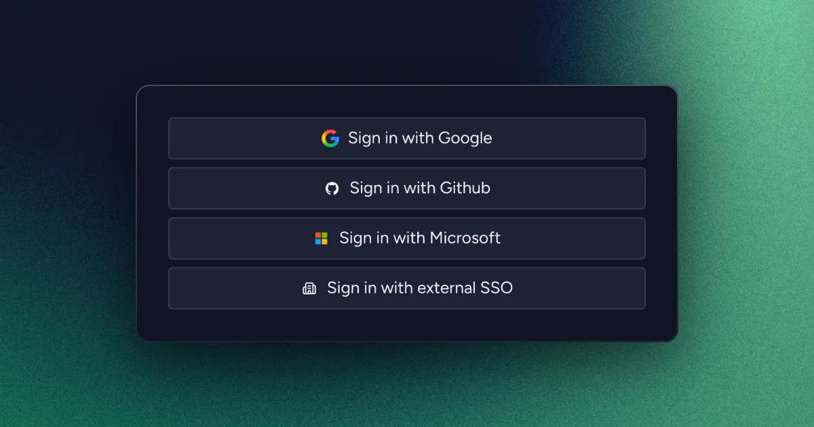
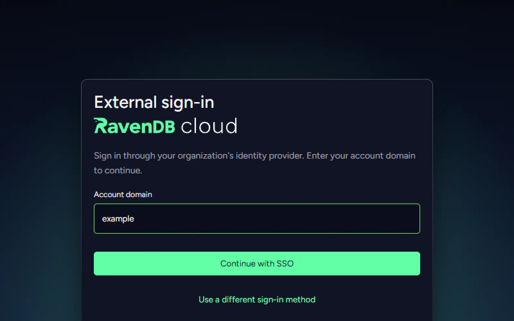
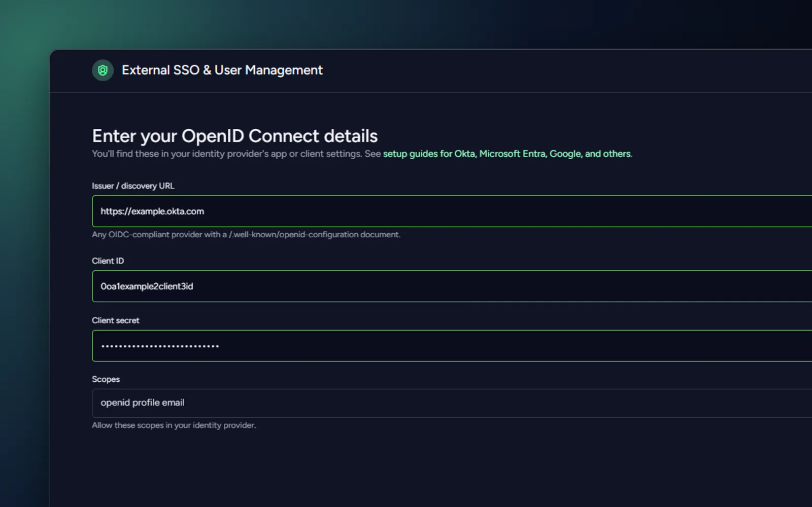
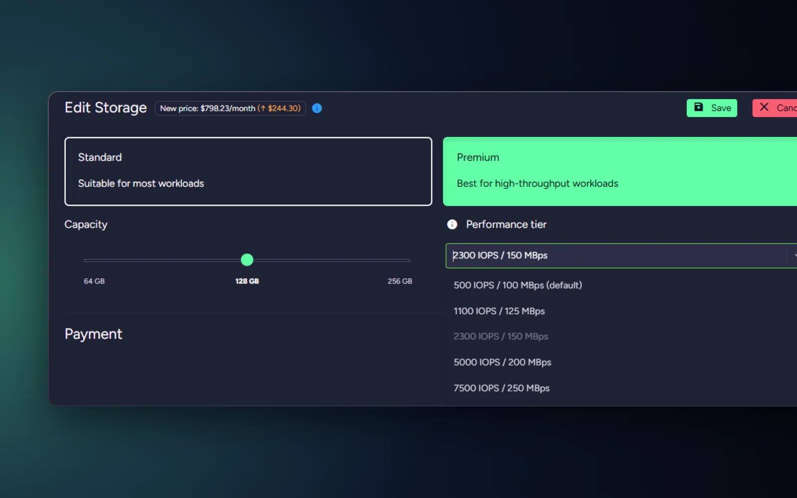
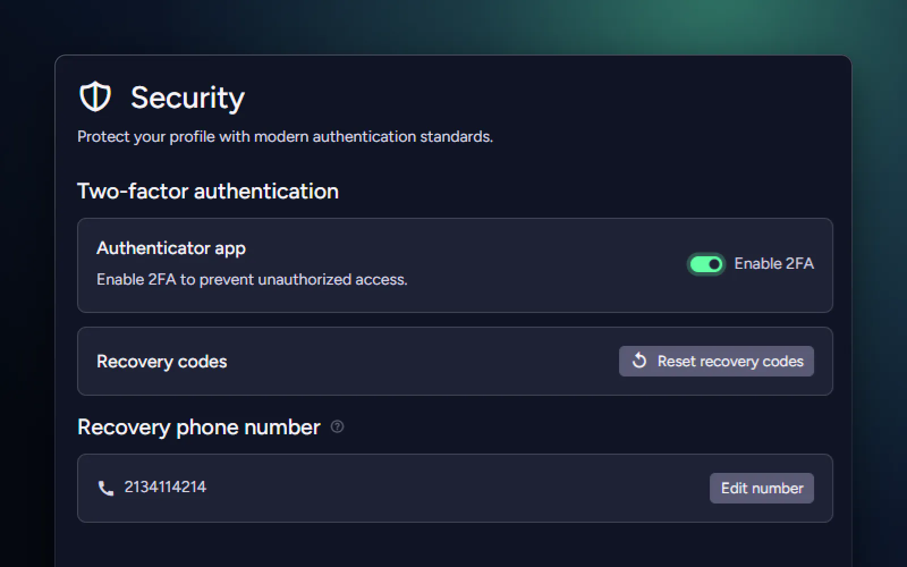
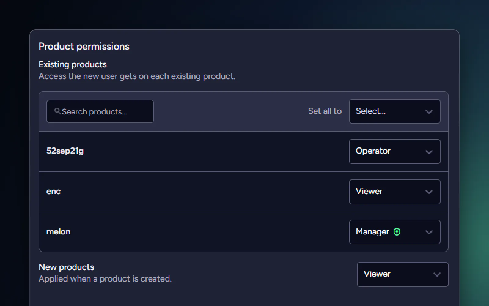

- **External SSO & User Management:** Your team signs in with the work accounts it already has, and your identity provider decides who gets in.
- **Change storage without losing what you've tuned:** Switch between Standard and Premium at your current disk size, and get your IOPS and performance tier back when you switch back.
- **A simpler profile:** Organizations, Invitations and Security each have their own page, and two-factor authentication is now a single switch.
- **Set product access in one place:** Give a user access to every product, one by one or all at once, right where you invite or edit them.
- **Daily summaries focused on the day:** The suggestions in the daily alert email now come from that day's events alone.
- **Newer Azure machines:** New Azure Production products run on current-generation v5 virtual machines.

{/* truncate */}

## External SSO & User Management

Your team no longer needs a separate RavenDB Cloud login. People sign in through your organization's identity
provider, whether that is Okta, Microsoft Entra ID, Google or any other OpenID Connect provider.
Your password rules and MFA apply there as they do for every other app, and what each person may do in RavenDB Cloud is
still set by account roles and product permissions.

Choose how much your identity provider takes over:

- **Sign-in only:** your identity provider signs people in, and you add SSO users and their roles on **Users & Access**.
- **Sign-in and user provisioning (SCIM):** your identity provider also creates, updates and deactivates users, and its
  groups map to account roles and product permissions. Someone deactivated there loses their SSO sign-in with it.

A four-step wizard under **Account features** connects your provider. From then on, your team clicks **Sign in with
External SSO** on the login page and enters your account domain.

- External SSO is activated per account: contact sales to turn it on.
- Turning it on removes no one. Existing members keep signing in the way they do today.
- SSO users get their MFA from your identity provider, not from RavenDB Cloud.

[Set up External SSO](/cloud/cloud-sso)

## Change storage without losing what you've tuned

Moving between **Standard** and **Premium** storage is no longer a fresh start. The switch keeps your disk at its
current size, even when that is more than your instance type offers for a new disk. The other type starts at its
default performance for that size, and if you switch back, your IOPS, throughput and Azure performance tier come back
with it.

- **Resizing keeps your settings:** your IOPS stay within what the new size allows, and a raised Azure performance tier
  stays as long as the new size offers it.
- **No downtime for a tier change:** changing only the Azure performance tier no longer stops the node, so even a
  single-node Development product stays up.
- **Where it applies:** AWS and Azure products whose data is on the main disk. Products with a separate data disk, and
  Serverless products, cannot switch storage type.

[Change storage](/cloud/cloud-scaling#scaling---change-storage)

## A simpler profile

The profile menu at the bottom of the Portal sidebar now opens three pages:

- **Organizations:** the cloud accounts your profile belongs to.
- **Invitations:** invitations to join other accounts, waiting there until you click **Accept**.
- **Security:** two-factor authentication, recovery codes and your recovery phone number.

On **Security**, two-factor authentication is a single **Enable 2FA** switch that walks you through the authenticator
app and your recovery codes, and asks for a recovery phone number first if you have none. The **Recovery codes** card
warns you when 3 or fewer codes are left, and **Reset recovery codes** gives you a new set.

[Set up two-factor authentication](/cloud/cloud-security#enable-mfa)

## Set product access in one place

The invite and edit panels on **Users & Access** list every product with its own access menu. Set each one to
Viewer, Operator, Manager or Admin, and a new user has the right access from the moment they accept the invitation.

- **Set all to** applies one level to every listed product, and **Search products** finds the one you need.
- **Security admin** is a switch at the bottom of each product's menu, and a shield next to the level shows it is on.
- **New products** sets the access the user gets on products created later. Only the Account Owner can change it.

[Product permissions](/cloud/cloud-account#product-permissions)

## Daily summaries focused on the day

The daily summary email used to repeat the 30-day suggestions from the Cluster Health page. Its suggestions now come
from the reported day only, so each one points at something that happened in those 24 hours. A node gets a suggestion
when, during that day, it had:

- *High CPU usage* for at least 5% of the time,
- *High IO usage* for at least 3% of the time,
- *Low memory mode* for at least 2% of the time, or
- any *Low CPU credits*, *Not responding* or *Server restarted due to Out of Memory* event.

Only the part of an event that falls within the day counts, and an event still in progress when the email is sent is
marked as ongoing. [Daily summary](/cloud/cloud-maintenance-troubleshooting#daily-summary)

## Newer Azure machines

New Azure Production products from P10 to P70 are created on current-generation v5 virtual machines, wherever the
region offers them. Products still on the older Dsv3 machines move to v5 at their next resize or rebuild.
