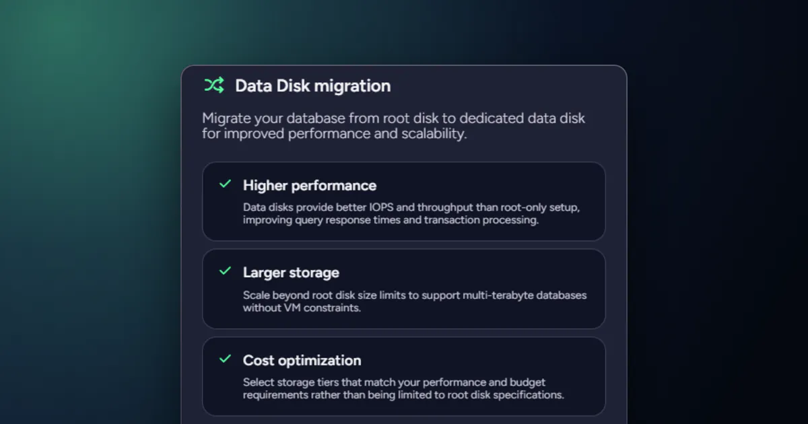
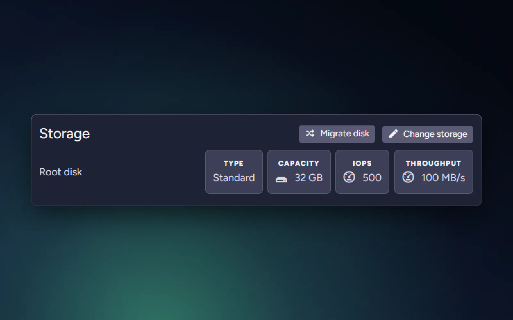
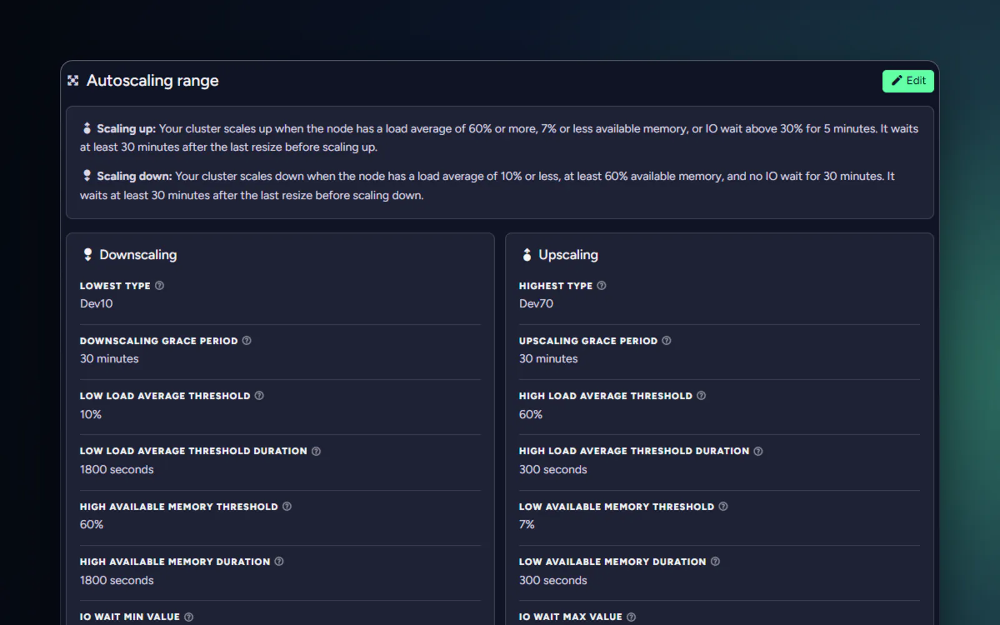

- **A data disk for every new product:** New Development and Production products keep RavenDB's data on a dedicated data disk, and existing ones can migrate to one.
- **Data disks up to 16 TB:** On P50, P60 and P70, a data disk can now grow up to 16,384 GB.
- **Autoscaling at a glance:** The autoscaling view now sums up in two sentences when your cluster scales up and down, and durations go up to an hour.

{/* truncate */}

## A data disk for every new product

Every new **Development** and **Production** product now keeps RavenDB's data on a dedicated data disk, separate from
the operating system disk. The operating system stays isolated, and your data gets a disk of its own: better IOPS and
throughput than a root-only setup, room to grow past the root disk's size limits, and a storage tier you choose for it.
There is no disk layout to pick in the create wizard, and the data disk can be Standard or Premium.

Development and Production products whose data is still on the operating system disk can move it with **Migrate disk**
on the product's Storage card. Development products can now migrate too.

- **Your storage type stays:** the migration keeps your storage type. On Azure, a Premium product in a region with
  Premium SSD v2 gets a Premium SSD v2 data disk, and a Standard product stays Standard.
- **Plan the migration:** it moves one node at a time and can take several hours, and the node being migrated may be
  unavailable.
- **Switch storage type later:** a data disk can now switch between Standard and Premium. On Azure, switching a
  Standard data disk to Premium in a region with Premium SSD v2 makes it a Premium SSD v2 disk, which cannot be
  switched back. The storage form warns you before you save.
- **Indexing follows the data disk:** the indexing batch size is now worked out from the IOPS of the data disk, the
  disk that holds your data.

Only Free products, Performance (PN) instance types and Serverless products keep their data on the operating system
disk. [Data disks](/cloud/cloud-scaling#data-disks)

## Data disks up to 16 TB

Data disks now go well beyond 4 TB. On the largest Production instance types, **P50**, **P60** and **P70**, a data
disk can grow up to **16,384 GB**.

| Disk type                               | Sizes above 4 TB                   |
| --------------------------------------- | ---------------------------------- |
| AWS, GCP and Azure Premium SSD v2       | 6,144, 8,192, 12,288 and 16,384 GB |
| Azure Standard SSD and Premium SSD (v1) | 8,192 and 16,384 GB                |

Azure bills Standard SSD and Premium SSD (v1) disks by the whole tier that covers their size, so the sizes in between
are not offered for them. P40 and smaller instance types keep their current maximum.
[Data disks larger than 4 TB](/cloud/cloud-scaling#data-disks-larger-than-4-tb)

## Autoscaling at a glance

The autoscaling configuration now opens with a two-sentence summary: when your cluster scales up, and when it scales
down. The summary follows your changes while you edit.

- **Durations up to an hour:** each threshold duration can now be set anywhere from 180 to 3,600 seconds, up from a
  600-second maximum.
- **Grace periods cover your durations:** a grace period must be at least as long as the longest duration in its
  direction, rounded up to whole minutes. The form tells you the minimum.
- **New defaults:** the cluster scales up after 5 minutes of sustained load and down only after 30 minutes of low load,
  with 30-minute grace periods. Settings still on the old defaults move to the new ones in waves after the deployment,
  and values you changed stay as they are. While a product moves, it briefly shows *Deploying Changes*.

[Autoscaling](/cloud/cloud-features#autoscaling)
