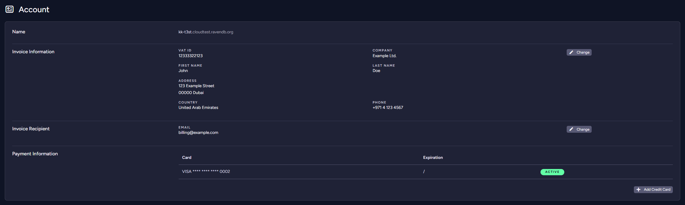
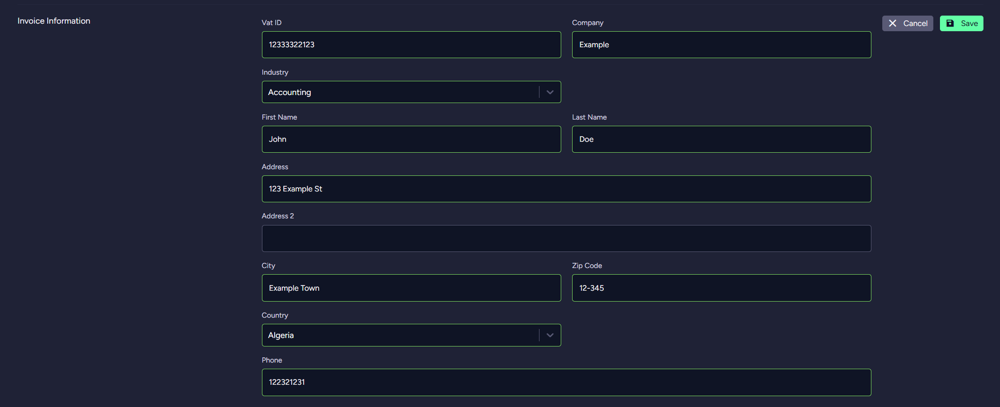
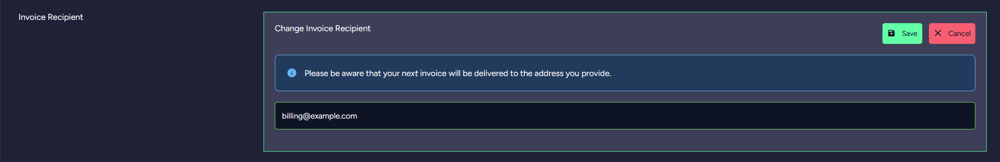
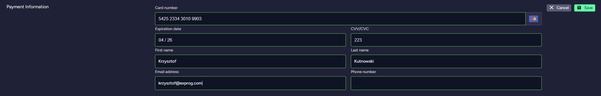
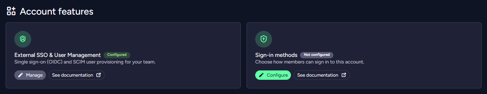
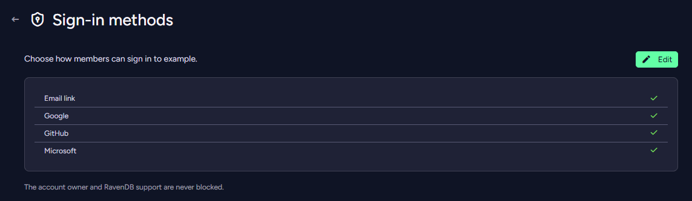
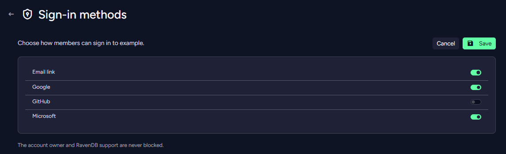
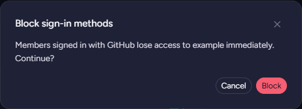

import Admonition from '@theme/Admonition';
import Tabs from '@theme/Tabs';
import TabItem from '@theme/TabItem';
import CodeBlock from '@theme/CodeBlock';
import LanguageSwitcher from "@site/src/components/LanguageSwitcher";
import LanguageContent from "@site/src/components/LanguageContent";

# Cloud Portal: The Account Tab

<Admonition type="note" title="">

This tab allows you to manage your account and payment information. 

* In this page:  
   * [The Account Tab](../../cloud/portal/cloud-portal-account-tab.mdx#the-account-tab)  
        * [Billing information management](../../cloud/portal/cloud-portal-account-tab.mdx#billing-information-management)  
        * [Account features](../../cloud/portal/cloud-portal-account-tab.mdx#account-features)  
            * [Sign-in methods](../../cloud/portal/cloud-portal-account-tab.mdx#sign-in-methods)  
</Admonition>
## The Account Tab

    

### Billing information management

In this section you can edit the data that will be used for the invoice.

In this section you can edit the email address to which invoices will be sent.  
If a custom recipient email is not provided, the invoice is sent to the *account owner*.

In this section you can manage payment cards that will be used to pay for RavenDB Cloud services.  
You can add, remove or change the default credit card.

### User management

Managing account users — inviting or removing members, assigning their [account roles](../../cloud/cloud-account.mdx#account-roles), and managing their [per-product permissions](../../cloud/cloud-account.mdx#product-permissions) — is now done from the dedicated [Users & Access](../../cloud/portal/cloud-portal-users-and-access-tab.mdx) page.

### Account features

Features that apply to the whole account are set up from the separate **Account features** view in the sidebar.
Each feature has its own card:

* **External SSO & User Management**: single sign-on through your organization's identity provider.
  See [External SSO & User Management](../../cloud/cloud-sso.mdx).
* **Sign-in methods**: the sign-in methods the members of this account can use.
  See [Sign-in methods](#sign-in-methods) below.

Each card is shown only to users with a matching [account role](../../cloud/cloud-account.mdx#account-roles): the
*Sign-in methods* card requires the **Sign-in methods** role. A card reads *Configured* once its feature is set up.

#### Sign-in methods {#sign-in-methods}

By default, members of an account can sign in with any method the
[login page](../../cloud/cloud-overview.mdx#login-to-your-account) offers. The **Sign-in methods** page lets you block
any of these methods for your account:

* **Email link** (the magic link)
* **Google**
* **GitHub**
* **Microsoft**

[External SSO](../../cloud/cloud-sso.mdx) is not on the list and cannot be blocked.

To block or allow a method:

1. Open **Account features** and click **Configure** (or **Manage**) on the **Sign-in methods** card.
2. Click **Edit** and turn off the switch of each method you want to block, or turn it on to allow it again.
3. Click **Save**. If you are blocking a method, confirm with **Block**: members signed in with that method lose
   access to the account immediately.

<Admonition type="note" title="The Account Owner is never blocked">
The **Account Owner** and RavenDB support can always sign in, whatever the list says. The owner's own login stays
the way back in if the account's sign-in setup ever locks the members out.
</Admonition>

Some switches cannot be turned off. Hover a disabled switch to see why:

* **Blocking all four methods** requires an active [External SSO](../../cloud/cloud-sso.mdx) connection, so that
  members still have a way in. With all four blocked, members can sign in only through SSO.
* **The method you are signed in with** cannot be blocked by you, unless you are the Account Owner.
  Sign in another way first.
* If the page asks you to **sign in again** before changing sign-in methods, your current session does not record how
  you signed in. Sign out and sign back in.

**What a member with a blocked method sees**

* If none of the member's accounts allows the method, signing in with it fails, and a member who is already signed in
  with it is signed out. The login page then says *Your account doesn't allow sign-in with GitHub. Sign in another
  way.*
* If another of the member's accounts still allows the method, the Portal switches to that account. In the account
  switcher, the account that blocks the method is greyed out with
  *Your sign-in method isn't allowed for this account.*
* A user who accepts an [invitation](../../cloud/portal/cloud-portal-users-and-access-tab.mdx#accepting-an-invitation) to an account can sign
  in with any method that account allows.
