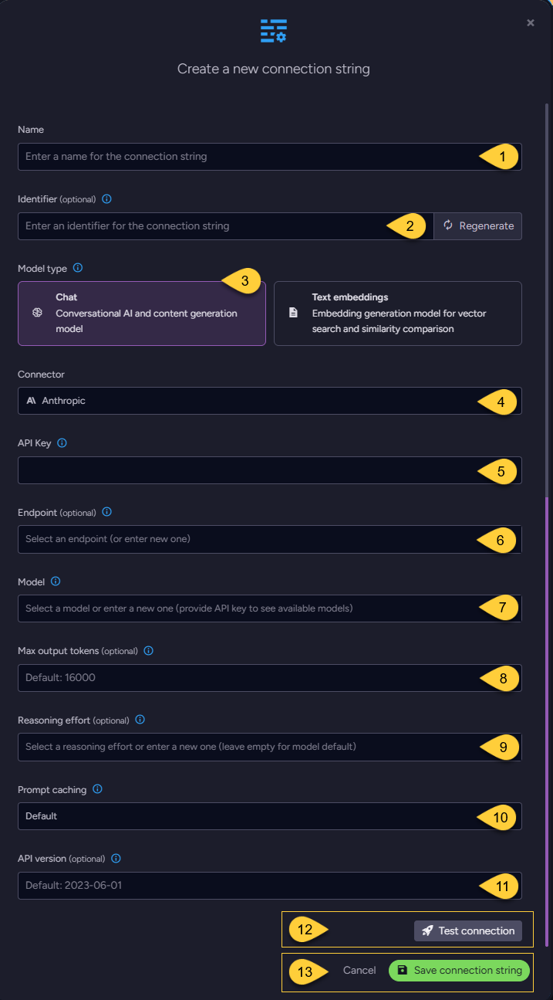

import Admonition from '@theme/Admonition';
import Tabs from '@theme/Tabs';
import TabItem from '@theme/TabItem';
import CodeBlock from '@theme/CodeBlock';
import ContentFrame from '@site/src/components/ContentFrame';
import Panel from '@site/src/components/Panel';

<Admonition type="note" title="">

* This article explains how to define a connection string to Anthropic's [Claude API](https://platform.claude.com/docs/en/api/messages/create),  
  enabling RavenDB to use Claude models for [Gen AI tasks](../../../ai-integration/gen-ai-integration/overview.mdx) and [AI agents](../../../ai-integration/ai-agents/overview.mdx).

* Anthropic connection strings support **chat models only** and cannot be used for
  [embeddings generation tasks](../../../ai-integration/generating-embeddings/overview.mdx).

* The Studio and Client API examples below define a **per-database** AI connection string.  
  To define the same provider configuration at the **cluster level**, see [Add a server-wide connection string](../../../integrations/connection-strings/server-wide/add-or-update-connection-string.mdx).

* In this article:
  * [Define the connection string - from Studio](../../../ai-integration/connection-strings/anthropic.mdx#define-the-connection-string-from-studio)
    * [Reasoning effort](../../../ai-integration/connection-strings/anthropic.mdx#reasoning-effort)
    * [Prompt caching](../../../ai-integration/connection-strings/anthropic.mdx#prompt-caching)
  * [Define the connection string - from the Client API](../../../ai-integration/connection-strings/anthropic.mdx#define-the-connection-string-from-the-client-api)
  * [Syntax](../../../ai-integration/connection-strings/anthropic.mdx#syntax)
  * [Anthropic-specific behavior](../../../ai-integration/connection-strings/anthropic.mdx#anthropic-specific-behavior)
    * [Tools and output schemas](../../../ai-integration/connection-strings/anthropic.mdx#tools-and-output-schemas)
    * [Token usage](../../../ai-integration/connection-strings/anthropic.mdx#token-usage)
    * [Token limits and errors](../../../ai-integration/connection-strings/anthropic.mdx#token-limits-and-errors)

</Admonition>

<Panel heading="Define the connection string - from Studio">



1. **Name**  
   Enter a name for this connection string.

2. **Identifier** (optional)  
   Learn more about the identifier in the [connection string identifier](../../../ai-integration/connection-strings/overview.mdx#identifier) section.

3. **Model Type**  
   Select "Chat".  
   Anthropic is not listed as a connector when "Text Embeddings" is selected.

4. **Connector**  
   Select **Anthropic** from the dropdown menu.

5. **API key**  
   Enter the Anthropic API key used to authenticate requests.  
   RavenDB sends the key in the `x-api-key` request header.

6. **Endpoint** (optional)  
   * The base URL of the Claude API.  
     If not set, `https://api.anthropic.com/v1/` is used.  
     If set to `https://api.anthropic.com`, RavenDB adds the `v1/` path automatically.  
   * Any other URL is used as is, so it must include the path under which the Messages API is served 
     (e.g., when using a proxy or gateway).  
     RavenDB sends chat requests to `<endpoint>/messages`.

7. **Model**  
   Select or enter the Claude model to use, e.g., `claude-sonnet-5-5`.  
   After you enter an API key, the dropdown lists the models available to that key.

8. **Max output tokens** (optional)  
   * The maximum number of tokens the model can generate in a single response.  
     RavenDB sends this value to Anthropic in the `max_tokens` field of the API request.    
     Thinking tokens count toward this limit.
   * If not set, `16000` is used. The value must be a positive integer.
   * See [Token limits and errors](../../../ai-integration/connection-strings/anthropic.mdx#token-limits-and-errors).

9. **Reasoning effort** (optional) <span id="reasoning-effort" />  
   * Turns on [adaptive thinking](https://platform.claude.com/docs/en/build-with-claude/thinking) and sets how much reasoning the model does before answering.  
     RavenDB sends `thinking: { "type": "adaptive" }` and the selected [effort](https://platform.claude.com/docs/en/build-with-claude/effort) level in `output_config.effort`.
   * Select `low`, `medium`, `high`, `xhigh`, or `max`, or enter another value supported by the model.
   * The selected model must support adaptive thinking and the requested effort level; otherwise, Anthropic rejects the request.
     Supported levels vary by model. Check Anthropic's documentation for the model you use.
   * RavenDB trims the value and converts it to lowercase, but does not validate it.  
     This allows new Anthropic effort levels to be used without waiting for a RavenDB release.
   * If not set, RavenDB sends no thinking or effort configuration, and the model applies its own defaults.
   * Thinking content is not included in the answer.  
     Thinking tokens are reported in `reasoning_tokens` (see [Token usage](../../../ai-integration/connection-strings/anthropic.mdx#token-usage)) and count toward `max_output_tokens`.

10. **Prompt caching** (optional) <span id="prompt-caching" />  
    
    * When caching applies, RavenDB adds Anthropic's top-level `cache_control` field (`{ "type": "ephemeral" }`) to the request,
      allowing Anthropic to [cache the prompt prefix](https://platform.claude.com/docs/en/build-with-claude/prompt-caching) and reuse it in later requests.
    
    * Anthropic bills a cache write above the normal input-token price and a cache read well below it.  
      Caching therefore pays off only when the same prompt prefix is sent again within the cache lifetime:
      * In an **AI agent** conversation, every turn resends the system prompt and the prior messages.
      * In a **GenAI task**, the prompt is resent only when the model calls a tool (e.g., a query tool) and RavenDB sends the tool result back.
        A GenAI task without tools sends each document once, so caching would only add the cost of the cache write.
    
    * Caching is controlled by `enable_prompt_cache`.  
      The Studio options correspond to the following values:  
    
        | `enable_prompt_cache`      | AI agents | GenAI tasks with tools | GenAI tasks without tools |
        |----------------------------|-----------|------------------------|---------------------------|
        | `None` (Studio: _Default_) | Enabled   | Enabled                | Disabled                  |
        | `True` (Studio: _True_)    | Enabled   | Enabled                | Enabled                   |
        | `False` (Studio: _False_)  | Disabled  | Disabled               | Disabled                  |

    * RavenDB does not control Anthropic's caching behavior, such as the cache lifetime or the minimum prompt length that can be cached.
      Cache reads and writes are reported as described in [Token usage](../../../ai-integration/connection-strings/anthropic.mdx#token-usage).

11. **API version** (optional)  
    The Anthropic API version, sent in the `anthropic-version` request header.  
    If not set, `2023-06-01` is used.

12. Click **Test Connection** to confirm the connection string is set up correctly.

13. Click **Save** to store the connection string or **Cancel** to discard changes.

</Panel>

<Panel heading="Define the connection string - from the Client API">

<TabItem value="Connection_string_for_chat_model" label="Connection_string_for_chat_model">
```python
# Replace the server URL and database name with your own values.
store = DocumentStore(["https://your-ravendb-server"], "YourDatabase")
store.initialize()

# Define the connection string to Anthropic
connection_string = AiConnectionString(
    # Connection string Name & Identifier
    name="ConnectionStringToAnthropic",
    identifier="identifier-to-the-connection-string",  # or None to generate it from the name

    # Model type
    # Anthropic supports chat models only
    model_type=AiModelType.CHAT,

    # Anthropic connection settings
    anthropic_settings=AnthropicSettings(
        api_key="your-api-key",

        # Name of the Claude model to use
        model="claude-sonnet-5-5",

        # Optionally, raise the output-token cap (default: 16000)
        max_output_tokens=32000,

        # Optionally, turn on adaptive thinking with the given effort level.
        # The model must support adaptive thinking and this effort level.
        reasoning_effort="medium",

        # endpoint, enable_prompt_cache, and api_version are not set,
        # so their defaults apply.
    ),
)

# Deploy the connection string to the server
put_connection_string_op = PutConnectionStringOperation(connection_string)
put_connection_string_result = store.maintenance.send(put_connection_string_op)
```

</TabItem>

</Panel>

<Panel heading="Syntax">

<TabItem value="anthropic_settings" label="anthropic_settings">
```python
class AiConnectionString(ConnectionString):
    def __init__(
        self,
        name: str,
        identifier: str,
        # ...
        model_type: AiModelType = None,  # Must be AiModelType.CHAT for Anthropic
        anthropic_settings: Optional[AnthropicSettings] = None,
    ):
        ...

class AnthropicSettings(AbstractAiSettings):
    def __init__(
        self,
        api_key: Optional[str] = None,
        model: Optional[str] = None,
        endpoint: Optional[str] = None,              # optional
        max_output_tokens: Optional[int] = None,     # optional
        reasoning_effort: Optional[str] = None,      # optional
        enable_prompt_cache: Optional[bool] = None,  # optional
        api_version: Optional[str] = None,           # optional
    ):
        ...
```
</TabItem>

| Property                | Type   | Required | Description                                                                                                                                                                                         |
|-------------------------|--------|----------|-----------------------------------------------------------------------------------------------------------------------------------------------------------------------------------------------------|
| **api_key**             | `str`  | Yes      | The Anthropic API key, sent in the `x-api-key` request header.                                                                                                                                      |
| **model**               | `str`  | Yes      | The Claude model ID, e.g., `claude-sonnet-5-5`.                                                                                                                                                     |
| **endpoint**            | `str`  | No       | The base URL of the Claude API.<br/>Default: `https://api.anthropic.com/v1/`.<br/>When set to `https://api.anthropic.com`, `v1/` is added automatically. Any other URL is used as is.               |
| **max_output_tokens**   | `int`  | No       | The maximum number of tokens per response, sent as `max_tokens`. Thinking tokens count toward this limit.<br/>Default: `16000`. Must be positive.                                                   |
| **reasoning_effort**    | `str`  | No       | Enables adaptive thinking and sets the effort level.<br/>Not sent when `None` or whitespace.<br/>See [Reasoning effort](../../../ai-integration/connection-strings/anthropic.mdx#reasoning-effort). |
| **enable_prompt_cache** | `bool` | No       | Controls prompt caching for AI agents and GenAI tasks.<br/>Default: `None` (Studio: _Default_).<br/>See [Prompt caching](../../../ai-integration/connection-strings/anthropic.mdx#prompt-caching).  |
| **api_version**         | `str`  | No       | The Anthropic API version, sent in the `anthropic-version` request header.<br/>Default: `2023-06-01`.                                                                                               |

* Set `model_type` to `AiModelType.CHAT`.  
  `AiConnectionString` raises `ValueError` if `model_type` is `AiModelType.TEXT_EMBEDDINGS`.
    
* `AnthropicSettings` has no `temperature` setting; RavenDB does not send `temperature` to Anthropic.
    
* `embeddings_max_concurrent_batches`, inherited from `AbstractAiSettings`, has no effect, since Anthropic is not used for embeddings.

</Panel>

<Panel heading="Anthropic-specific behavior">

### Tools and output schemas

A tool's parameters schema defines the arguments the model can pass to that tool.  
An output schema defines the structure of the model's final answer.

* RavenDB sends every tool to Anthropic in [strict mode](https://platform.claude.com/docs/en/agents-and-tools/tool-use/strict-tool-use) (`strict: true`).  
  Strict mode constrains the arguments generated for each tool call to the tool's parameters schema.

* In the JSON schema for a tool's parameters, each object must include `"additionalProperties": false`.  
  This allows only the properties declared for that object.
    
  * Schemas that RavenDB generates from a parameters **sample object** already meet this requirement.
    
  * For a hand-written `parameters_schema`, RavenDB adds `additionalProperties: false` to the **root (outermost) object** if it is missing.
    If the root object's schema explicitly sets `"additionalProperties": true`, RavenDB preserves that value and Anthropic rejects the request.
    Include `"additionalProperties": false` in every **nested object**; otherwise, Anthropic rejects the request.  
    
    In the following example, `customer` is the nested object. Its schema sets `additionalProperties: false`,  
    and RavenDB adds this property to the root object before sending the schema to Anthropic:

      ```json
      {
        "type": "object",
        "properties": {
          "customer": {
            "type": "object",
            "properties": {
              "id": { "type": "string" }
            },
            "required": ["id"],
            "additionalProperties": false
          }
        },
        "required": ["customer"]
      }
      ```

* Anthropic allows at most **20 strict tools per request**.  
  All tools sent with a request count toward this limit: query tools, action tools, and sub-agents,
  plus the built-in `RetrieveAttachment` tool, which RavenDB adds when attachments are stored on the conversation document so the model can re-read them.

* Both tool parameters schemas and output schemas must follow Anthropic's
  [JSON Schema limitations](https://platform.claude.com/docs/en/build-with-claude/structured-outputs#json-schema-limitations).  
  Anthropic rejects requests whose schemas use unsupported features, such as the numeric constraint `minimum` or the string constraint `maxLength`.
  Limits on optional parameters and parameters that allow multiple types apply across the tool and output schemas in the request.

* Learn more about agent tools in [Query tools](../../../ai-integration/ai-agents/creating-ai-agents/creating-ai-agents_api.mdx#query-tools)
  and [Action tools](../../../ai-integration/ai-agents/creating-ai-agents/creating-ai-agents_api.mdx#action-tools).

---

### Token usage

RavenDB represents token-usage statistics using the [AiUsage](../../../ai-integration/ai-agents/creating-ai-agents/creating-ai-agents_api.mdx#conversation-response) class.  
The following table shows how RavenDB populates its properties from the token counts reported by Anthropic.

| `AiUsage` property  | Anthropic usage fields                                                     |
|---------------------|----------------------------------------------------------------------------|
| `prompt_tokens`     | `input_tokens` + `cache_read_input_tokens` + `cache_creation_input_tokens` |
| `completion_tokens` | `output_tokens`                                                            |
| `total_tokens`      | `prompt_tokens` + `completion_tokens`                                      |
| `cached_tokens`     | `cache_read_input_tokens` (cache reads only)                               |
| `reasoning_tokens`  | `output_tokens_details.thinking_tokens` (thinking tokens)                  |

Cache writes are included in `prompt_tokens`, but are not reported separately.

---

### Token limits and errors

A model's context window limits the total number of tokens in the input and generated response.  
RavenDB handles Anthropic token limits as follows:

| Situation                                                                                                                        | Result                                                                                                                                                                                                   | What to do                                                                                                                                                                                      |
|----------------------------------------------------------------------------------------------------------------------------------|----------------------------------------------------------------------------------------------------------------------------------------------------------------------------------------------------------|-------------------------------------------------------------------------------------------------------------------------------------------------------------------------------------------------|
| The input exceeds the model's context window.<br/>Anthropic rejects the request with HTTP 400 `prompt is too long`.              | RavenDB throws `TooManyTokensException`.                                                                                                                                                                 | Shorten the input or the conversation history,<br/>e.g., with [chat trimming](../../../ai-integration/ai-agents/creating-ai-agents/creating-ai-agents_api.mdx#set-chat-trimming-configuration). |
| The response reaches `max_output_tokens`<br/>(`stop_reason`: `max_tokens`).                                                      | RavenDB returns a truncated text answer or throws `TooManyTokensException`.<br/>See [Returning truncated text](../../../ai-integration/connection-strings/anthropic.mdx#returning-truncated-text) below. | Increase `max_output_tokens`.                                                                                                                                                                   |
| The input and generated response together reach the model's context limit.<br/>(`stop_reason`: `model_context_window_exceeded`). | RavenDB returns a truncated text answer or throws `TooManyTokensException`.<br/>See [Returning truncated text](../../../ai-integration/connection-strings/anthropic.mdx#returning-truncated-text) below. | Shorten the input or the conversation history.                                                                                                                                                  |

<Admonition type="info" title="">

#### Returning truncated text
    
When generation stops because of an output or context limit,  
RavenDB returns a truncated text answer without throwing an exception only when **all** of the following apply:

* No output schema is specified.
* The response contains some text.
* The response contains no tool calls.

</Admonition>

---
    
Other Anthropic responses that RavenDB maps to specific exceptions:  
    
  * **Refusal** (`stop_reason`: `refusal`):  
    RavenDB throws `RefusedToAnswerException`.
    
  * **HTTP 429 with a valid `Retry-After` header**:  
    RavenDB throws `RateLimitException`, with `retry_after` set from the header.
    * In an AI agent conversation, the exception reaches your code; RavenDB does not retry the request.  
      Retry after the `retry_after` delay.
    * For a GenAI task, the RavenDB server retries automatically after the delay specified by Anthropic's `Retry-After` header.
      It temporarily limits the task to one concurrent request to the model.
    
  * **HTTP 429 without a valid `Retry-After` header**  
    (e.g., when the organization reaches its usage tier's monthly spend cap):  
    RavenDB throws `InsufficientQuotaException` rather than treating the response as a temporary rate limit.

  * **A rate-limit error during a streamed AI agent response**  
    (an `error` event whose `error.type` is `rate_limit_error`):  
    RavenDB throws `InsufficientQuotaException`. Handle the exception in your application.  
    RavenDB does not automatically retry the request, and no retry delay is provided.

</Panel>
