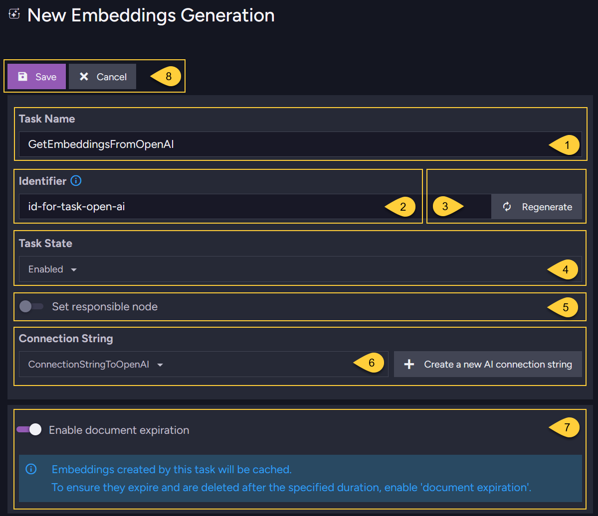
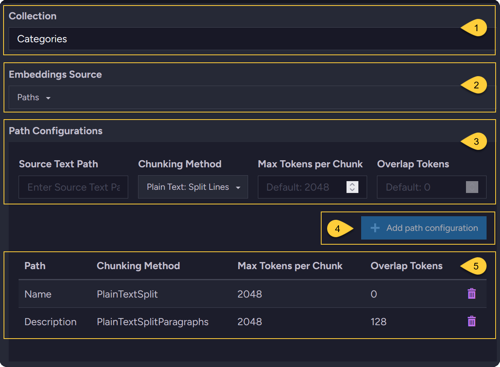
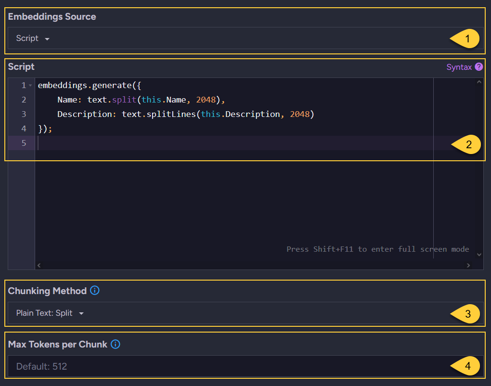
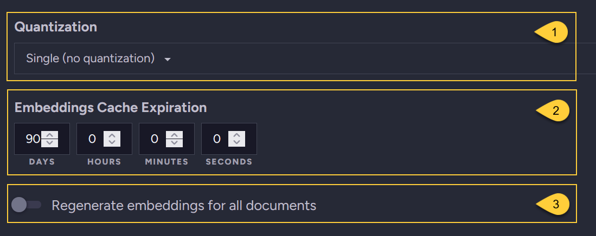
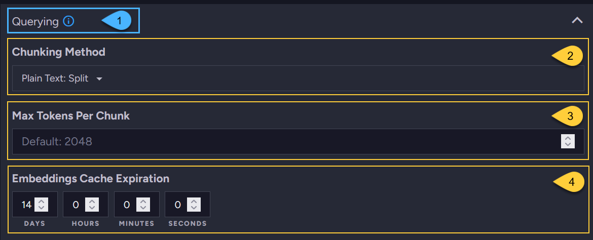
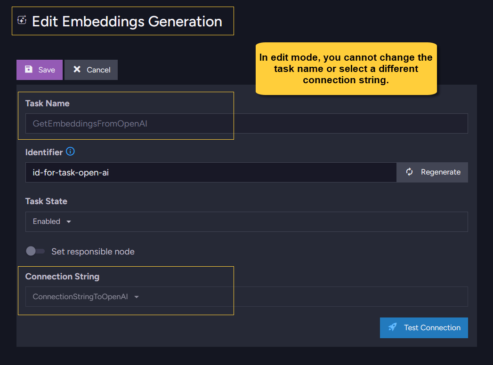
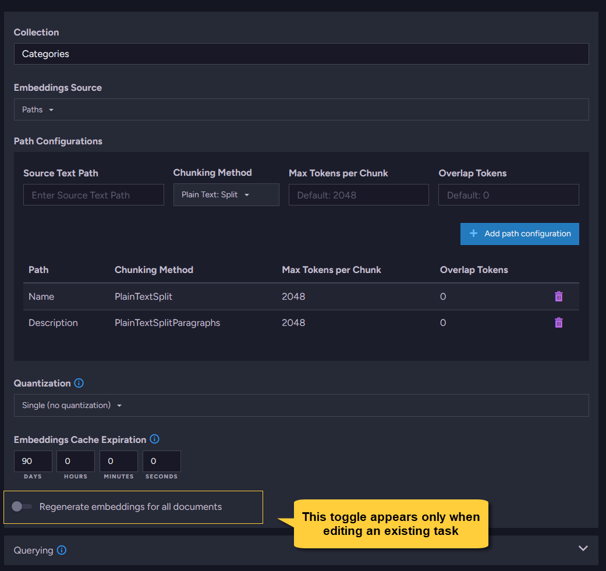

import Admonition from '@theme/Admonition';
import ContentFrame from '@site/src/components/ContentFrame';
import Panel from '@site/src/components/Panel';

<Admonition type="note" title="">

* In RavenDB, you can define AI tasks to automatically generate embeddings from your document content.  
  These embeddings are then stored in [dedicated collections](../../../ai-integration/generating-embeddings/embedding-collections.mdx) within the database,  
  enabling [Vector search](../../../ai-integration/vector-search/overview.mdx) on your documents.

* This article explains how to configure such a task.  
  It is recommended to first refer to this [Overview](../../../ai-integration/generating-embeddings/overview.mdx#embeddings-generation-overview)
  to understand the embeddings generation process flow.

* To learn how the task splits text into chunks and how to add a context prefix to each chunk,  
  see [Chunking and context prefixes](../../../ai-integration/generating-embeddings/chunking-and-context-prefixes.mdx).

* In this article:
    * [Configuring an embeddings generation task - from Studio](#configuring-an-embeddings-generation-task-from-studio)
    * [Configuring an embeddings generation task - from the Client API](#configuring-an-embeddings-generation-task-from-the-client-api)
      * [Define source using PATHS](#configure-an-embeddings-generation-task---define-source-using-paths)
      * [Define source using SCRIPT](#configure-an-embeddings-generation-task---define-source-using-script)
      * [Store chunk text](#store-chunk-text)
    * [Updating an existing embeddings generation task](#updating-an-existing-embeddings-generation-task)
      * [Modify the task - from Studio](#modify-the-task---from-studio)
      * [Modify the task - from the Client API](#modify-the-task---from-the-client-api)
      * [Reprocess existing documents](#reprocess-existing-documents)
    * [Syntax](#syntax)
    
</Admonition>

<Panel heading="Configuring an embeddings generation task - from Studio">

* **Define the general task settings**:

     

  1. **Name**  
     Enter a name for the task.
  2. **Identifier**  
     Enter a unique identifier for the task.  
     Each AI task in the database must have a distinct identifier.  

        If not specified, or when clicking the "Regenerate" button,  
        RavenDB automatically generates the identifier based on the task name. For example:     
        * If the task name is: _"Generate embeddings from OpenAI"_
        * The generated identifier will be: _"generate-embeddings-from-openai"_
      
        Allowed characters: only lowercase letters (a-z), numbers (0-9), and hyphens (-).  
        The identifier cannot contain consecutive hyphens or end with a hyphen.
  
        **This identifier is used:**  
        * When querying embeddings generated by the task via a dynamic query.  
          An example is available in [Querying pre-made embeddings](../../../ai-integration/vector-search/vector-search-using-dynamic-query.mdx#querying-pre-made-embeddings-generated-by-tasks).
        * When indexing the embeddings generated by the task.  
          An example is available in [Indexing pre-made text-embeddings](../../../ai-integration/vector-search/vector-search-using-static-index.mdx#indexing-vector-data-text).
        * In documents in the [Embeddings collection](../../../ai-integration/generating-embeddings/embedding-collections.mdx#the-embeddings-collections),  
          where the task identifier is used to identify the origin of each embedding.
     
  3. **Regenerate**  
     Click "Regenerate" to automatically create an identifier based on the task name.
  4. **Task state**  
     Enable/Disable the task.
  5. **Responsible node**  
     Select a node from the [Database group](../../../studio/database/settings/manage-database-group.mdx) to be the responsible node for this task.
  6. **Connection string**  
     Select a previously defined [AI connection string](../../../ai-integration/connection-strings/overview.mdx) or create a new one.
  7. **Enable document expiration**  
     This toggle appears only if the [Document expiration feature](../../../documents/document-expiration/document-expiration-view.mdx) is Not enabled in the database.
     Enabling document expiration ensures that embeddings in the `@embeddings-cache` collection are automatically deleted when they expire.
  8. **Save**  
     Click _Save_ to store the task definition or _Cancel_.

---

* **Define the embeddings source - using PATHS**:
  
    

  1. **Collection**  
     Enter or select the source document collection from the dropdown.
  2. **Embeddings source**  
     Select `Paths` to define the source content by document properties.
  3. **Path configuration**  
     Specify which document properties to extract text from, and how the text should be chunked into embeddings. 

     * **Source text path**  
       Enter the property name from the document that contains the text for embedding generation.  
     * **Chunking method**  
       Select the method for splitting the source text into chunks.  
       Learn more in [Chunking methods and tokens](../../../ai-integration/generating-embeddings/chunking-and-context-prefixes.mdx#chunking-methods-and-tokens).  
     * **Max tokens per chunk**  
       Enter the maximum number of tokens per chunk. Choose a value below the model's input token limit,  
       since RavenDB's token counts may differ from the model's.
     * **Overlap tokens**  
       Enter the number of tokens to repeat at the start of each chunk from the end of the previous one.  
       This helps preserve context between chunks by carrying over some tokens from one to the next.  
       Applies only to the _"Plain Text: Split Paragraphs"_ and _"Markdown: Split Paragraphs"_ chunking methods.

  4. **Add path configuration**  
     Click to add the path configuration to the list.
  5. **List of paths**  
     This table displays the document properties you added for embedding generation.

---

* **Define the embeddings source - using SCRIPT**:
  
    

  1. **Embeddings source**  
     Select `Script` to define the source content and chunking methods using a JavaScript script.
  2. **Script**  
     Refer to section [Chunking methods and tokens](../../../ai-integration/generating-embeddings/chunking-and-context-prefixes.mdx#chunking-methods-and-tokens) for available JavaScript methods.
  3. **Default chunking method**  
     The selected chunking method is used for values supplied as plain strings or string arrays in the script.
     e.g., when the script contains: `Name: this.Name`.
  4. **Default max tokens per chunk**:  
     Enter the maximum number of tokens per chunk for values that use the default chunking method.  
     Choose a value below the selected model's input token limit.
  5. **Default overlap tokens**  
     Enter the default number of overlap tokens for values supplied as plain strings or string arrays in the script.  
     This is the number of tokens to repeat at the start of each chunk from the end of the previous one.  
     Applies only to the _"Plain Text: Split Paragraphs"_ and _"Markdown: Split Paragraphs"_ chunking methods.

---

* **Define quantization and expiration -  
  for the generated embeddings from the source documents**:

    

  1. **Quantization**  
     Select the quantization method that RavenDB will apply to embeddings received from the service provider.  
     Available options:  
     * Single (no quantization)
     * Int8
     * Binary
  2. **Embeddings cache expiration**  
     Set the expiration period for documents stored in the `@embeddings-cache` collection.  
     These documents contain embeddings generated from the source documents, serving as a cache for these embeddings.  
     The default initial period is `90` days. This period may be extended when the source documents change.  
     Learn more in [The embeddings cache collection](../../../ai-integration/generating-embeddings/embedding-collections.mdx#the-embeddings-cache-collection).
  3. **Regenerate embeddings**  
     This toggle is visible only when editing an existing task.  
     Toggle ON to regenerate embeddings for all documents in the collection, as specified by the _Paths_ or _Script_.

---

* **Define chunking method & expiration -  
  for the embedding generated from a search term in a vector search query**:

    

  1. **Querying**  
     This label indicates that this section configures parameters only for embeddings  
     generated by the task for **search terms in vector search queries**.
  2. **Chunking method**  
     Select the method for splitting the search term into chunks.  
     Learn more in [Chunking methods and tokens](../../../ai-integration/generating-embeddings/chunking-and-context-prefixes.mdx#chunking-methods-and-tokens).
  3. **Max tokens per chunk**  
     Enter the maximum number of tokens per chunk. Choose a value below the model's input token limit,  
     since RavenDB's token counts may differ from the model's.
  4. **Overlap tokens**  
     Enter the number of tokens to repeat at the start of each chunk from the end of the previous one.  
     This helps preserve context between chunks by carrying over some tokens from one to the next.  
     Applies only to the _"Plain Text: Split Paragraphs"_ and _"Markdown: Split Paragraphs"_ chunking methods.
  5. **Embeddings cache expiration**  
     Set the expiration period for documents stored in the `@embeddings-cache` collection.  
     These documents contain embeddings generated from the search terms, serving as a cache for these embeddings.  
     The default period is `14` days. Learn more in [The embeddings cache collection](../../../ai-integration/generating-embeddings/embedding-collections.mdx#the-embeddings-cache-collection).

---

<Admonition type="note" title="">

The `storeChunkText` option, which stores the text of each chunk, cannot currently be set in Studio.  
Set it through the Client API, as described in [Store chunk text](#store-chunk-text).

</Admonition>

</Panel>

<Panel heading="Configuring an embeddings generation task - from the Client API">

<ContentFrame>

#### Configure an embeddings generation task - define source using PATHS:

```js
// Define a connection string that will be used in the task definition:
// ====================================================================

const connectionString = new AiConnectionString();

// Connection string name & identifier
connectionString.name = "ConnectionStringToOpenAI";
connectionString.identifier = "id-for-open-ai-connection-string";

// Model type
connectionString.modelType = "TextEmbeddings";

// OpenAI connection settings
connectionString.openAiSettings = new OpenAiSettings(
    "your-api-key",
    "https://api.openai.com/v1",
    "text-embedding-3-small");

// Deploy the connection string to the server:
// ===========================================
const putConnectionStringOp = new PutConnectionStringOperation(connectionString);
const putConnectionStringResult =
    await documentStore.maintenance.send(putConnectionStringOp);

// Define the embeddings generation task:
// ======================================
const embeddingsTaskConfiguration = new EmbeddingsGenerationConfiguration();

// General info:
embeddingsTaskConfiguration.name = "GetEmbeddingsFromOpenAI";
embeddingsTaskConfiguration.identifier = "id-for-task-open-ai";
embeddingsTaskConfiguration.connectionStringName = "ConnectionStringToOpenAI";
embeddingsTaskConfiguration.disabled = false;

// Embeddings source & chunking methods - using PATHS configuration:
embeddingsTaskConfiguration.collection = "Categories";
embeddingsTaskConfiguration.embeddingsPathConfigurations = [
    {
        path: "Name",
        chunkingOptions: {
            chunkingMethod: "PlainTextSplit",
            maxTokensPerChunk: 2048
        }
    },
    {
        path: "Description",
        chunkingOptions: {
            chunkingMethod: "PlainTextSplitParagraphs",
            maxTokensPerChunk: 2048,

            // 'overlapTokens' is only applicable when 'chunkingMethod' is
            // 'PlainTextSplitParagraphs' or 'MarkDownSplitParagraphs'
            overlapTokens: 128
        }
    }
];

// Quantization & expiration -
// for embeddings generated from source documents:
embeddingsTaskConfiguration.quantization = "Single";
embeddingsTaskConfiguration.embeddingsCacheExpiration =
    90 * 24 * 60 * 60 * 1000; // 90 days

// Chunking method and expiration -
// for the embeddings generated from search term in vector search query:
embeddingsTaskConfiguration.chunkingOptionsForQuerying = {
    chunkingMethod: "PlainTextSplit",
    maxTokensPerChunk: 2048
};

embeddingsTaskConfiguration.embeddingsCacheForQueryingExpiration =
    14 * 24 * 60 * 60 * 1000; // 14 days

// Chunk text storage:
// Default is 'false'. Set to 'true' to also store the text of each chunk
// in the embeddings document (see "Store chunk text" below).
embeddingsTaskConfiguration.storeChunkText = false;

// Deploy the embeddings generation task to the server:
// ====================================================
const addEmbeddingsGenerationTaskOp =
    new AddEmbeddingsGenerationOperation(embeddingsTaskConfiguration);
const addAiIntegrationTaskResult =
    await documentStore.maintenance.send(addEmbeddingsGenerationTaskOp);
```

</ContentFrame>

<ContentFrame>

#### Configure an embeddings generation task - define source using SCRIPT:

* To configure the source content using a script -  
  use the `embeddingsTransformation` object instead of the `embeddingsPathConfigurations` object.

* The rest of the configuration properties are the same as in the example above.

* Call `embeddings.generate(object)` within the script.  
  Each KEY names a field in the generated embeddings document.  
  For each VALUE, provide a string or string array to use the task's default chunking settings,  
  or call a text-splitting method to specify how that text should be split.

* Set the maximum number of tokens per chunk to a value below the selected model's input token limit.  
  Learn how the methods count or estimate tokens in [Chunking methods and tokens](../../../ai-integration/generating-embeddings/chunking-and-context-prefixes.mdx#chunking-methods-and-tokens).
 
* For example:  

    ```js
    // Source collection:
    embeddingsTaskConfiguration.collection = "Categories";

    // Use 'embeddingsTransformation':
    embeddingsTaskConfiguration.embeddingsTransformation = {
        // Define the script:
        script: `
            embeddings.generate({

                // Process the document 'Name' field using method text.split().
                // Use a token budget of 2048 for each chunk.
                Name: text.split(this.Name, 2048),

                // Process the document 'Description' field
                // using method text.splitParagraphs().
                // Use an estimated token budget of 2048 for each chunk,
                // with an estimated overlap budget of 128 tokens.
                Description: text.splitParagraphs(this.Description, 2048, 128)
            });`,

        // 'chunkingOptions' is required in Node.js (see the note below)
        chunkingOptions: {
            chunkingMethod: "PlainTextSplit",
            maxTokensPerChunk: 256
        }
    };
    ```

* For values supplied as plain strings or string arrays, the task uses `embeddingsTransformation.chunkingOptions`.  
  In Node.js, `chunkingOptions` has no default value and must be set  
  (the example above sets `PlainTextSplit` with a token budget of `256`).  
  To set different defaults:

    ```js
    embeddingsTaskConfiguration.collection = "Categories";
    embeddingsTaskConfiguration.embeddingsTransformation = {
        script: `
            embeddings.generate({

                // No chunking method is specified here
                Name: this.Name,
                Description: this.Description
            });`,

        // Specify the default chunking options to use in the script
        chunkingOptions: {
            chunkingMethod: "PlainTextSplit",
            maxTokensPerChunk: 2048
        }
    };
    ```

</ContentFrame>

<ContentFrame>

#### Store chunk text:

* By default, the task stores only the embeddings generated for the text chunks, as attachments of the source document's [embeddings document](../../../ai-integration/generating-embeddings/embedding-collections.mdx#the-embeddings-collections).
  The text of the chunks is not stored.

* Set `storeChunkText` to `true` to also store the text of each chunk in the embeddings document  
  (`embeddings/<source-document-id>`).  
  * The text is stored as it was sent to the embedding model,
    including the [context prefix](../../../ai-integration/generating-embeddings/chunking-and-context-prefixes.mdx#adding-a-context-prefix-to-chunks), if one is defined.  
  * The embeddings are still stored as attachments.  
  * Storing the text makes the embeddings documents larger.

* Storing chunk text lets you [retrieve the text of matching chunks](../../../ai-integration/vector-search/more-querying-options.mdx#retrieving-matching-chunk-text)
  for each document returned by a vector search.

* The option is **not retroactive**. It applies only to documents the task processes after the option is enabled,  
  such as new or modified documents.
  To store the chunk text of documents the task has already processed, [reprocess the existing documents](#reprocess-existing-documents).

* `storeChunkText` cannot currently be set in Studio. Set it through the Client API.

* For example, the following task generates embeddings from the `Notes` field of _Employee_ documents  
  and stores the text of each chunk:

    ```js
    const employeeNotesTaskConfiguration = new EmbeddingsGenerationConfiguration();

    employeeNotesTaskConfiguration.name = "GetEmployeeNotesEmbeddings";
    employeeNotesTaskConfiguration.identifier = "id-for-task-employee-notes";
    // The connection string defined in the PATHS example above
    employeeNotesTaskConfiguration.connectionStringName = "ConnectionStringToOpenAI";

    employeeNotesTaskConfiguration.collection = "Employees";
    employeeNotesTaskConfiguration.embeddingsPathConfigurations = [
        {
            path: "Notes",
            chunkingOptions: {
                // Split the notes into small chunks,
                // so each chunk covers a short part of the text
                chunkingMethod: "PlainTextSplitLines",
                maxTokensPerChunk: 64
            }
        }
    ];

    employeeNotesTaskConfiguration.chunkingOptionsForQuerying = {
        chunkingMethod: "PlainTextSplit",
        maxTokensPerChunk: 2048
    };

    // Store the text of each chunk in the embeddings document
    employeeNotesTaskConfiguration.storeChunkText = true;

    const addEmployeeNotesTaskOp =
        new AddEmbeddingsGenerationOperation(employeeNotesTaskConfiguration);
    const addEmployeeNotesTaskResult =
        await documentStore.maintenance.send(addEmployeeNotesTaskOp);
    ```

</ContentFrame>

</Panel>

<Panel heading="Updating an existing embeddings generation task">

<ContentFrame>

#### Modify the task - from Studio:

* To modify a task, click _Edit_ next to the task in the [AI Tasks list view](../../../ai-integration/ai-tasks-list-view.mdx#ai-tasks---list-view).  
  The task opens in the same view used to [create it](#configuring-an-embeddings-generation-task-from-studio),
  with the following differences:

* **Locked fields**:  
  The task name and the connection string cannot be modified.
    
      

* **Regenerate embeddings for all documents**:  
  This toggle appears only when editing a task.  
  If it is ON when you save the task, the task processes all documents in its collection again,  
  the same as [resetting the task with `ResetEtlOperation`](#reprocess-existing-documents) in the Client API.
  * The Studio turns the toggle ON automatically the first time you change any of the following settings:  
    the collection, the embeddings source (_Paths_ or _Script_), the list of paths, the script,  
    the script's default chunking method or default max tokens per chunk, or the quantization.
  * You can turn the toggle OFF before saving.
  * The Client API never resets the task automatically: updating the task does not reset it.
  * For reprocessing when switching between _Paths_ and _Script_, see the [Client API explanation](#modify-the-task---from-the-client-api) below.    
    

* **Store chunk text**:  
  Currently, Studio has no control for `storeChunkText`.  
  Saving the task in Studio keeps the `storeChunkText` value that was set through the Client API.

</ContentFrame>

<ContentFrame>

#### Modify the task - from the Client API:

* To modify a task, change the settings you need in the configuration you defined for the task,  
  and send the configuration with `UpdateEmbeddingsGenerationOperation`.  
  The configuration you send replaces the task's existing configuration.  
  The Node.js client does not currently return the task's configuration as an `EmbeddingsGenerationConfiguration` object,  
  so the configuration returned by `GetOngoingTaskInfoOperation` cannot be sent back to update the task.

* **Task ID vs. identifier**:  
  `UpdateEmbeddingsGenerationOperation` takes the task's **ID** (`taskId`), a number that RavenDB assigns to the task.
  The task's ID is not the task's `identifier`, which is the string you define in the configuration and use in queries and indexes.  

  The task ID changes each time the task is updated, including when the task is saved in Studio.  
  The update operation returns the new ID in `UpdateEmbeddingsGenerationOperationResult.taskId`.  
  To get the current task ID, use `GetOngoingTaskInfoOperation` as shown in the example below.

* **Resetting the task**:  
  * No reset (default) - Continue from the task's saved processing position.  
    Changing the settings does not cause already-processed documents to be processed again.  
    The updated settings apply to documents the task processes next, including new or modified documents.
  * Reset with `ResetEtlOperation` after the update - The task processes all documents in its collection again.  
    Learn more in [Reprocess existing documents](#reprocess-existing-documents).

  The _Paths_ and _Script_ source modes have separate saved progress.
  Switching to a mode that has no saved progress causes existing documents to be processed even without a reset.

* **Update restrictions**:  
  Changes to the connection settings that affect how the embeddings are generated are rejected.
  * The update is rejected if the new connection string differs from the current one in its AI provider,  
    identifier, model, embedding dimensions, or deployment (e.g., the Azure OpenAI deployment name).  
    Since each AI connection string in a database has a unique [identifier](../../../ai-integration/connection-strings/overview.mdx#identifier),
    the task cannot switch to another connection string.
  * To change only the endpoint or the API key, update the connection string itself.  
    This is allowed while tasks use it.
  * To generate embeddings with a different provider or model, delete the task and create a new one.

* For example, to change the expiration period of the embeddings cache of an existing task:

    ```js
    // Get the existing task by its name
    const getTaskOp = new GetOngoingTaskInfoOperation(
        "GetEmbeddingsFromOpenAI", "EmbeddingsGeneration");
    const task = await documentStore.maintenance.send(getTaskOp);

    // Modify the configuration defined for the task
    // ('embeddingsTaskConfiguration' from the PATHS example above)
    embeddingsTaskConfiguration.embeddingsCacheExpiration =
        180 * 24 * 60 * 60 * 1000; // 180 days

    // Update the task
    // The task is not reset,
    // so documents the task already processed are not processed again
    const updateTaskOp = new UpdateEmbeddingsGenerationOperation(
        task.taskId, embeddingsTaskConfiguration);
    await documentStore.maintenance.send(updateTaskOp);
    ```

</ContentFrame>

<ContentFrame>

#### Reprocess existing documents:

* Enabling `storeChunkText` in an existing task does not add chunk text to documents the task has already processed.
  To store their chunk text, update the task with `UpdateEmbeddingsGenerationOperation`, then reset it with `ResetEtlOperation`.
  The task then processes all documents in its collection again.

* Before requesting an embedding from the provider, the task checks the [embeddings cache collection](../../../ai-integration/generating-embeddings/embedding-collections.mdx#the-embeddings-cache-collection).  
  Chunks whose embeddings are still cached are not sent to the provider again.

* If you enable `storeChunkText` without resetting the task or changing its source mode, the task continues from its saved progress.
  Only documents it processes from that point on, such as new or modified documents, get stored chunk text.

* You can also reprocess the documents from Studio: edit the task and toggle ON [Regenerate embeddings](#configuring-an-embeddings-generation-task-from-studio).  
  Saving the task in Studio keeps the `storeChunkText` value that was set through the Client API.

* Learn more about updating a task in [Modify the task - from Studio](#modify-the-task---from-studio)
  and [Modify the task - from the Client API](#modify-the-task---from-the-client-api).

* For example, the _GetEmbeddingsFromOpenAI_ task from the PATHS example above was created with `storeChunkText = false`.
  The following update enables chunk text storage and reprocesses its documents:

    ```js
    // Get the existing task by its name
    const getTaskOp = new GetOngoingTaskInfoOperation(
        "GetEmbeddingsFromOpenAI", "EmbeddingsGeneration");
    const task = await documentStore.maintenance.send(getTaskOp);

    // Enable 'storeChunkText' in the configuration defined for the task
    // ('embeddingsTaskConfiguration' from the PATHS example above)
    embeddingsTaskConfiguration.storeChunkText = true;

    // Update the task
    const updateTaskOp = new UpdateEmbeddingsGenerationOperation(
        task.taskId, embeddingsTaskConfiguration);
    await documentStore.maintenance.send(updateTaskOp);

    // Reset the task to process all documents in the collection again
    // ('embeddings-from-paths' is the transformation name of a PATHS-based task)
    const resetTaskOp = new ResetEtlOperation(
        "GetEmbeddingsFromOpenAI", "embeddings-from-paths");
    await documentStore.maintenance.send(resetTaskOp);
    ```

</ContentFrame>

</Panel>

<Panel heading="Syntax">

#### The embeddings generation task configuration:

```js
// The 'EmbeddingsGenerationConfiguration' class inherits from 'EtlConfiguration'
// and provides the following specialized configurations
// for the embeddings generation task:
// ==============================================================================

class EmbeddingsGenerationConfiguration extends AbstractAiIntegrationConfiguration {
    identifier;                           // string
    collection;                           // string
    embeddingsPathConfigurations;         // EmbeddingPathConfiguration[]
    embeddingsTransformation;             // EmbeddingsTransformation
    quantization;                         // VectorEmbeddingType, default: "Single"
    chunkingOptionsForQuerying;           // ChunkingOptions
    embeddingsCacheExpiration;            // number (ms), default: 90 days
    embeddingsCacheForQueryingExpiration; // number (ms), default: 14 days
    storeChunkText;                       // boolean, default: false
}
```

| Parameter                                | Type                           | Description                                                                                                                                                                                                                                                                   |
|------------------------------------------|--------------------------------|-------------------------------------------------------------------------------------------------------------------------------------------------------------------------------------------------------------------------------------------------------------------------------|
| **identifier**                           | `string`                       | The identifier of the embeddings generation task.                                                                                                                                                                                                                             |
| **collection**                           | `string`                       | The name of the source collection from which documents are processed for embeddings generation.                                                                                                                                                                               |
| **embeddingsPathConfigurations**         | `EmbeddingPathConfiguration[]` | A list of properties inside documents that contain text to be embedded, along with their chunking settings.                                                                                                                                                                   |
| **embeddingsTransformation**             | `EmbeddingsTransformation`     | An object that contains a script defining the transformations and processing applied to the source text before generating embeddings.                                                                                                                                         |
| **quantization**                         | `VectorEmbeddingType`          | The quantization type for the generated embeddings: `"Single"`, `"Int8"`, or `"Binary"`. Default: `"Single"`. <br/> Cannot be `"Text"`.                                                                                                                                       |
| **chunkingOptionsForQuerying**           | `ChunkingOptions`              | The chunking method, maximum token limit, and overlap tokens used when processing search terms in vector search queries.                                                                                                                                                      |
| **embeddingsCacheExpiration**            | `number` (ms)                  | The expiration period for documents in the [Embedding cache collection](../../../ai-integration/generating-embeddings/embedding-collections.mdx#the-embeddings-cache-collection) that contain embeddings generated from source documents.                                     |
| **embeddingsCacheForQueryingExpiration** | `number` (ms)                  | The expiration period for documents in the embedding cache collection that contain embeddings generated from search terms in vector search queries.                                                                                                                           |
| **storeChunkText**                       | `boolean`                      | Whether to also store the text of each chunk in the source document's [embeddings document](../../../ai-integration/generating-embeddings/embedding-collections.mdx#the-embeddings-collections). Default: `false`. <br/> Learn more in [Store chunk text](#store-chunk-text). |

```js
// EmbeddingPathConfiguration
{
    path,            // string
    chunkingOptions  // ChunkingOptions
}

// ChunkingOptions
{
    chunkingMethod,    // ChunkingMethod, server default: "PlainTextSplit"
    maxTokensPerChunk, // number, server default: 512

    // 'overlapTokens' is only applicable when chunkingMethod is
    // 'PlainTextSplitParagraphs' or 'MarkDownSplitParagraphs'
    overlapTokens,     // number, server default: 0

    // Text prepended to each produced chunk before it is sent
    // to the embedding model.
    // Leave undefined to generate embeddings without a context prefix.
    // Its tokens count against 'maxTokensPerChunk'.
    contextPrefix      // string (optional)
}

// ChunkingMethod
"PlainTextSplit" | "PlainTextSplitLines" | "PlainTextSplitParagraphs" |
"MarkDownSplitLines" | "MarkDownSplitParagraphs" | "HtmlStrip"

// EmbeddingsTransformation
{
    script,          // string
    chunkingOptions  // ChunkingOptions (required)
}

// VectorEmbeddingType
"Single" | "Int8" | "Binary" | "Text"
```
    
---
        
#### Deploying the embeddings generation task:

```js
new AddEmbeddingsGenerationOperation(configuration);
```

---
        
#### Updating the embeddings generation task:

```js
new UpdateEmbeddingsGenerationOperation(taskId, configuration);

new ResetEtlOperation(configurationName, transformationName);
```

| Parameter              | Type                                | Description                                                                                                                                                                                                                   |
|------------------------|-------------------------------------|-------------------------------------------------------------------------------------------------------------------------------------------------------------------------------------------------------------------------------|
| **taskId**             | `number`                            | The current ID of the embeddings generation task to update. The ID changes after each update.                                                                                                                                 |
| **configuration**      | `EmbeddingsGenerationConfiguration` | The updated task configuration.                                                                                                                                                                                               |
| **configurationName**  | `string`                            | The name of the embeddings generation task to reset.                                                                                                                                                                          |
| **transformationName** | `string`                            | `"embeddings-from-paths"` for a task that uses PATHS. <br/> `"embeddings-transform-script"` for a task that uses SCRIPT. <br/> Learn more in [Modify the task - from the Client API](#modify-the-task---from-the-client-api). |
    
</Panel>