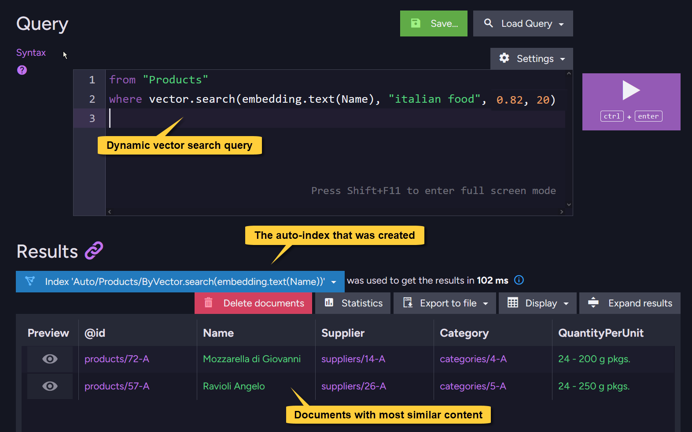
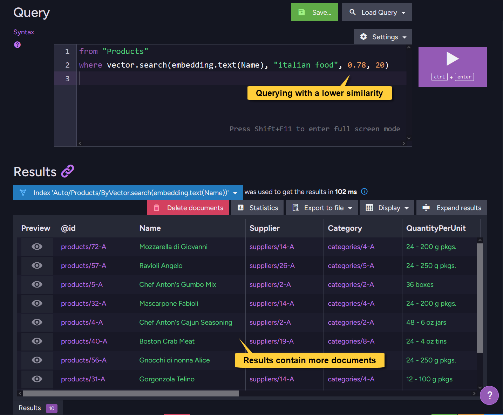
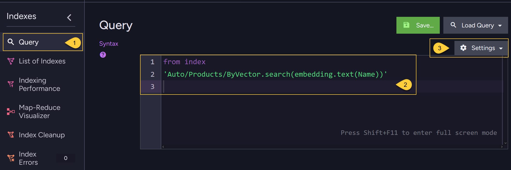
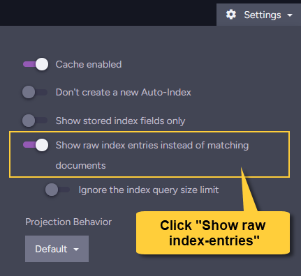
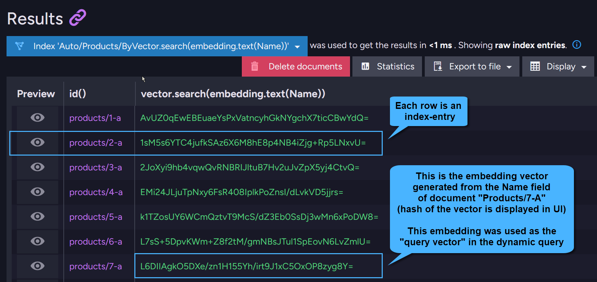

import Admonition from '@theme/Admonition';
import Tabs from '@theme/Tabs';
import TabItem from '@theme/TabItem';
import Panel from '@site/src/components/Panel';
import ContentFrame from "@site/src/components/ContentFrame";

<Admonition type="note" title="">

* This article explains how to run a vector search using a **dynamic query**.  
  To learn how to run a vector search using a **static-index**, see [vector search using a static-index](../../../ai-integration/vector-search/vector-search-using-static-index.mdx).

* The following articles cover options shared by dynamic queries and static-index queries:
  * For quantization configuration, see [Vector Search: Quantization](../../../ai-integration/vector-search/quantization.mdx).  
  * For exact search, regular filters, multiple vector searches, and retrieving matching chunk text,  
    see [Vector Search: More Querying Options](../../../ai-integration/vector-search/more-querying-options.mdx).

* In this article:
  * [What is a vector search](#what-is-a-vector-search)
  * [Dynamic vector search - query overview](#dynamic-vector-search-query-overview)
     * [Overview](#overview)
     * [Creating embeddings for the auto-index](#creating-embeddings-for-the-auto-index)
     * [Retrieving results](#retrieving-results)
     * [The dynamic query parameters](#the-dynamic-query-parameters)
     * [Corax auto-indexes](#corax-auto-indexes)
  * [Dynamic vector search - querying TEXT](#dynamic-vector-search-querying-text)
     * [Querying raw text](#querying-raw-text)
     * [Querying pre-made embeddings generated by tasks](#querying-pre-made-embeddings-generated-by-tasks)
  * [Dynamic vector search - querying NUMERICAL content](#dynamic-vector-search-querying-numerical-content)
  * [Dynamic vector search - querying for similar documents](#dynamic-vector-search-querying-for-similar-documents)
  * [Syntax](#syntax)
    
</Admonition>

<Panel heading="What is a vector search">

* Vector search is a method for finding documents based on their **contextual similarity** to the search item provided in a given query.
 
* Your data is converted into vectors, known as **embeddings**, and stored in a multidimensional space.  
  Unlike traditional keyword-based searches, which rely on exact matches,
  vector search identifies vectors closest to your query vector and retrieves the corresponding documents.

</Panel>

<Panel heading="Dynamic vector search - query overview">

<Admonition type="note" title="">

### Overview
    
---    

* A dynamic vector search query can be performed on:  
  * Raw text stored in your documents.
  * Pre-made embeddings that you created yourself and stored using these [Data types](../../../ai-integration/vector-search/data-types-for-vector-search.mdx).
  * Pre-made embeddings that are automatically generated from your document content  
    by RavenDB's [Embeddings generation tasks](../../../ai-integration/generating-embeddings/overview.mdx) using external service providers.

* Note: Vector search queries cannot be used with [Subscription queries](../../../data-subscriptions/creating-subscription/creating-subscription_api.mdx#subscription-query).

* When executing a dynamic vector search query, RavenDB creates or reuses a matching [Corax Auto-Index](#corax-auto-indexes) to process the query,
  and the results are retrieved from that index.    

* To make a **dynamic vector search query**:
    * From the Client API - use method `VectorSearch()`
    * In RQL - use method `vector.search()`
    * Examples are provided below

</Admonition>

<Admonition type="note" title="">

### Creating embeddings for the Auto-index
    
---    

* **Creating embeddings from TEXTUAL content**:  

    * **Pre-made embeddings via tasks**:  
      Embeddings can be created from textual content in your documents by defining [Tasks that generate embeddings](../../../ai-integration/generating-embeddings/overview.mdx).  

      When performing a dynamic vector search query over textual data and explicitly specifying the task,  
      results will be retrieved by comparing your search term against the embeddings previously generated by that task.
      A query example is available in: [Querying pre-made embeddings generated by tasks](#querying-pre-made-embeddings-generated-by-tasks).  
  
    * **Default embeddings generation**:  
      When querying textual data without specifying a task, RavenDB automatically generates embeddings for the specified document field as it builds or updates the auto-index,
      using the built-in [bge-micro-v2](https://huggingface.co/TaylorAI/bge-micro-v2) sentence-transformer model.  

      RavenDB also generates an embedding for the search term using the same model and compares it against the embeddings stored in the auto-index.
      A query example is available in: [Querying raw text](#querying-raw-text).

* **Creating embeddings from NUMERICAL arrays**:  
  When querying over pre-made numerical arrays that are already in vector format,  
  RavenDB will index them without transformation (unless further quantization is applied).  
  A query example is available in: [Vector search on numerical content](#dynamic-vector-search-querying-numerical-content).
    <Admonition type="warning" title="">
    To avoid index errors, ensure that the dimensionality of these numerical arrays (i.e., their length)  
    is consistent across all your source documents for the field you are querying.  
    If you wish to enforce such consistency -  
    perform a vector search using a [Static-index](../../../ai-integration/vector-search/vector-search-using-static-index.mdx) instead of a dynamic query.
    </Admonition> 

* **Quantizing the embeddings**:  
  The embeddings are quantized based on the parameters specified in the query.  
  Learn more about quantization in [Vector Search: Quantization](../../../ai-integration/vector-search/quantization.mdx).

* **Indexing the embeddings**:  
  RavenDB indexes the embeddings on the server using the [HNSW algorithm](https://en.wikipedia.org/wiki/Hierarchical_navigable_small_world).  
  This algorithm organizes embeddings into a high-dimensional graph structure,  
  enabling efficient retrieval of Approximate Nearest Neighbors (ANN) during queries.

* Learn how parallel HNSW graph construction can affect result repeatability in  
  [What affects vector search results](../../../ai-integration/vector-search/what-affects-vector-search-results.mdx#the-approximate-nature-of-hnsw).

</Admonition>

<Admonition type="note" title="">

### Retrieving results
    
---    

* **Processing the query**:  
  To ensure consistent comparisons, the **search term** is transformed into an embedding vector using the same method as the document fields.
  The server will search for the most similar vectors in the indexed vector space,
  taking into account all the [query parameters](#the-dynamic-query-parameters) described below.  
  The documents that correspond to the resulting vectors are then returned to the client. 

* **Search results**:  
  By default, the resulting documents will be ordered by their score, with the highest scores (best matches) first.  
  You can modify this behavior using the [Indexing.Corax.VectorSearch.OrderByScoreAutomatically](../../../ai-integration/vector-search/configuration.mdx#indexingcoraxvectorsearchorderbyscoreautomatically) configuration key.  

  In addition, you can apply any of the 'order by' methods to your query, as explained in [Sort query results](../../../querying/sorting-query-results/sort-query-results.mdx).  
  `OrderByScore()` (`order by score()` in RQL) lists the most similar results (highest scores) first.  
  `OrderByScoreDescending()` (`order by score() desc` in RQL) lists the least similar results (lowest scores) first.  

  Changing the sort direction only reorders the matches selected by vector search using its minimum similarity and number of candidates.
  Learn more in [Order by score](../../../querying/sorting-query-results/sort-query-results.mdx#order-by-score).

</Admonition>

<Admonition type="note" title="">

### The dynamic query parameters
    
---    

* **Source data format**  
  RavenDB supports performing vector search on TEXTUAL values or NUMERICAL arrays.  
  the source data can be formatted as `Text`, `Single`, `Int8`, or `Binary`.

* **Target quantization**  
  You can specify the quantization encoding for the embeddings that will be created from source data.  
  Learn more about quantization in [Vector Search: Quantization](../../../ai-integration/vector-search/quantization.mdx).  

* **Minimum similarity**  
  You can specify the minimum similarity to use when searching for related vectors.  
  The value can be between `0.0f` and `1.0f`.  
    * A value closer to `1.0f` requires higher similarity between vectors,  
      while a value closer to `0.0f` allows for less similarity.
    * **Important**: To filter out less relevant results when performing vector search queries,  
      it is recommended to explicitly specify the minimum similarity level at query time.

    If not specified, the default value is taken from the following configuration key:
    [Indexing.Corax.VectorSearch.DefaultMinimumSimilarity](../../../ai-integration/vector-search/configuration.mdx#indexingcoraxvectorsearchdefaultminimumsimilarity).

* **Number of candidates**  
  You can specify the maximum number of matching vectors that RavenDB returns for each embedding used as search input.  
  If you supply multiple search texts with `ByTexts`, or an embeddings task splits the search term into chunks,  
  RavenDB runs a separate search for each resulting embedding, and the maximum applies to each search.  
  In approximate search, increasing this value can improve accuracy but requires more computation.

  The number of documents returned may be:  
    * **lower** than the number of candidates - when several matching vectors belong to the same document.  
    * **higher** than the number of candidates - when the same vector is shared between multiple documents,  
      or when results from several searches are combined.

    If not specified, the default value is taken from the following configuration key:
    [Indexing.Corax.VectorSearch.DefaultNumberOfCandidatesForQuerying](../../../ai-integration/vector-search/configuration.mdx#indexingcoraxvectorsearchdefaultnumberofcandidatesforquerying).

* **Search method**
    * _Approximate Nearest-Neighbor search_ (Default):   
      Search for related vectors in an approximate manner, providing faster results.
    * _Exact search_:   
      Perform a thorough scan of the vectors to find the actual closest vectors,  
      offering better accuracy but at a higher computational cost.  
      Learn more in [Exact search](../../../ai-integration/vector-search/more-querying-options.mdx#exact-search).

</Admonition>

<Admonition type="note" title="">

### Corax auto-indexes
    
---    

* Only [Corax indexes](../../../indexes/search-engine/corax.mdx) support vector search.

* Even if your **default auto-index engine** is set to Lucene (via [Indexing.Auto.SearchEngineType](../../../server/configuration/indexing-configuration.mdx#indexingautosearchenginetype)),  
  performing a vector search using a dynamic query will create a new auto-index based on Corax.

* Normally, new dynamic queries extend existing [auto-indexes](../../../querying/overview.mdx#queries-always-provide-results-using-an-index) if they require additional fields.  
  However, a dynamic query with a vector search will not extend an existing Lucene-based auto-index.

* **For example**, suppose you have an existing **Lucene**-based auto-index on the Employees collection: e.g.:  
  `Auto/Employees/ByFirstName`.  

  Now, you run a query that:  
    * searches for Employees by _LastName_ (a regular text search)
    * and performs a vector search over the _Notes_ field.

  The following new **Corax**-based auto-index will be created:  
  `Auto/Employees/ByLastNameAndVector.search(embedding.text(Notes))`,  
  and the existing **Lucene** index on Employees will not be deleted or extended.    
  
</Admonition>

</Panel>

<Panel heading="Dynamic vector search - querying TEXT">

### Querying raw text

* The following example searches for Product documents where the _'Name'_ field is similar to the search term `"italian food"`.

* Since the query does not specify an [Embeddings generation task](../../../ai-integration/generating-embeddings/overview.mdx),
  RavenDB automatically generates embedding vectors for the **Name** field of each document as it builds or updates the auto-index, using the built-in
  [bge-micro-v2](https://huggingface.co/TaylorAI/bge-micro-v2) text-embedding model.  

  RavenDB also generates an embedding for the search term **"italian food"** using the same model and compares it against the embeddings stored in the auto-index.  
  Unlike embeddings pre-made by tasks, this process does not create dedicated collections for storing embeddings.  

* Since this query does not specify a target quantization format,
  the generated embedding vectors will be encoded in the default _Single_ format (single-precision floating-point).  
  Refer to [Configuring quantization in dynamic queries](../../../ai-integration/vector-search/quantization.mdx#configuring-quantization-in-dynamic-queries) for examples that specify the destination quantization.

<Tabs groupId='languageSyntax'>
<TabItem value="Query" label="Query">
```csharp
var similarProducts = session.Query<Product>()
     // Perform a vector search
     // Call the 'VectorSearch' method
    .VectorSearch(
        // Call 'WithText'
        // Specify the document field in which to search for similar values
        field => field.WithText(x => x.Name),
        // Call 'ByText' 
        // Provide the term for the similarity comparison
        searchTerm => searchTerm.ByText("italian food"),
        // It is recommended to specify the minimum similarity level
        0.82f,
        // Optionally, specify the number of candidates for the search
        20)
     // Waiting for not-stale results is not mandatory
     // but will assure results are not stale
    .Customize(x => x.WaitForNonStaleResults())
    .ToList();
```
</TabItem>
<TabItem value="Query_async" label="Query_async">
```csharp
var similarProducts = await asyncSession.Query<Product>()
    .VectorSearch(
        field => field.WithText(x => x.Name), 
        searchTerm => searchTerm.ByText("italian food"),
        0.82f,
        20)
    .Customize(x => x.WaitForNonStaleResults())
    .ToListAsync();
```
</TabItem>
<TabItem value="DocumentQuery" label="DocumentQuery">
```csharp
var similarProducts = session.Advanced
    .DocumentQuery<Product>()
    .VectorSearch(
        field => field.WithText(x => x.Name),
        searchTerm => searchTerm.ByText("italian food"),
        0.82f,
        20)
    .WaitForNonStaleResults()
    .ToList();
```
</TabItem>
<TabItem value="DocumentQuery_async" label="DocumentQuery_async">
```csharp
var similarProducts = await asyncSession.Advanced
    .AsyncDocumentQuery<Product>()
    .VectorSearch(
        field => field.WithText(x => x.Name),
        searchTerm => searchTerm.ByText("italian food"),
        0.82f,
        20)
    .WaitForNonStaleResults()
    .ToListAsync();
```
</TabItem>
<TabItem value="RawQuery" label="RawQuery">
```csharp
var similarProducts = session.Advanced
    .RawQuery<Product>(@"
        from 'Products'
        // Wrap the document field 'Name' with 'embedding.text' to indicate the source data type
        where vector.search(embedding.text(Name), $searchTerm, 0.82, 20)")
    .AddParameter("searchTerm", "italian food")
    .WaitForNonStaleResults()
    .ToList();
```
</TabItem>
<TabItem value="RawQuery_async" label="RawQuery_async">
```csharp
var similarProducts = await asyncSession.Advanced
    .AsyncRawQuery<Product>(@"
        from 'Products'
        // Wrap the document field 'Name' with 'embedding.text' to indicate the source data type
        where vector.search(embedding.text(Name), $searchTerm, 0.82, 20)")
    .AddParameter("searchTerm", "italian food")
    .WaitForNonStaleResults()
    .ToListAsync();
```
</TabItem>
<TabItem value="RQL" label="RQL">
```sql
// Query the Products collection
from "Products"
// Call 'vector.search'
// Wrap the document field 'Name' with 'embedding.text' to indicate the source data type
where vector.search(embedding.text(Name), "italian food", 0.82, 20)
```
</TabItem>
</Tabs>

* Executing the above query on the RavenDB sample data will create the following **auto-index**:  
  `Auto/Products/ByVector.search(embedding.text(Name))`

    
  
* Running the same query at a lower similarity level will return more results related to _"Italian food"_ but they may be less similar:

    

---

### Querying pre-made embeddings generated by tasks

* The following example searches for Category documents where the _'Name'_ field is similar to the search term `"candy"`.

* The query explicitly specifies the **identifier** of the embeddings generation task that was defined in
  [this example](../../../ai-integration/generating-embeddings/embeddings-generation-task.mdx#configuring-an-embeddings-generation-task-from-studio).  
  An `InvalidQueryException` will be thrown if the task does not exist or is disabled.  
  
  To avoid this error, you can verify that the specified embeddings generation task exists and is enabled before issuing the query.  
  Refer to [Get embeddings generation task details](../../../ai-integration/generating-embeddings/overview.mdx#get-embeddings-generation-task-details)
  to learn how to programmatically check which tasks are defined  
  and what their identifiers are.

* Results are retrieved by comparing the search term against the pre-made embeddings generated by the specified task,
  which are stored in the [Embedding collections](../../../ai-integration/generating-embeddings/embedding-collections.mdx).  
  To ensure consistent comparisons, the search term is transformed into an embedding using the same embeddings generation task.

<Tabs groupId='languageSyntax'>
<TabItem value="Query" label="Query">
```csharp
var similarCategories = session.Query<Category>()
    .VectorSearch(
        field => field
             // Call 'WithText'
             // Specify the document field in which to search for similar values
            .WithText(x => x.Name)
             // Call 'UsingTask'
             // Specify the identifier of the task that generated
             // the embeddings for the Name field
            .UsingTask("id-for-task-open-ai"),
        // Call 'ByText' 
        // Provide the search term for the similarity comparison
        searchTerm => searchTerm.ByText("candy"),
        // It is recommended to specify the minimum similarity level
        0.75f)
    .Customize(x => x.WaitForNonStaleResults())
    .ToList();
```
</TabItem>
<TabItem value="Query_async" label="Query_async">
```csharp
var similarCategories = await asyncSession.Query<Category>()
    .VectorSearch(
        field => field
            .WithText(x => x.Name)
            .UsingTask("id-for-task-open-ai"),
        searchTerm => searchTerm.ByText("candy"),
        0.75f)
    .Customize(x => x.WaitForNonStaleResults())
    .ToListAsync();
```
</TabItem>
<TabItem value="DocumentQuery" label="DocumentQuery">
```csharp
var similarCategories = session.Advanced
    .DocumentQuery<Category>()
    .VectorSearch(
        field => field
            .WithText(x => x.Name)
            .UsingTask("id-for-task-open-ai"),
        searchTerm => searchTerm.ByText("candy"),
        0.75f)
    .WaitForNonStaleResults()
    .ToList();
```
</TabItem>
<TabItem value="DocumentQuery_async" label="DocumentQuery_async">
```csharp
var similarCategories = await asyncSession.Advanced
    .AsyncDocumentQuery<Category>()
    .VectorSearch(
        field => field
            .WithText(x => x.Name)
            .UsingTask("id-for-task-open-ai"),
        searchTerm => searchTerm.ByText("candy"),
        0.75f)
    .WaitForNonStaleResults()
    .ToListAsync();
```
</TabItem>
<TabItem value="RawQuery" label="RawQuery">
```csharp
var similarCategories = session.Advanced
    .RawQuery<Category>(@"
        from 'Categories'
        // Specify the identifier of the task that generated the embeddings inside 'ai.task'
        where vector.search(
            embedding.text(Name, ai.task('id-for-task-open-ai')),
            $searchTerm,
            0.75)")
    .AddParameter("searchTerm", "candy")
    .WaitForNonStaleResults()
    .ToList();
```
</TabItem>
<TabItem value="RawQuery_async" label="RawQuery_async">
```csharp
var similarCategories = await asyncSession.Advanced
    .AsyncRawQuery<Category>(@"
        from 'Categories'
        // Specify the identifier of the task that generated the embeddings inside 'ai.task'
        where vector.search(
            embedding.text(Name, ai.task('id-for-task-open-ai')),
            $searchTerm,
            0.75)")
    .AddParameter("searchTerm", "candy")
    .WaitForNonStaleResults()
    .ToListAsync();
```
</TabItem>
<TabItem value="RQL" label="RQL">
```sql
// Query the Categories collection
from "Categories"
// Call 'vector.search'
// Specify the identifier of the task that generated the embeddings inside the 'ai.task' method
where vector.search(embedding.text(Name, ai.task('id-for-task-open-ai')), $searchTerm, 0.75)
{"searchTerm": "candy"}
```
</TabItem>
</Tabs>

* Executing the above query on the RavenDB sample data will create the following **auto-index**:  
  `Auto/Categories/ByVector.search(embedding.text(Name|ai.task('id-for-task-open-ai')))`

* To also retrieve the text of the chunks that matched the search term,  
  see [Retrieving matching chunk text](../../../ai-integration/vector-search/more-querying-options.mdx#chunk-text-dynamic-query).

</Panel>

<Panel heading="Dynamic vector search - querying NUMERICAL content">

* The following examples will use the sample data shown below.  
  The _Movie_ class includes various formats of numerical vector data.  
  Note: This sample data is minimal to keep the examples simple.

* Note the usage of RavenDB's dedicated data type, [RavenVector](../../../ai-integration/vector-search/data-types-for-vector-search.mdx#ravenvector), which is highly optimized for reading and writing arrays to disk.
  Learn more about the source data types suitable for vector search in [Data types for vector search](../../../ai-integration/vector-search/data-types-for-vector-search.mdx).

* Unlike vector searches on text, where RavenDB transforms the raw text into an embedding vector,  
  numerical vector searches require your source data to already be in an embedding vector format.  

* If your raw data is in a _float_ format, you can request further quantization of the embeddings that will be indexed in the auto-index.
  See an example of this in: [Configuring quantization in dynamic queries](../../../ai-integration/vector-search/quantization.mdx#configuring-quantization-in-dynamic-queries).  

* Raw data that is already formatted as _Int8_ or _Binary_ **cannot** be quantized to lower-form (e.g. Int8 -&gt; Int1).  
  When storing data in these formats in your documents, you should use [RavenDB’s `vectorQuantizer` methods](../../../ai-integration/vector-search/quantization.mdx#vectorquantizer-reference).

#### Sample data:

<Tabs groupId='languageSyntax'>
<TabItem value="Class" label="Class">
```csharp
// Sample class representing a document with various formats of numerical vectors
// The embedding vectors for these fields here are generated externally by you (not by RavenDB).
public class Movie
{
    public string Id { get; set; }
    public string Title { get; set; }
    
    // This field will hold numerical vector data - Not quantized
    public RavenVector<float> TagsEmbeddedAsSingle { get; set; }
    
    // This field will hold numerical vector data - Quantized to Int8
    public sbyte[][] TagsEmbeddedAsInt8 { get; set; }
    
    // This field will hold numerical vector data - Encoded in Base64 format
    public List<string> TagsEmbeddedAsBase64 { get; set; }
    
    // A field for holding a numerical vector data produced by a multimodal model 
    // that converts an image into an embedding
    public RavenVector<float> MoviePhotoEmbedding { get; set; }
}
```
</TabItem>
<TabItem value="Sample_data" label="Sample_data">
```csharp
using (var session = store.OpenSession())
{    
    var movie1 = new Movie()
    {
        Title = "Hidden Figures",
        Id = "movies/1",
    
        // Embedded vector represented as float values
        TagsEmbeddedAsSingle = new RavenVector<float>(new float[]
        {
            6.599999904632568f, 7.699999809265137f
        }),
        
        // Embedded vectors encoded in Base64 format
        TagsEmbeddedAsBase64 = new List<string>()
        {
            "zczMPc3MTD6amZk+", "mpmZPs3MzD4AAAA/"
        },
        
        // Array of embedded vectors quantized to Int8
        TagsEmbeddedAsInt8 = new sbyte[][]
        {
            // Use RavenDB's quantization methods to convert float vectors to Int8
            VectorQuantizer.ToInt8(new float[] { 0.1f, 0.2f }),
            VectorQuantizer.ToInt8(new float[] { 0.3f, 0.4f })
        },
        
        // Example of an image embedding
        // In a real scenario, this vector would come from a multimodal model
        // such as CLIP, OpenCLIP, or similar
        MoviePhotoEmbedding = new RavenVector<float>(new float[]
        {
            0.123f, -0.045f, 0.987f, 0.564f, -0.321f, 0.220f
        })
    };

    var movie2 = new Movie()
    {
        Title = "The Shawshank Redemption",
        Id = "movies/2",
    
        TagsEmbeddedAsSingle =new RavenVector<float>(new float[]
        {
            8.800000190734863f, 9.899999618530273f
        }),
        TagsEmbeddedAsBase64 = new List<string>() {"zcxMPs3MTD9mZmY/", "zcxMPpqZmT4zMzM/"},
        TagsEmbeddedAsInt8 = new sbyte[][]
        {
            VectorQuantizer.ToInt8(new float[] { 0.5f, 0.6f }),
            VectorQuantizer.ToInt8(new float[] { 0.7f, 0.8f })
        },

        MoviePhotoEmbedding = new RavenVector<float>(new float[]
        {
            0.456f, -0.056f, 0.123f, 0.899f, -0.765f, 0.881f
        })
    };

    session.Store(movie1);
    session.Store(movie2);
    session.SaveChanges();
}
```
</TabItem>
<TabItem value="Sample_document" label="Sample_document">
```json
{
    "Title": "Hidden Figures",
    
    "TagsEmbeddedAsSingle": {
        "@vector": [
            6.599999904632568,
            7.699999809265137
        ]
    },
    
    "TagsEmbeddedAsInt8": [
        [
            64,
            127,
            -51,
            -52,
            76,
            62
        ],
        [
            95,
            127,
            -51,
            -52,
            -52,
            62
        ]
    ],
    
    "TagsEmbeddedAsBase64": [
        "zczMPc3MTD6amZk+",
        "mpmZPs3MzD4AAAA/"
    ],
    
    "MoviePhotoEmbedding": {
        "@vector": [0.123, -0.045, 0.987, 0.564, -0.321, 0.220]
    },
    
    "@metadata": {
        "@collection": "Movies"
    }
}
```
</TabItem>
</Tabs>

#### Examples:

These examples search for Movie documents with vectors similar to the one provided in the query.

<ContentFrame>

* Search on the `TagsEmbeddedAsSingle` field.  
  This field contains numerical data in **floating-point format**. 

<Tabs groupId='languageSyntax'>
<TabItem value="Query" label="Query">
```csharp
var similarMovies = session.Query<Movie>()
     // Perform a vector search
     // Call the 'VectorSearch' method
    .VectorSearch(
        // Call 'WithEmbedding', specify:
        // * The source field that contains the embedding in the document
        // * The source embedding type
        field => field.WithEmbedding(
            x => x.TagsEmbeddedAsSingle, VectorEmbeddingType.Single),
        // Call 'ByEmbedding'
        // Provide the vector for the similarity comparison
        queryVector => queryVector.ByEmbedding(
            new RavenVector<float>(new float[] { 6.599999904632568f, 7.699999809265137f })),
        // It is recommended to specify the minimum similarity level
        0.85f,
        // Optionally, specify the number of candidates for the search
        10)
    .Customize(x => x.WaitForNonStaleResults())
    .ToList();
```
</TabItem>
<TabItem value="Query_async" label="Query_async">
```csharp
var similarMovies = await asyncSession.Query<Movie>()
    .VectorSearch(
        field => field.WithEmbedding(
            x => x.TagsEmbeddedAsSingle, VectorEmbeddingType.Single),
        queryVector => queryVector.ByEmbedding(
            new RavenVector<float>(new float[] { 6.599999904632568f, 7.699999809265137f })),
        0.85f,
        10)
    .Customize(x => x.WaitForNonStaleResults())
    .ToListAsync();
```
</TabItem>
<TabItem value="DocumentQuery" label="DocumentQuery">
```csharp
var similarMovies = session.Advanced
    .DocumentQuery<Movie>()
    .VectorSearch(
        field => field.WithEmbedding(
            x => x.TagsEmbeddedAsSingle, VectorEmbeddingType.Single),
        queryVector => queryVector.ByEmbedding(
            new RavenVector<float>(new float[] { 6.599999904632568f, 7.699999809265137f })),
        0.85f,
        10)
    .WaitForNonStaleResults()
    .ToList();
```
</TabItem>
<TabItem value="DocumentQuery_async" label="DocumentQuery_async">
```csharp
var similarMovies = await asyncSession.Advanced
    .AsyncDocumentQuery<Movie>()
    .VectorSearch(
        field => field.WithEmbedding(
            x => x.TagsEmbeddedAsSingle, VectorEmbeddingType.Single),
        queryVector => queryVector.ByEmbedding(
            new RavenVector<float>(new float[] { 6.599999904632568f, 7.699999809265137f })),
        0.85f,
        10)
    .WaitForNonStaleResults()
    .ToListAsync();
```
</TabItem>
<TabItem value="RawQuery" label="RawQuery">
```csharp
var similarProducts = session.Advanced
    .RawQuery<Movie>(@"
        from 'Movies' 
        where vector.search(TagsEmbeddedAsSingle, $queryVector, 0.85, 10)")
    .AddParameter("queryVector", new RavenVector<float>(new float[]
        {
            6.599999904632568f, 7.699999809265137f
        }))
    .WaitForNonStaleResults()
    .ToList();
```
</TabItem>
<TabItem value="RawQuery_async" label="RawQuery_async">
```csharp
var similarProducts = await asyncSession.Advanced
    .AsyncRawQuery<Movie>(@"
        from 'Movies' 
        where vector.search(TagsEmbeddedAsSingle, $queryVector, 0.85, 10)")
    .AddParameter("queryVector", new RavenVector<float>(new float[]
        {
            6.599999904632568f, 7.699999809265137f
        }))
    .WaitForNonStaleResults()
    .ToListAsync();
```
</TabItem>
<TabItem value="RQL" label="RQL">
```sql
from "Movies"
// The source document field type is interpreted as 'Single' by default
where vector.search(TagsEmbeddedAsSingle, $queryVector, 0.85, 10)
{ "queryVector" : { "@vector" : [6.599999904632568, 7.699999809265137] }}
```
</TabItem>
</Tabs>

</ContentFrame>
<ContentFrame>

* Search on the `TagsEmbeddedAsInt8` field.  
  This field contains numerical data that is already quantized in **_Int8_ format**.

<Tabs groupId='languageSyntax'>
<TabItem value="Query" label="Query">
```csharp
var similarMovies = session.Query<Movie>()
    .VectorSearch(
        // Call 'WithEmbedding', specify:
        // * The source field that contains the embeddings in the document
        // * The source embedding type
        field => field.WithEmbedding(
            x => x.TagsEmbeddedAsInt8, VectorEmbeddingType.Int8),
        // Call 'ByEmbedding'
        // Provide the vector for the similarity comparison
        // (provide a single vector from the vector list in the TagsEmbeddedAsInt8 field)
        queryVector => queryVector.ByEmbedding(
            // The provided vector MUST be in the same format as was stored in your document
            // Call 'VectorQuantizer.ToInt8' to transform the raw data to the Int8 format  
            VectorQuantizer.ToInt8(new float[] { 0.1f, 0.2f })))
    .Customize(x => x.WaitForNonStaleResults())
    .ToList();
```
</TabItem>
<TabItem value="RQL" label="RQL">
```sql
from "Movies"
// Wrap the source document field name with 'embedding.i8' to indicate the source data type
where vector.search(embedding.i8(TagsEmbeddedAsInt8), $queryVector)
{ "queryVector" : [64, 127, -51, -52, 76, 62] }
```
</TabItem>
</Tabs>

</ContentFrame>
<ContentFrame>

* Search on the `TagsEmbeddedAsBase64` field.  
  This field contains numerical data represented in **_Base64_ format**.

<Tabs groupId='languageSyntax'>
<TabItem value="Query" label="Query">
```csharp
var similarMovies = session.Query<Movie>()
    .VectorSearch(
        // Call 'WithBase64', specify:
        // * The source field that contains the embeddings in the document
        // * The source embedding type
        //   (the type from which the Base64 string was constructed)
        field => field.WithBase64(x => x.TagsEmbeddedAsBase64, VectorEmbeddingType.Single),
        // Call 'ByBase64'
        // Provide the Base64 string that represents the vector to query against
        queryVector => queryVector.ByBase64("zczMPc3MTD6amZk+"))
    .Customize(x => x.WaitForNonStaleResults())
    .ToList();
```
</TabItem>
<TabItem value="RQL" label="RQL">
```sql
from "Movies"
// * Wrap the source document field name using 'embedding.<format>' to specify
//   the source data type from which the Base64 string was generated.
// * If the document field is Not wrapped, 'single' is assumed as the default source type. 
where vector.search(TagsEmbeddedAsBase64, $queryVectorBase64)
{ "queryVectorBase64" : "zczMPc3MTD6amZk+" }
```
</TabItem>
</Tabs>

</ContentFrame>

</Panel>

<Panel heading="Dynamic vector search - querying for similar documents">

* In the above examples, to find documents with similar content, the query was given an arbitrary input -  
  either a [raw textual search term](#dynamic-vector-search-querying-text) 
  or a [numerical query vector](#dynamic-vector-search-querying-numerical-content).

* RavenDB also allows you to search for documents whose content is similar to an **existing document**:  

   * To do so, use the `ForDocument` method and specify the existing document ID. See the example below.

   * When performing a dynamic vector query over a field, index-entries are generated in the auto-index, 
     one per document in the collection. Each index-entry contains the document ID and the embedding vector for the queried field.  

   * RavenDB retrieves the embedding that was indexed for the queried field in the specified document and uses it as the query vector for the similarity comparison.

   * The results will include documents whose indexed embeddings are most similar to the one stored in the referenced document’s index-entry.

<Tabs groupId='languageSyntax'>
<TabItem value="Query" label="Query">
```csharp
var similarProducts = session.Query<Product>()
    // Perform a vector search
    // Call the 'VectorSearch' method
    .VectorSearch(
         // Call 'WithText'
         // Specify the document field in which to search for similar values
        field => field.WithText(x => x.Name),
         // Call 'ForDocument' 
         // Provide the document ID for which you want to find similar documents.
         // The embedding stored in the auto-index for the specified document
         // will be used as the "query vector".
        embedding => embedding.ForDocument("Products/7-A"),
        0.82f)
    .Customize(x => x.WaitForNonStaleResults())
    .ToList();
```
</TabItem>
<TabItem value="Query_async" label="Query_async">
```csharp
var similarProducts = await asyncSession.Query<Product>()
    .VectorSearch(
        field => field.WithText(x => x.Name), 
        embedding => embedding.ForDocument("Products/7-A"),
        0.82f)
    .Customize(x => x.WaitForNonStaleResults())
    .ToListAsync();
```
</TabItem>
<TabItem value="DocumentQuery" label="DocumentQuery">
```csharp
var similarProducts = session.Advanced
    .DocumentQuery<Product>()
    .VectorSearch(
        field => field.WithText(x => x.Name),
        embedding => embedding.ForDocument("Products/7-A"),
        0.82f)
    .WaitForNonStaleResults()
    .ToList();
```
</TabItem>
<TabItem value="DocumentQuery_async" label="DocumentQuery_async">
```csharp
var similarProducts = await asyncSession.Advanced
    .AsyncDocumentQuery<Product>()
    .VectorSearch(
        field => field.WithText(x => x.Name),
        embedding => embedding.ForDocument("Products/7-A"),
        0.82f)
    .WaitForNonStaleResults()
    .ToListAsync();
```
</TabItem>
<TabItem value="RawQuery" label="RawQuery">
```csharp
var similarProducts = session.Advanced
    .RawQuery<Product>(@"
        from 'Products'
        // Pass a document ID to the 'forDoc' method to find similar documents
        where vector.search(embedding.text(Name), embedding.forDoc($documentID), 0.82)")
    .AddParameter("$documentID", "Products/7-A")
    .WaitForNonStaleResults()
    .ToList();
```
</TabItem>
<TabItem value="RawQuery_async" label="RawQuery_async">
```csharp
var similarProducts = await asyncSession.Advanced
    .AsyncRawQuery<Product>(@"
        from 'Products'
        // Pass a document ID to the 'forDoc' method to find similar documents
        where vector.search(embedding.text(Name), embedding.forDoc($documentID), 0.82)")
    .AddParameter("$documentID", "Products/7-A")
    .WaitForNonStaleResults()
    .ToListAsync();
```
</TabItem>
<TabItem value="RQL" label="RQL">
```sql
from "Products"
// Pass a document ID to the 'forDoc' method to find similar documents
where vector.search(embedding.text(Name), embedding.forDoc($documentID), 0.82)
{"documentID" : "Products/7-A"}
```
</TabItem>
</Tabs>

Running the above example on RavenDB’s sample data returns the following documents that have similar content in their _Name_ field:
(Note: the results include the referenced document itself, _Products/7-A_)


```csharp
// ID: products/7-A  ... Name: "Uncle Bob's Organic Dried Pears"
// ID: products/51-A ... Name: "Manjimup Dried Apples"
// ID: products/6-A  ... Name: "Grandma's Boysenberry Spread"
```
<br/>
    
The auto-index generated by running the above dynamic query is:  
`Auto/Products/ByVector.search(embedding.text(Name))`

You can **view the index-entries** of this auto-index in the Studio's query view:



1. Go to the Query view in the Studio
2. Query the index
3. Open the settings dialog:





</Panel>

<Panel heading="Syntax">

`VectorSearch`:  

```csharp
public IRavenQueryable<T> VectorSearch<T>(
    Func<IVectorFieldFactory<T>, IVectorEmbeddingTextField> textFieldFactory,
    Action<IVectorEmbeddingTextFieldValueFactory> textValueFactory,
    float? minimumSimilarity = null,
    int? numberOfCandidates = null,
    bool isExact = false);

public IRavenQueryable<T> VectorSearch<T>(
    Func<IVectorFieldFactory<T>, IVectorEmbeddingField> embeddingFieldFactory,
    Action<IVectorEmbeddingFieldValueFactory> embeddingValueFactory,
    float? minimumSimilarity = null,
    int? numberOfCandidates = null,
    bool isExact = false);

public IRavenQueryable<T> VectorSearch<T>(
    Func<IVectorFieldFactory<T>, IVectorField> embeddingFieldFactory,
    Action<IVectorFieldValueFactory> embeddingValueFactory,
    float? minimumSimilarity = null,
    int? numberOfCandidates = null,
    bool isExact = false);
```

| Parameter                 | Type                                                      | Description                                                                                                                         |
|---------------------------|-----------------------------------------------------------|-------------------------------------------------------------------------------------------------------------------------------------|
| **textFieldFactory**      | `Func<IVectorFieldFactory<T>, IVectorEmbeddingTextField>` | Factory creating textual vector field for indexing purposes.                                                                        |
| **textValueFactory**      | `Action<IVectorEmbeddingTextFieldValueFactory>`           | Factory preparing queried data to be used in vector search.                                                                         |
| **embeddingFieldFactory** | `Func<IVectorFieldFactory<T>, IVectorEmbeddingField>`     | Factory creating embedding vector field for indexing purposes.                                                                      |
| **embeddingValueFactory** | `Action<IVectorEmbeddingFieldValueFactory>`               | Factory preparing queried data to be used in vector search.                                                                         |
| **embeddingFieldFactory** | `Func<IVectorFieldFactory<T>, IVectorField>`              | Factory using existing, already indexed vector field.                                                                               |
| **embeddingValueFactory** | `Action<IVectorFieldValueFactory>`                        | Factory preparing queried data to be used in vector search.                                                                         |
| **minimumSimilarity**     | `float?`                                                  | Minimum similarity between the queried value and the indexed value for the vector search to match.                                  |
| **numberOfCandidates**    | `int?`                                                    | Maximum number of matching vectors returned for each embedding used as search input.<br/>In approximate search, increasing this value can improve accuracy but requires more computation. |
| **isExact**               | `bool`                                                    | `false` - vector search will be performed in an approximate manner.<br/>`true` - vector search will be performed in an exact manner. |

The default value for `minimumSimilarity` is defined by this configuration key:  
[Indexing.Corax.VectorSearch.DefaultMinimumSimilarity ](../../../ai-integration/vector-search/configuration.mdx#indexingcoraxvectorsearchdefaultminimumsimilarity).

The default value for `numberOfCandidates` is defined by this configuration key:  
[Indexing.Corax.VectorSearch.DefaultNumberOfCandidatesForQuerying](../../../ai-integration/vector-search/configuration.mdx#indexingcoraxvectorsearchdefaultnumberofcandidatesforquerying).

`IVectorFieldFactory`:

```csharp
public interface IVectorFieldFactory<T>
{
    // Methods for the dynamic query:
    // ==============================
    
    public IVectorEmbeddingTextField WithText(string documentFieldName);
    public IVectorEmbeddingTextField WithText(Expression<Func<T, object>> propertySelector);
    
    public IVectorEmbeddingField WithEmbedding(string documentFieldName, 
        VectorEmbeddingType storedEmbeddingQuantization = VectorEmbeddingType.Single);
    public IVectorEmbeddingField WithEmbedding(Expression<Func<T, object>> propertySelector,
        VectorEmbeddingType storedEmbeddingQuantization = VectorEmbeddingType.Single);
    
    public IVectorEmbeddingField WithBase64(string documentFieldName,
        VectorEmbeddingType storedEmbeddingQuantization = VectorEmbeddingType.Single);
    public IVectorEmbeddingField WithBase64(Expression<Func<T, object>> propertySelector,
        VectorEmbeddingType storedEmbeddingQuantization = VectorEmbeddingType.Single);
    
    // Methods for querying a static index:
    // ====================================
    
    public IVectorField WithField(string indexFieldName);
    public IVectorField WithField(Expression<Func<T, object>> indexPropertySelector);
}
```

| Parameter                       | Type                          | Description                                                                            |
|---------------------------------|-------------------------------|----------------------------------------------------------------------------------------|
| **documentFieldName**           | `string`                      | The name of the document field containing<br/>text / embedding / base64 encoded data.   |
| **indexFieldName**              | `string`                      | The name of the index-field that vector search will be performed on.                   |
| **propertySelector**            | `Expression<Func<T, object>>` | Path to the document field containing<br/>text / embedding /base64 encoded data.        |
| **indexPropertySelector**       | `Expression<Func<T, object>>` | Path to the index-field containing indexed data.                                       |
| **storedEmbeddingQuantization** | `VectorEmbeddingType`         | Quantization format of the stored embeddings.<br/>Default: `VectorEmbeddingType.Single` |

`IVectorEmbeddingTextField` & `IVectorEmbeddingField`:

```csharp
public interface IVectorEmbeddingTextField
{
    public IVectorEmbeddingTextField TargetQuantization(
        VectorEmbeddingType targetEmbeddingQuantization);
    
    public IVectorEmbeddingTextField UsingTask(
        string embeddingsGenerationTaskIdentifier);
}

public interface IVectorEmbeddingField
{
    public IVectorEmbeddingField TargetQuantization(
        VectorEmbeddingType targetEmbeddingQuantization);
}
```

| Parameter                              | Type                  | Description                                                                                                                                                                                               |
|----------------------------------------|-----------------------|-----------------------------------------------------------------------------------------------------------------------------------------------------------------------------------------------------------|
| **targetEmbeddingQuantization**        | `VectorEmbeddingType` | The desired target quantization format.                                                                                                                                                                   |
| **embeddingsGenerationTaskIdentifier** | `string `             | The identifier of an embeddings generation task.<br/>Used to locate the embeddings generated by the task in the [Embedding collections](../../../ai-integration/generating-embeddings/embedding-collections.mdx). |

```csharp
public enum VectorEmbeddingType
{
    Single,
    Int8,
    Binary,
    Text
}
```
<br/>
                                                                
`IVectorEmbeddingTextFieldValueFactory` & `IVectorEmbeddingFieldValueFactory`:

```csharp
public interface IVectorEmbeddingTextFieldValueFactory
{
    // Defines the queried text(s)
    public void ByText(string text);
    public void ByTexts(IEnumerable<string> texts);

    // Defines the queried text(s) and the embedding generation task to use.
    // These overloads should be used only when querying a static-index where vector fields contain 
    // numerical embeddings that were not generated by RavenDB's built-in embedding tasks.
    // The text is embedded at query time using the specified task identifier and compared to the indexed vectors.
    public void ByText(string text, string embeddingsGenerationTaskIdentifier);
    public void ByTexts(IEnumerable<string> texts, string embeddingsGenerationTaskIdentifier);
    
    // Query by the embedding(s) indexed from the specified document for the queried field 
    public void ForDocument(string documentId);
}

public interface IVectorEmbeddingFieldValueFactory
{
    // Define the queried embedding:
    // =============================
    
    // 'embeddings' is an enumerable containing embedding values
    public void ByEmbedding<T>(IEnumerable<T> embedding) where T : unmanaged, INumber<T>;
    public void ByEmbedding<T>(IEnumerable<IEnumerable<T>> embeddings) where T : unmanaged, INumber<T>;
    
    
    // 'embeddings' is an array containing embedding values
    public void ByEmbedding<T>(T[] embedding) where T : unmanaged, INumber<T>;
    public void ByEmbeddings<T>(T[][] embeddings) where T : unmanaged, INumber<T>;
    
    // 'embedding` is a `RavenVector` containing embedding values
    public void ByEmbedding<T>(RavenVector<T> embedding) where T : unmanaged, INumber<T>;
    
    // 'base64Embedding' is encoded as base64 string(s).
    public void ByBase64(string base64Embedding);
    public void ByBase64(IEnumerable<string> base64Embeddings);
}
```
<br/>

#### `RavenVector`:  

RavenVector is RavenDB's dedicated data type for storing and querying numerical embeddings.  
Learn more in [RavenVector](../../../ai-integration/vector-search/data-types-for-vector-search.mdx#ravenvector).

Constructors:

```csharp
public RavenVector(T[] embedding);
public RavenVector(IEnumerable<T> embedding);
```

</Panel>
