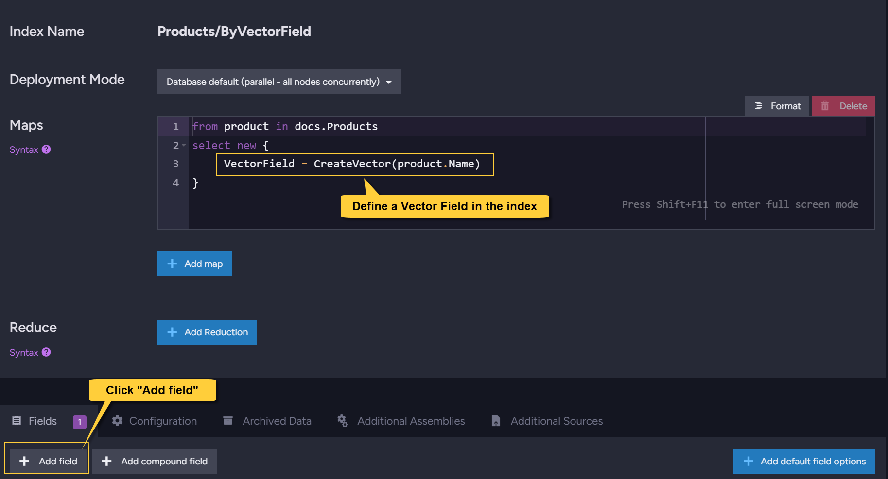
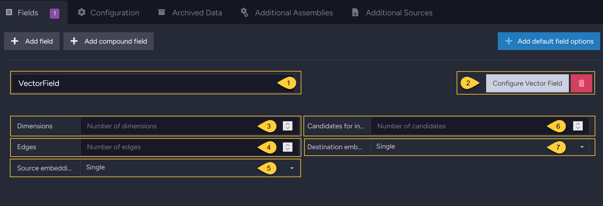

import Admonition from '@theme/Admonition';
import Tabs from '@theme/Tabs';
import TabItem from '@theme/TabItem';
import Panel from "@site/src/components/Panel";
import ContentFrame from "@site/src/components/ContentFrame";

<Admonition type="note" title="">

* This article explains how to perform a **vector search** using a **static Map index**.  
  **Prior to this article**, it is recommended to get familiar with the [Vector search using a dynamic query](../../../ai-integration/vector-search/vector-search-using-dynamic-query.mdx) article.

* A static index allows you to define a **vector index-field**,  
  enabling you to execute vector searches while leveraging the advantages of RavenDB's [indexes](../../../indexes/what-are-indexes.mdx).

* The vector search feature is only supported by indexes that use the [Corax search engine](../../../indexes/search-engine/corax.mdx).
    
* Vector fields are **not** supported in Map-Reduce indexes.  
  See [Combining vector search with Map-Reduce indexes](#combining-vector-search-with-map-reduce-indexes)
  for a workaround that uses two separate indexes.
    
* In this article:
    * [Indexing a vector field - Overview](#indexing-a-vector-field-overview)
       * [Defining a vector field in a static index](#defining-a-vector-field-in-a-static-index)
       * [Parameters defined in the index definition](#parameters-defined-in-the-index-definition)
       * [Behavior during indexing](#behavior-during-indexing)
       * [Parameters used at query time](#parameters-used-at-query-time)
       * [Behavior when documents are deleted](#vector-behavior-when-documents-are-deleted)
    * [Indexing vector data - TEXT](#indexing-vector-data-text)
      * [Indexing raw text](#indexing-raw-text)
      * [Indexing text-embeddings generated by tasks - from current document](#indexing-text-embeddings-generated-by-tasks---from-current-document)
      * [Indexing text-embeddings generated by tasks - from related document](#indexing-text-embeddings-generated-by-tasks---from-related-document)
    * [Indexing vector data - NUMERICAL](#indexing-vector-data-numerical)
      * [Indexing numerical data and querying using numeric input](#indexing-numerical-data-and-querying-using-numeric-input)
      * [Indexing numerical data and querying using text input](#indexing-numerical-data-and-querying-using-text-input)
    * [Indexing multiple field types](#indexing-multiple-field-types)
    * [Querying the static index for similar documents](#querying-the-static-index-for-similar-documents)
    * [Configure the vector field in the Studio](#configure-the-vector-field-in-the-studio)
    * [Combining vector search with Map-Reduce indexes](#combining-vector-search-with-map-reduce-indexes)
    * [Syntax](#syntax)

</Admonition>

<Panel heading="Indexing a vector field - Overview">

<Admonition type="note" title="">

### Defining a vector field in a static index
    
---    

* **From the Client API**:
    
    * **`LoadVector()`**:  
      * When indexing **text-embeddings** generated by RavenDB's [Embeddings generation tasks](../../../ai-integration/generating-embeddings/overview.mdx),  
        use the `LoadVector()` method in your index definition.
      * The embeddings can be loaded either from the document currently being indexed   
        or from a [related document](../../../indexes/indexing-related-documents.mdx#what-are-related-documents).      
      * Examples are available in:  
        [Indexing text-embeddings generated by tasks - from current document](#indexing-text-embeddings-generated-by-tasks---from-current-document)  
        [Indexing text-embeddings generated by tasks - from related document](#indexing-text-embeddings-generated-by-tasks---from-related-document)    
       
    * **`CreateVector()`**:  
      * When indexing **your own data** (textual or numerical) that was Not generated by the  
        [Embeddings generation tasks](../../../ai-integration/generating-embeddings/overview.mdx), use the `CreateVector()` method in your index definition.  
      * An example is available in [Indexing raw text](#indexing-raw-text).      

* **From the Studio**:  
  See [Configure the vector field in the Studio](#configure-the-vector-field-in-the-studio).  

The **source data types** that can be used for vector search are detailed in [Data types for vector search](../../../ai-integration/vector-search/data-types-for-vector-search.mdx).

</Admonition>

<Admonition type="note" title="">

### Parameters defined in the index definition
    
---    

The following params can be defined for the vector index-field in the index definition:  

**Source embedding type** -   
RavenDB supports performing vector search on TEXTUAL values or NUMERICAL arrays.  
This param specifies the embedding format of the source data to be indexed.  
Options include `Text`, `Single`, `Int8`, or `Binary`.  

**Destination embedding type** -   
Specify the quantization format for the embeddings that will be generated.  
Read more about quantization in [Vector Search: Quantization](../../../ai-integration/vector-search/quantization.mdx).

**Dimensions** -   
For numerical input only - define the size of the array from your source document.  

* If this param is Not provided -  
  the size will be determined by the first document indexed and will apply to all subsequent documents.

* Ensure the dimensionality of these numerical arrays (i.e., their length) is consistent across all source documents for the indexed field.
  An index error will occur if a source document has a different dimension for the indexed field.

**Number of edges** -  
Specify the number of edges that will be created for a vector during indexing.  
If not specified, the default value is taken from the following configuration key: [Indexing.Corax.VectorSearch.DefaultNumberOfEdges](../../../server/configuration/indexing-configuration.mdx#indexingcoraxvectorsearchdefaultnumberofedges).

**Number of candidates for indexing time** -   
The  number of candidates (potential neighboring vectors) that RavenDB evaluates during vector indexing.  
If not specified, the default value is taken from the following configuration key: [Indexing.Corax.VectorSearch.DefaultNumberOfCandidatesForIndexing](../../../server/configuration/indexing-configuration.mdx#indexingcoraxvectorsearchdefaultnumberofcandidatesforindexing).   
(Note, this param differs from the number of candidates for query time).

</Admonition>

<Admonition type="note" title="">

### Behavior during indexing
    
---    

* **Raw textual input**:  
  When indexing raw textual input from your documents, RavenDB generates embedding vectors using the built-in  
  [bge-micro-v2](https://huggingface.co/TaylorAI/bge-micro-v2) sentence-transformer model, which are then indexed.

* **Pre-made text-embeddings input**:  
  When indexing embeddings that are pre-generated from your documents' raw text by RavenDB's [Embeddings generation tasks](../../../ai-integration/generating-embeddings/overview.mdx),
  RavenDB indexes them without additional transformation, unless quantization is applied.  
 
* **Raw numerical input**:  
  When indexing pre-made numerical arrays that are already in vector format but were Not generated by these tasks,
  such as numerical arrays you created externally, RavenDB indexes them without additional transformation, unless quantization is applied.  

The embeddings are indexed on the server using the [HNSW algorithm](https://en.wikipedia.org/wiki/Hierarchical_navigable_small_world).  
This algorithm organizes embeddings into a high-dimensional graph structure,  
enabling efficient retrieval of Approximate Nearest Neighbors (ANN) during queries.

Learn how parallel HNSW graph construction can affect result repeatability in
[What affects vector search results](../../../ai-integration/vector-search/what-affects-vector-search-results.mdx#the-approximate-nature-of-hnsw).

</Admonition>

<Admonition type="note" title="">

### Parameters used at query time
    
---    

**Minimum similarity** -  
You can specify the minimum similarity to use when searching for related vectors. Can be a value between `0.0` and `1.0`.  
    
A value closer to `1.0` requires **higher** similarity between vectors, while a value closer to `0.0` allows for **less** similarity.  
    
If not specified, the default value is taken from the following configuration key: [Indexing.Corax.VectorSearch.DefaultMinimumSimilarity](../../../server/configuration/indexing-configuration.mdx#indexingcoraxvectorsearchdefaultminimumsimilarity).

**Number of candidates at query time** -  
You can specify the maximum number of vectors that RavenDB will return from a graph search.  
The number of the resulting documents that correspond to these vectors may be:  

  * lower than the number of candidates - when multiple vectors originated from the same document.   
    
  * higher than the number of candidates - when the same vector is shared between multiple documents.

If not specified, the default value is taken from the following configuration key: [Indexing.Corax.VectorSearch.DefaultNumberOfCandidatesForQuerying](../../../server/configuration/indexing-configuration.mdx#indexingcoraxvectorsearchdefaultnumberofcandidatesforquerying).

**Search method** -  
You can specify the search method at query time:  

  *  _Approximate Nearest-Neighbor search_ (Default):  
     Search for related vectors in an approximate manner, providing faster results.

  *  _Exact search_:  
     Perform a thorough scan of the vectors to find the actual closest vectors,  
     offering better accuracy but at a higher computational cost.

**To ensure consistent comparisons** -  
the search term is transformed into an embedding vector using the same method as the vector index-field.  

**Search results** -  
The server will search for the most similar vectors in the indexed vector space, taking into account all the parameters described.
The documents that correspond to the resulting vectors are then returned to the client.

By default, the resulting documents will be ordered by their score, with the highest scores (best matches) first.  
You can modify this behavior using the [Indexing.Corax.VectorSearch.OrderByScoreAutomatically](../../../server/configuration/indexing-configuration.mdx#indexingcoraxvectorsearchorderbyscoreautomatically) configuration key.  

In addition, you can apply any of the 'order by' methods to your query, as explained in [Sort query results](../../../querying/sorting-query-results/sort-query-results.mdx).  
`order_by_score()` (`order by score()` in RQL) lists the most similar results (highest scores) first.  
`order_by_score_descending()` (`order by score() desc` in RQL) lists the least similar results (lowest scores) first.  

Changing the sort direction only reorders the matches selected by vector search using its minimum similarity and number of candidates.
Learn more in [Order by score](../../../querying/sorting-query-results/sort-query-results.mdx#order-by-score).

</Admonition>

<Admonition type="note" title="">

### Vector behavior when documents are deleted  
    
---    

* RavenDB's implementation of the HNSW graph is append-only.  

* When all documents associated with a specific vector are deleted, the vector itself is Not physically removed but is soft-deleted.
  This means the vector is marked as deleted and will no longer appear in query results.  
  Currently, compaction is not supported.

</Admonition>

---

</Panel>

<Panel heading="Indexing vector data - TEXT">

### Indexing raw text

The index in this example indexes data from raw text.  
For an index that indexes pre-made text-embeddings see [this example below](#indexing-text-embeddings-generated-by-tasks---from-current-document).
 
The following index defines a **vector field** named `vector_from_text`.  
It indexes embeddings generated from the raw textual data in the `Name` field of all _Product_ documents.

<Tabs groupId='languageSyntax'>
<TabItem value="AbstractIndexCreationTask" label="AbstractIndexCreationTask">
```python
class Products_ByVector_Text(AbstractIndexCreationTask):
    def __init__(self):
        super().__init__()
        # Call 'CreateVector' to create a VECTOR FIELD.
        # Pass the document field containing the text
        # from which the embeddings will be generated.
        self.map = (
            "from p in docs.Products "
            "select new { vector_from_text = CreateVector(p.Name) }"
        )

        # Customize using VectorOptions:
        self._vector(
            "vector_from_text",
            VectorOptions(
                # Define the source embedding type
                source_embedding_type=VectorEmbeddingType.TEXT,

                # Define the quantization for the destination embedding
                destination_embedding_type=VectorEmbeddingType.SINGLE,

                # Optionally, set the number of edges
                number_of_edges=20,

                # Optionally, set the number of candidates
                number_of_candidates_for_indexing=20,
            ),
        )

        # The index MUST use the Corax search engine
        self.search_engine_type = SearchEngineType.CORAX
```
</TabItem>
<TabItem value="JS_index" label="JS_index">
```python
class Products_ByVector_Text_JS(AbstractJavaScriptIndexCreationTask):
    def __init__(self):
        super().__init__()
        self.maps = {
            "map('Products', function (p) {"
            "   return { vector_from_text: createVector(p.Name) };"
            "})"
        }

        self.fields = {
            "vector_from_text": IndexFieldOptions(
                vector=VectorOptions(
                    source_embedding_type=VectorEmbeddingType.TEXT,
                    destination_embedding_type=VectorEmbeddingType.SINGLE,
                    number_of_edges=20,
                    number_of_candidates_for_indexing=20,
                )
            )
        }

        self.search_engine_type = SearchEngineType.CORAX
```
</TabItem>
<TabItem value="IndexDefinition" label="IndexDefinition">
```python
index_definition = IndexDefinition(
    name="Products/ByVector/Text",
    maps={"from p in docs.Products select new { vector_from_text = CreateVector(p.Name) }"},
    fields={
        "vector_from_text": IndexFieldOptions(
            vector=VectorOptions(
                source_embedding_type=VectorEmbeddingType.TEXT,
                destination_embedding_type=VectorEmbeddingType.SINGLE,
                number_of_edges=20,
                number_of_candidates_for_indexing=20,
            )
        )
    },
    configuration={"Indexing.Static.SearchEngineType": "Corax"},
)

store.maintenance.send(PutIndexesOperation(index_definition))
```
</TabItem>
</Tabs>

Execute a vector search using the index:  
Results will include _Product_ documents where the `Name` field is similar to the search term `"italian food"`.

<Tabs groupId='languageSyntax'>
<TabItem value="query" label="query">
```python
similar_products = list(
        session.query_index_type(Products_ByVector_Text, Product)
        # Perform a vector search
        # Call the 'vector_search_with_text_field' method
        .vector_search_with_text_field(
            # Specify the index-field in which to search for similar values
            "vector_from_text",
            # Provide the term for the similarity comparison
            "italian food",
            # Optionally, specify the minimum similarity value
            minimum_similarity=0.82,
            # Optionally, specify the number of candidates for querying
            number_of_candidates=20,
            # Optionally, specify whether the vector search should use the 'exact search method'
            is_exact=True,
        )
        # Waiting for not-stale results is not mandatory
        # but will assure results are not stale
        .wait_for_non_stale_results()
    )
```
</TabItem>
<TabItem value="raw_query" label="raw_query">
```python
similar_products = list(
        session.advanced.raw_query(
            (
                "from index 'Products/ByVector/Text' "
                # Optionally, wrap the 'vector.search' query with 'exact()' 
                # to perform an exact search
                "where exact(vector.search(vector_from_text, $searchTerm, 0.82, 20))"
            ),
            object_type=Product,
        )
        .add_parameter("searchTerm", "italian food")
        .wait_for_non_stale_results()
    )
```
</TabItem>
<TabItem value="RQL" label="RQL">
```sql
from index "Products/ByVector/Text"
// Optionally, wrap the 'vector.search' query with 'exact()' to perform an exact search
where exact(vector.search(vector_from_text, $searchTerm, 0.82, 20))
{ "searchTerm" : "italian food" }
```
</TabItem>
</Tabs>

---
    
### Indexing text-embeddings generated by tasks - from current document

The index in this example defines a **vector field** named `vector_from_text_embeddings`.  
It indexes text-embeddings that were generated by this
[Embedding generation task](../../../ai-integration/generating-embeddings/embeddings-generation-task.mdx#configuring-an-embeddings-generation-task-from-the-studio).
 
<Tabs groupId='languageSyntax'>
<TabItem value="AbstractIndexCreationTask" label="AbstractIndexCreationTask">
```python
class Categories_ByPreMadeTextEmbeddings(AbstractIndexCreationTask):
    def __init__(self):
        super().__init__()
        # Call 'LoadVector' to create a VECTOR FIELD. Pass:
        # * The document field name to be indexed (as a string)
        # * The identifier of the task that generated the embeddings
        #   for the 'Name' field
        self.map = (
            'from c in docs.Categories '
            'select new '
            '{'
            '   vector_from_text_embeddings = LoadVector("Name", "id-for-task-open-ai")'
            '}'
        )

        self._vector(
            "vector_from_text_embeddings",
            VectorOptions(
                # Vector options can be customized
                # in the same way as the above index example,
                # but 'source_embedding_type' must match the quantization set in the task
                # (default: VectorEmbeddingType.SINGLE).
            ),
        )

        # The index MUST use the Corax search engine
        self.search_engine_type = SearchEngineType.CORAX
```
</TabItem>
<TabItem value="JS_index" label="JS_index">
```python
class Categories_ByPreMadeTextEmbeddings_JS(AbstractJavaScriptIndexCreationTask):
    def __init__(self):
        super().__init__()
        self.maps = {
            'map("Categories", function (c) {'
            '   return {'
            '       vector_from_text_embeddings: loadVector("Name", "id-for-task-open-ai")'
            '   };'
            '})'
        }

        self.fields = {
            "vector_from_text_embeddings": IndexFieldOptions(
                vector=VectorOptions(
                    # Vector options can be customized
                    # in the same way as the above index example,
                    # but 'source_embedding_type' must match the quantization set in the task
                    # (default: VectorEmbeddingType.SINGLE).
                )
            )
        }

        self.search_engine_type = SearchEngineType.CORAX
```
</TabItem>
<TabItem value="IndexDefinition" label="IndexDefinition">
```python
index_definition = IndexDefinition(
    name="Categories/ByPreMadeTextEmbeddings",
    maps={
        'from c in docs.Categories '
        'select new '
        '{'
        '   vector_from_text_embeddings = LoadVector("Name", "id-for-task-open-ai")'
        '}'
    },
    fields={
        "vector_from_text_embeddings": IndexFieldOptions(
            vector=VectorOptions(
                # Vector options can be customized
                # in the same way as the above index example,
                # but 'source_embedding_type' must match the quantization set in the task
                # (default: VectorEmbeddingType.SINGLE).
            )
        )
    },
    configuration={"Indexing.Static.SearchEngineType": "Corax"},
)

store.maintenance.send(PutIndexesOperation(index_definition))
```
</TabItem>
</Tabs>

Execute a vector search using the index:

  * Results will include _Category_ documents where the `Name` field is similar to the search term `"candy"`.

  * The [Embeddings generation task](../../../ai-integration/generating-embeddings/embeddings-generation-task.mdx)
    referenced in the index must exist and be **enabled** when querying the index by text.
    The task generates the embedding for the query text at query time.

  * If the referenced task is not found or is disabled, RavenDB throws an `InvalidQueryException`.
    To avoid this error, you can verify the task before issuing the query.
    See [Get embeddings generation task details](../../../ai-integration/generating-embeddings/overview.mdx#get-embeddings-generation-task-details)
    to learn how to check which tasks are defined and what their identifiers are.

<Tabs groupId='languageSyntax'>
<TabItem value="query" label="query">
```python
similar_categories = list(
        session.query_index_type(Categories_ByPreMadeTextEmbeddings, Category)
        # Perform a vector search
        # Call the 'vector_search_with_text_field' method
        .vector_search_with_text_field(
            # Specify the index-field in which to search for similar values
            "vector_from_text_embeddings",
            # Provide the search term for the similarity comparison
            "candy",
            # Optionally, specify the minimum similarity value
            minimum_similarity=0.75,
            # Optionally, specify the number of candidates for querying
            number_of_candidates=20,
            # Optionally, specify whether the vector search should use the 'exact search method'
            is_exact=True,
        )
        # Waiting for not-stale results is not mandatory
        # but will assure results are not stale
        .wait_for_non_stale_results()
    )
```
</TabItem>
<TabItem value="raw_query" label="raw_query">
```python
similar_categories = list(
        session.advanced.raw_query(
            (
                "from index 'Categories/ByPreMadeTextEmbeddings' "
                # Optionally, wrap the 'vector.search' query with 'exact()'
                # to perform an exact search
                "where exact(vector.search(vector_from_text_embeddings, $searchTerm, 0.75, 20))"
            ),
            object_type=Category,
        )
        .add_parameter("searchTerm", "candy")
        .wait_for_non_stale_results()
    )
```
</TabItem>
<TabItem value="RQL" label="RQL">
```sql
from index "Categories/ByPreMadeTextEmbeddings"
// Optionally, wrap the 'vector.search' query with 'exact()' to perform an exact search
where exact(vector.search(vector_from_text_embeddings, $searchTerm, 0.75, 20))
{ "searchTerm" : "candy" }
```
</TabItem>
</Tabs>
    
---    

### Indexing text-embeddings generated by tasks - from related document

The [previous example](#indexing-text-embeddings-generated-by-tasks---from-current-document)
indexed pre-made embeddings that were generated from the **document currently being indexed**.  
However, you can also index pre-made embeddings that were generated from a **related document**. 

The index in this example is defined on the _Products_ collection,  
but the embeddings it indexes were generated from the related _Category_ documents:  

  * Each _Product_ document references a category via its `Category` field  (e.g., `categories/1-A`).  
  * An [embeddings generation task](../../../ai-integration/generating-embeddings/embeddings-generation-task.mdx#configuring-an-embeddings-generation-task-from-the-studio)
    is defined on the _Categories_ collection and generates embeddings  
    from each category's `Name` field.  
  * For each product, `LoadVector` uses the product's `Category` value to load the embeddings generated  
    for the related category's `Name` field.

This way, instead of searching products by their own content,  
the index lets you find products whose **category** is semantically similar to a search term.

<Tabs groupId='languageSyntax'>
<TabItem value="AbstractIndexCreationTask" label="AbstractIndexCreationTask">
```python
class Products_ByCategoryVector(AbstractIndexCreationTask):
    def __init__(self):
        super().__init__()
        # Call 'LoadVector' to create a VECTOR FIELD. Pass:
        # * The field path in the related document
        #   for which the task generated embeddings
        # * The identifier of the task that generated the embeddings
        # * The ID of the RELATED source document
        #
        # String-based index definitions have no generic overload,
        # so pass the related source collection as a string literal in the last argument.
        # RavenDB uses it when compiling the index
        # to track @embeddings/Categories collection.
        self.map = (
            'from p in docs.Products '
            'select new '
            '{'
            '   category_vector_from_text_embeddings = LoadVector('
            '       "Name",'
            '       "id-for-task-open-ai",'
            '       p.Category,'
            '       "Categories")'
            '}'
        )

        self._vector(
            "category_vector_from_text_embeddings",
            VectorOptions(
                # Vector options can be customized
                # in the same way as the above index examples,
                # but 'source_embedding_type' must match the quantization set in the task
                # (default: VectorEmbeddingType.SINGLE).
            ),
        )

        # The index MUST use the Corax search engine
        self.search_engine_type = SearchEngineType.CORAX
```
</TabItem>
<TabItem value="JS_index" label="JS_index">
```python
class Products_ByCategoryVector_JS(AbstractJavaScriptIndexCreationTask):
    def __init__(self):
        super().__init__()
        self.maps = {
            # JS indexes have no generic overload, so pass the
            # related source collection as a string literal in the last argument.
            # RavenDB uses it when compiling the index
            # to track the @embeddings/Categories collection.
            "map('Products', function (p) {"
            "   return {"
            "       category_vector_from_text_embeddings: loadVector("
            "           'Name',"
            "           'id-for-task-open-ai',"
            "           p.Category,"
            "           'Categories')"
            "   };"
            "})"
        }

        self.fields = {
            "category_vector_from_text_embeddings": IndexFieldOptions(
                vector=VectorOptions(
                    # Vector options can be customized
                    # in the same way as the above index examples,
                    # but 'source_embedding_type' must match the quantization set in the task
                    # (default: VectorEmbeddingType.SINGLE).
                )
            )
        }

        self.search_engine_type = SearchEngineType.CORAX
```
</TabItem>
<TabItem value="IndexDefinition" label="IndexDefinition">
```python
index_definition = IndexDefinition(
    name="Products/ByCategoryVector",
    maps={
        # String-based index definitions have no generic overload,
        # so pass the related source collection as a string literal in the last argument.
        # RavenDB uses it when compiling the index
        # to track @embeddings/Categories collection.
        'from p in docs.Products '
        'select new '
        '{'
        '   category_vector_from_text_embeddings = LoadVector('
        '       "Name",'
        '       "id-for-task-open-ai",'
        '       p.Category,'
        '       "Categories")'
        '}'
    },
    fields={
        "category_vector_from_text_embeddings": IndexFieldOptions(
            vector=VectorOptions(
                # Vector options can be customized
                # in the same way as the above index examples,
                # but 'source_embedding_type' must match the quantization set in the task
                # (default: VectorEmbeddingType.SINGLE).
            )
        )
    },
    configuration={"Indexing.Static.SearchEngineType": "Corax"},
)

store.maintenance.send(PutIndexesOperation(index_definition))
```
</TabItem>
</Tabs>

<Admonition type="note" title="">

#### Tracking changes to related embeddings:    
    
* The index tracks the related source's [embeddings collection](../../../ai-integration/generating-embeddings/embedding-collections.mdx#the-embeddings-collections) for the related source collection  
  (`@embeddings/Categories` in this example).
    
  When the embeddings document for a referenced category changes, the affected index entries are automatically re-indexed.
  This can happen, for example, when the category's `Name` is modified and the embeddings generation task regenerates its embeddings.    

* If a product references a category whose embedding has Not been generated yet,  
  the vector field is indexed as `null` for that product (no error is raised).  

* A single index can load embeddings from multiple sources -  
  e.g., from the currently-indexed document AND from one or more related collections.  

</Admonition>

Execute a vector search using the index:  
Results will include _Product_ documents whose related category `Name` is similar to the search term `"soft drinks"`.

<Tabs groupId='languageSyntax'>
<TabItem value="query" label="query">
```python
related_products = list(
        session.query_index_type(Products_ByCategoryVector, Product)
        # Perform a vector search
        # Call the 'vector_search_with_text_field' method
        .vector_search_with_text_field(
            # Specify the index-field in which to search for similar values
            "category_vector_from_text_embeddings",
            # Provide the search term for the similarity comparison
            "soft drinks",
            # Optionally, specify the minimum similarity value
            minimum_similarity=0.75,
            # Optionally, specify the number of candidates for querying
            number_of_candidates=20,
        )
        .wait_for_non_stale_results()
    )
```
</TabItem>
<TabItem value="raw_query" label="raw_query">
```python
related_products = list(
        session.advanced.raw_query(
            (
                "from index 'Products/ByCategoryVector' "
                "where vector.search("
                    "category_vector_from_text_embeddings, "
                    "$searchTerm, 0.75, 20)"
            ),
            object_type=Product,
        )
        .add_parameter("searchTerm", "soft drinks")
        .wait_for_non_stale_results()
    )
```
</TabItem>
<TabItem value="RQL" label="RQL">
```sql
from index "Products/ByCategoryVector"
where vector.search(category_vector_from_text_embeddings, $searchTerm, 0.75, 20)
{ "searchTerm" : "soft drinks" }
```
</TabItem>
</Tabs>

---

</Panel>

<Panel heading="Indexing vector data - NUMERICAL">

<Admonition type="note" title="">

* RavenDB’s [Embedding generation tasks](../../../ai-integration/generating-embeddings/overview.mdx) are typically used to generate vector embeddings from TEXTUAL data stored in your documents. 
  These embeddings are then stored in [dedicated collections](../../../ai-integration/generating-embeddings/embedding-collections.mdx).

* However, you are not limited to using these built-in tasks.
  You can generate your own NUMERICAL embeddings - from any source (e.g., text, image, audio, etc.) - using a suitable multimodal model, and store them:
    * as numerical arrays in your documents’ properties, or
    * as attachments associated with your documents.

* This numerical data can be indexed in a vector field in a static-index.  
  Once indexed, you can query the vector field using either of the following:

  * **Query using a numerical embedding (direct vector)**:  
    You provide a numerical array as the search term, and RavenDB compares it directly against the indexed embeddings.
    See [Indexing numerical data and querying using numeric input](#indexing-numerical-data-and-querying-using-numeric-input).  

  * **Query using a text input**:   
    You provide a text string as the search term and specify an existing [Embedding generation task](../../../ai-integration/generating-embeddings/overview.mdx) that will convert this text into a vector embedding.
    This will work only if:  
    * the vector field you're querying contains numerical embeddings that were created using the **same model** as the one configured in the specified task, and
    * that task exists in your database (i.e., its identifier is still available).

    In this case, RavenDB uses the task to transform the search term into an embedding, then compares it to the vector data that you had previously indexed yourself.
    To improve performance, the generated embedding is cached, so repeated queries with the same search term don’t require re-computation.
    
    This hybrid approach allows you to index custom embeddings (e.g., externally generated image vectors)
    while still benefiting from RavenDB’s ability to perform semantic text search, as long as the same model was used for both.
    See [Indexing numerical data and querying using text input](#indexing-numerical-data-and-querying-using-text-input).  

* <Admonition type="info" title="">
  The examples in this section use the [sample data provided in the dynamic query article](../../../ai-integration/vector-search/vector-search-using-dynamic-query.mdx#sample-data).
  </Admonition>

</Admonition>

---    
    
### Indexing numerical data and querying using numeric input

The following index defines a vector field named `vector_from_single`.  
It indexes the pre-generated embeddings stored in the `tags_embedded_as_single` field of all _Movie_ documents.  
The raw numerical data in the source documents is in **32-bit floating-point format**.

<Tabs groupId='languageSyntax'>
<TabItem value="AbstractIndexCreationTask" label="AbstractIndexCreationTask">
```python
class Movies_ByVector_Single(AbstractIndexCreationTask):
    def __init__(self):
        super().__init__()
        # Call 'CreateVector' to create a VECTOR FIELD.
        # Pass the document field containing the pre-generated embeddings
        # (an array of 32-bit floating-point values).
        self.map = (
            "from m in docs.Movies "
            "select new { vector_from_single = CreateVector(m.tags_embedded_as_single) }"
        )

        # Customize the vector field using VectorOptions:
        self._vector(
            "vector_from_single",
            VectorOptions(
                # Define the source embedding type
                source_embedding_type=VectorEmbeddingType.SINGLE,

                # Define the quantization for the destination embedding
                destination_embedding_type=VectorEmbeddingType.SINGLE,

                # It is recommended to configure the number of dimensions
                # which is the size of the arrays that will be indexed.
                dimensions=2,

                # Optionally, set the number of edges and candidates
                number_of_edges=20,
                number_of_candidates_for_indexing=20,
            ),
        )

        # The index MUST use the Corax search engine
        self.search_engine_type = SearchEngineType.CORAX
```
</TabItem>
<TabItem value="JS_index" label="JS_index">
```python
class Movies_ByVector_Single_JS(AbstractJavaScriptIndexCreationTask):
    def __init__(self):
        super().__init__()
        self.maps = {
            "map('Movies', function (m) {"
            "   return { vector_from_single: createVector(m.tags_embedded_as_single) };"
            "})"
        }

        self.fields = {
            "vector_from_single": IndexFieldOptions(
                vector=VectorOptions(
                    source_embedding_type=VectorEmbeddingType.SINGLE,
                    destination_embedding_type=VectorEmbeddingType.SINGLE,
                    dimensions=2,
                    number_of_edges=20,
                    number_of_candidates_for_indexing=20,
                )
            )
        }

        self.search_engine_type = SearchEngineType.CORAX
```
</TabItem>
<TabItem value="IndexDefinition" label="IndexDefinition">
```python
index_definition = IndexDefinition(
    name="Movies/ByVector/Single",
    maps={
        "from m in docs.Movies "
        "select new { vector_from_single = CreateVector(m.tags_embedded_as_single) }"
    },
    fields={
        "vector_from_single": IndexFieldOptions(
            vector=VectorOptions(
                source_embedding_type=VectorEmbeddingType.SINGLE,
                destination_embedding_type=VectorEmbeddingType.SINGLE,
                dimensions=2,
                number_of_edges=20,
                number_of_candidates_for_indexing=20,
            )
        )
    },
    configuration={"Indexing.Static.SearchEngineType": "Corax"},
)

store.maintenance.send(PutIndexesOperation(index_definition))
```
</TabItem>
</Tabs>

Execute a vector search using the index:  
(Provide a vector as the search term to the `vector_search_with_field` method)

<Tabs groupId='languageSyntax'>
<TabItem value="query" label="query">
```python
similar_movies = list(
        session.query_index_type(Movies_ByVector_Single, Movie)
        # Perform a vector search
        # Call the 'vector_search_with_field' method
        .vector_search_with_field(
            # Specify the index-field in which to search for similar values
            "vector_from_single",
            # Provide the vector for the similarity comparison
            [6.599999904632568, 7.699999809265137],
        )
        .wait_for_non_stale_results()
    )
```
</TabItem>
<TabItem value="raw_query" label="raw_query">
```python
similar_movies = list(
        session.advanced.raw_query(
            (
                "from index 'Movies/ByVector/Single' "
                "where vector.search(vector_from_single, $queryVector)"
            ),
            object_type=Movie,
        )
        .add_parameter("queryVector", [6.599999904632568, 7.699999809265137])
        .wait_for_non_stale_results()
    )
```
</TabItem>
<TabItem value="RQL" label="RQL">
```sql
from index "Movies/ByVector/Single"
where vector.search(vector_from_single, $queryVector)
{ "queryVector" : { "@vector" : [6.599999904632568, 7.699999809265137] }}
```
</TabItem>
</Tabs>

The following index defines a vector field named `vector_from_int8_arrays`.  
It indexes the pre-generated embeddings stored in the `tags_embedded_as_int8` field of all _Movie_ documents.  
The raw numerical data in the source documents is in **Int8 (8-bit integers) format**. 

<Tabs groupId='languageSyntax'>
<TabItem value="AbstractIndexCreationTask" label="AbstractIndexCreationTask">
```python
class Movies_ByVector_Int8(AbstractIndexCreationTask):
    def __init__(self):
        super().__init__()
        # Call 'CreateVector' to create a VECTOR FIELD.
        # Pass the document field containing the pre-generated embeddings
        # (arrays of 8-bit integer values).
        self.map = (
            "from m in docs.Movies "
            "select new { vector_from_int8_arrays = CreateVector(m.tags_embedded_as_int8) }"
        )

        # Customize the vector field using VectorOptions:
        self._vector(
            "vector_from_int8_arrays",
            VectorOptions(
                # Define the source embedding type
                source_embedding_type=VectorEmbeddingType.INT8,

                # Define the quantization for the destination embedding
                destination_embedding_type=VectorEmbeddingType.INT8,

                # It is recommended to configure the number of dimensions
                # which is the size of the arrays that will be indexed.
                dimensions=2,

                # Optionally, set the number of edges and candidates
                number_of_edges=20,
                number_of_candidates_for_indexing=20,
            ),
        )

        # The index MUST use the Corax search engine
        self.search_engine_type = SearchEngineType.CORAX
```
</TabItem>
<TabItem value="JS_index" label="JS_index">
```python
class Movies_ByVector_Int8_JS(AbstractJavaScriptIndexCreationTask):
    def __init__(self):
        super().__init__()
        self.maps = {
            "map('Movies', function (m) {"
            "   return { vector_from_int8_arrays: createVector(m.tags_embedded_as_int8) };"
            "})"
        }

        self.fields = {
            "vector_from_int8_arrays": IndexFieldOptions(
                vector=VectorOptions(
                    source_embedding_type=VectorEmbeddingType.INT8,
                    destination_embedding_type=VectorEmbeddingType.INT8,
                    dimensions=2,
                    number_of_edges=20,
                    number_of_candidates_for_indexing=20,
                )
            )
        }

        self.search_engine_type = SearchEngineType.CORAX
```
</TabItem>
<TabItem value="IndexDefinition" label="IndexDefinition">
```python
index_definition = IndexDefinition(
    name="Movies/ByVector/Int8",
    maps={
        "from m in docs.Movies "
        "select new { vector_from_int8_arrays = CreateVector(m.tags_embedded_as_int8) }"
    },
    fields={
        "vector_from_int8_arrays": IndexFieldOptions(
            vector=VectorOptions(
                source_embedding_type=VectorEmbeddingType.INT8,
                destination_embedding_type=VectorEmbeddingType.INT8,
                dimensions=2,
                number_of_edges=20,
                number_of_candidates_for_indexing=20,
            )
        )
    },
    configuration={"Indexing.Static.SearchEngineType": "Corax"},
)

store.maintenance.send(PutIndexesOperation(index_definition))
```
</TabItem>
</Tabs>

Execute a vector search using the index:  
(Provide a vector as the search term to the `vector_search_with_i8_field` method)

<Tabs groupId='languageSyntax'>
<TabItem value="query" label="query">
```python
similar_movies = list(
        session.query_index_type(Movies_ByVector_Int8, Movie)
        # Perform a vector search
        # Call the 'vector_search_with_i8_field' method
        .vector_search_with_i8_field(
            # Specify the index-field in which to search for similar values
            "vector_from_int8_arrays",
            # Provide the vector for the similarity comparison
            # (Note: provide a single vector)
            # The provided vector MUST be in the same format as was stored in your document
            # Call 'VectorQuantizer.to_int8' to transform the rawData to the Int8 format
            VectorQuantizer.to_int8([0.1, 0.2]),
        )
        .wait_for_non_stale_results()
    )
```
</TabItem>
<TabItem value="raw_query" label="raw_query">
```python
similar_movies = list(
        session.advanced.raw_query(
            (
                "from index 'Movies/ByVector/Int8' "
                "where vector.search(vector_from_int8_arrays, $queryVector)"
            ),
            object_type=Movie,
        )
        .add_parameter("queryVector", VectorQuantizer.to_int8([0.1, 0.2]))
        .wait_for_non_stale_results()
    )
```
</TabItem>
<TabItem value="RQL" label="RQL">
```sql
from index "Movies/ByVector/Int8"
where vector.search(vector_from_int8_arrays, $queryVector)
{ "queryVector" : [63, 127, -51, -52, 76, 62] }
```
</TabItem>
</Tabs>
    
---    

### Indexing numerical data and querying using text input

The following index defines a vector field named `vector_from_photo`.  
It indexes the pre-generated embeddings stored in the `movie_photo_embedding` field of all _Movie_ documents.  

<Tabs groupId='languageSyntax'>
<TabItem value="AbstractIndexCreationTask" label="AbstractIndexCreationTask">
```python
class Movies_ByVectorFromPhoto(AbstractIndexCreationTask):
    def __init__(self):
        super().__init__()
        # Call 'CreateVector' to create a VECTOR FIELD.
        # Pass the document field containing the pre-generated embeddings.
        self.map = (
            "from m in docs.Movies "
            "select new { vector_from_photo = CreateVector(m.movie_photo_embedding) }"
        )

        # Customize the vector field:
        self._vector(
            "vector_from_photo",
            VectorOptions(
                source_embedding_type=VectorEmbeddingType.SINGLE,
                destination_embedding_type=VectorEmbeddingType.SINGLE,
                # Dimensions should match the embedding size, 6 is only for our simple example...
                dimensions=6,
            ),
        )

        # The index MUST use the Corax search engine
        self.search_engine_type = SearchEngineType.CORAX
```
</TabItem>
<TabItem value="JS_index" label="JS_index">
```python
class Movies_ByVectorFromPhoto_JS(AbstractJavaScriptIndexCreationTask):
    def __init__(self):
        super().__init__()
        self.maps = {
            "map('Movies', function (m) {"
            "   return { vector_from_photo: createVector(m.movie_photo_embedding) };"
            "})"
        }

        self.fields = {
            "vector_from_photo": IndexFieldOptions(
                vector=VectorOptions(
                    source_embedding_type=VectorEmbeddingType.SINGLE,
                    destination_embedding_type=VectorEmbeddingType.SINGLE,
                    dimensions=6, # using 6 only for this simple example
                )
            )
        }

        self.search_engine_type = SearchEngineType.CORAX
```
</TabItem>
<TabItem value="IndexDefinition" label="IndexDefinition">
```python
index_definition = IndexDefinition(
    name="Movies/ByVectorFromPhoto",
    maps={
        "from m in docs.Movies "
        "select new { vector_from_photo = CreateVector(m.movie_photo_embedding) }"
    },
    fields={
        "vector_from_photo": IndexFieldOptions(
            vector=VectorOptions(
                source_embedding_type=VectorEmbeddingType.SINGLE,
                destination_embedding_type=VectorEmbeddingType.SINGLE,
                dimensions=6, # using 6 only for this simple example
            )
        )
    },
    configuration={"Indexing.Static.SearchEngineType": "Corax"},
)

store.maintenance.send(PutIndexesOperation(index_definition))
```
</TabItem>
</Tabs>

Execute a vector search using the index:  

  * Pass a textual search term to the RQL `embedding.text` method,  
    along with the ID of the embedding generation task that will convert the text into an embedding.
  
  * The query is only meaningful if the vector field being searched contains numerical embeddings  
    generated using the same model as the one configured in the specified task.

  * The specified task ID must reference an existing and **enabled** [Embeddings generation task](../../../ai-integration/generating-embeddings/embeddings-generation-task.mdx).  
    If the task is not found or is disabled, RavenDB throws an `InvalidQueryException`.  
    To avoid this error, you can verify the task before issuing the query.  
    See [Get embeddings generation task details](../../../ai-integration/generating-embeddings/overview.mdx#get-embeddings-generation-task-details)
    to learn how to check which tasks are defined and what their identifiers are.

<Tabs groupId='languageSyntax'>
<TabItem value="raw_query" label="raw_query">
```python
similar_movies = list(
        session.advanced.raw_query(
            (
                "from index 'Movies/ByVectorFromPhoto' "
                "where vector.search("
                    "vector_from_photo, "
                    "embedding.text($searchTerm, ai.task($embeddingTaskId)), "
                    "0.85, null)"
            ),
            object_type=Movie,
        )
        .add_parameter("searchTerm", "NASA")
        .add_parameter("embeddingTaskId", "id-of-embedding-generation-task")
        .wait_for_non_stale_results()
    )
```
</TabItem>
<TabItem value="RQL" label="RQL">
```sql
from index "Movies/ByVectorFromPhoto"
where vector.search(vector_from_photo, embedding.text($searchTerm, ai.task($embeddingTaskId)), 0.85, null)
{ "searchTerm" : "NASA", "embeddingTaskId" : "id-of-embedding-generation-task" }
```
</TabItem>
</Tabs>

---

</Panel>

<Panel heading="Indexing multiple field types">

An index can define multiple types of index-fields. In this example, the index includes:  
A _'regular'_ field, a _'vector'_ field, and a field configured for [full-text search](../../../indexes/querying/searching.mdx).  
This allows you to query across all fields using various predicates.

<Tabs groupId='languageSyntax'>
<TabItem value="AbstractIndexCreationTask" label="AbstractIndexCreationTask">
```python
class Products_ByMultipleFields(AbstractIndexCreationTask):
    def __init__(self):
        super().__init__()
        self.map = (
            "from product in docs.Products "
            "select new "
            "{"
            "   price_per_unit = product.PricePerUnit,"
            "   name = product.Name,"
            "   vector_from_text = CreateVector(product.Name)"
            "}"
        )

        # Configure the index-field 'name' for FTS:
        self._index("name", FieldIndexing.SEARCH)

        # Note:
        # Default values will be used for the VECTOR FIELD if not customized here.

        # The index MUST use the Corax search engine
        self.search_engine_type = SearchEngineType.CORAX
```
</TabItem>
<TabItem value="JS_index" label="JS_index">
```python
class Products_ByMultipleFields_JS(AbstractJavaScriptIndexCreationTask):
    def __init__(self):
        super().__init__()
        self.maps = {
            "map('Products', function (p) {"
            "   return {"
            "       price_per_unit: p.PricePerUnit, "
            "       name: p.Name, "
            "       vector_from_text: createVector(p.Name) "
            "   };"
            "})"
        }

        self.fields = {
            "name": IndexFieldOptions(indexing=FieldIndexing.SEARCH),
        }

        self.search_engine_type = SearchEngineType.CORAX
```
</TabItem>
<TabItem value="IndexDefinition" label="IndexDefinition">
```python
index_definition = IndexDefinition(
    name="Products/ByMultipleFields",
    maps={
        "from product in docs.Products "
        "select new "
        "{"
        "   price_per_unit = product.PricePerUnit,"
        "   name = product.Name,"
        "   vector_from_text = CreateVector(product.Name)"
        "}"
    },
    fields={
        "name": IndexFieldOptions(indexing=FieldIndexing.SEARCH),
    },
    configuration={"Indexing.Static.SearchEngineType": "Corax"},
)

store.maintenance.send(PutIndexesOperation(index_definition))
```
</TabItem>
</Tabs>

Execute a query that combines predicates across all index-field types:  

<Tabs groupId='languageSyntax'>
<TabItem value="query" label="query">
```python
results = list(
        session.query_index_type(Products_ByMultipleFields, Product)
        # Perform a regular search
        .where_greater_than("price_per_unit", 200)
        .or_else()
        # Perform a full-text search
        .search("name", "Alice")
        .or_else()
        # Perform a vector search
        .vector_search_with_text_field(
            "vector_from_text",
            "italian food",
            minimum_similarity=0.8,
        )
        .wait_for_non_stale_results()
    )
```
</TabItem>
<TabItem value="raw_query" label="raw_query">
```python
results = list(
        session.advanced.raw_query(
            (
                "from index 'Products/ByMultipleFields' "
                "where price_per_unit > $minPrice "
                "or search(name, $searchTerm1) "
                "or vector.search(vector_from_text, $searchTerm2, 0.8)"
            ),
            object_type=Product,
        )
        .add_parameter("minPrice", 200)
        .add_parameter("searchTerm1", "Alice")
        .add_parameter("searchTerm2", "italian food")
        .wait_for_non_stale_results()
    )
```
</TabItem>
<TabItem value="RQL" label="RQL">
```sql
from index "Products/ByMultipleFields"
where price_per_unit > $minPrice
or search(name, $searchTerm1)
or vector.search(vector_from_text, $searchTerm2, 0.8)
{ "minPrice" : 200, "searchTerm1" : "Alice", "searchTerm2" : "italian food" }
```
</TabItem>
</Tabs>

<Admonition type="note" title=""> 
    
* **Multiple vector searches**:  
  You can combine multiple vector search statements in a single query using logical operators.  
  An example is available in:
  [Combining multiple vector searches](../../../ai-integration/vector-search/more-querying-options.mdx#combining-multiple-vector-searches).
    
* **Vector search with filtering**:  
  You can also combine vector search with filtering conditions on regular (non-vector) fields in the same query.  
  Learn more in [Combining vector search with regular filters](../../../ai-integration/vector-search/more-querying-options.mdx#combining-vector-search-with-regular-filters).

</Admonition>

---

</Panel>

<Panel heading="Querying the static index for similar documents">

* Similar to [querying for similar documents using a dynamic query](../../../ai-integration/vector-search/vector-search-using-dynamic-query.mdx#dynamic-vector-search-querying-for-similar-documents),  
  you can **query a static-index for similar documents** by specifying a document ID in the vector search.

* The following example queries the static-index defined in [this example](#indexing-vector-data-text) above.
  The document for which we want to find similar documents is specified by the document ID passed to the RQL `forDoc` method.

* RavenDB retrieves the embedding that was indexed for the queried field in the specified document and uses it as the query vector for the similarity comparison.

* The results will include documents whose indexed embeddings are most similar to the one stored in the referenced document’s index-entry.

<Tabs groupId='languageSyntax'>
<TabItem value="raw_query" label="raw_query">
```python
similar_products = list(
        session.advanced.raw_query(
            # Pass a document ID to the 'forDoc' method to find similar documents
            (
                "from index 'Products/ByVector/Text' "
                "where vector.search("
                    "vector_from_text, "
                    "embedding.forDoc($documentID), 0.82)"
            ),
            object_type=Product,
        )
        .add_parameter("documentID", "Products/7-A")
        .wait_for_non_stale_results()
    )
```
</TabItem>
<TabItem value="RQL" label="RQL">
```sql
from index "Products/ByVector/Text"
// Pass a document ID to the 'forDoc' method to find similar documents
where vector.search(vector_from_text, embedding.forDoc($documentID), 0.82)
{ "documentID" : "Products/7-A" }
```
</TabItem>
</Tabs>

Running the above example on RavenDB’s sample data returns the following documents that have similar content in their _Name_ field:
(Note: the results include the referenced document itself, _Products/7-A_)

```text
ID: products/7-A  ... Name: "Uncle Bob's Organic Dried Pears"
ID: products/51-A ... Name: "Manjimup Dried Apples"
ID: products/6-A  ... Name: "Grandma's Boysenberry Spread"
```

---

</Panel>

<Panel heading="Configure the vector field in the Studio">

  

  

1. **Vector field name**  
   Enter the name of the vector field to customize.
2. **Configure Vector Field**  
   Click this button to customize the field.
3. **Dimensions**  
   For numerical input only - define the size of the array from your source document.
4. **Edges**  
   The number of edges that will be created for a vector during indexing.
5. **Source embedding type**  
   The format of the source embeddings (Text, Single, Int8, or Binary).
6. **Candidates for indexing**  
   The number of candidates (potential neighboring vectors) that RavenDB evaluates during vector indexing.
7. **Destination embedding type**  
   The quantization format for the embeddings that will be generated (Single, Int8, or Binary).

---

</Panel>

<Panel heading="Combining vector search with Map-Reduce indexes">

Vectorized fields are currently **not** supported by Map-Reduce indexes.

If you need to perform vector searches on aggregated data, you can use a **two-index workaround**.  
This involves generating artificial documents with a Map-Reduce index, and then applying a standard Map index to those documents to perform the vector search.

<ContentFrame>
    
### 1. Create a Map-Reduce index (without vector fields)

This Map-Reduce index acts solely as a document generator.  
Enable the [Output reduce results to collection](../../../studio/database/indexes/create-map-reduce-index.mdx#saving-map-reduce-results-in-a-collection-artificial-documents) feature
so the reduce output is saved as artificial documents in your database.

* **Do not include pre-made embeddings in the Map phase:**  
  Vector embeddings are massive arrays of data.
  Because of how RavenDB processes and groups data during the reduction phase, carrying these large arrays through the Map-Reduce pipeline will severely inflate your index storage size. 

* **Propagate lightweight data instead:**  
  Include only the minimal data needed to create the vectorized field later  
  (for example, the document IDs required for `LoadVector`).

* **Disable field indexing:**  
  Since this Map-Reduce index acts only as a document generator and will not be queried directly,  
  set the indexing behavior for all fields to `No` (e.g., `FieldIndexing.NO` in code, or **No** in the Studio field options).  
  This prevents unnecessary background work, saving significant disk space and CPU resources.  
  See [Disabling indexing for index-field](../../../indexes/using-analyzers.mdx#disabling-indexing-for-index-field).  

### 2. Create a Map index on the artificial collection

Create a standard Map index on the artificial collection produced by the first index.  
Because these are now regular documents, you can freely define vector fields and use all vector search APIs on this index to fulfill your query needs.
    
</ContentFrame>

---

</Panel>

<Panel heading="Syntax">

* The following methods create vector fields in a static index.
    
* In Python, you call these methods within the index's map expression, which is written in C# and supplied as a string.  
  RavenDB compiles this expression on the server, so the method signatures below are shown in C#.  
    
* For the query-time API (`vector_search`), see the [Syntax section](../../../ai-integration/vector-search/vector-search-using-dynamic-query.mdx#syntax) in the dynamic-query article.

---
    
`CreateVector`:  
    
Use `CreateVector` to index **your own data** (textual or numerical) that was Not generated by an embeddings generation task.

```csharp
// Generate embeddings from textual data
// (RavenDB generates the embeddings using the built-in model)
public object CreateVector(string value);
public object CreateVector(IEnumerable<string> value);

// Index a single pre-made numerical embedding (Single / Int8 / Binary)
public object CreateVector(IEnumerable<float> value);
public object CreateVector(IEnumerable<sbyte> value);
public object CreateVector(IEnumerable<byte> value);

// Index multiple pre-made numerical embeddings
public object CreateVector(IEnumerable<IEnumerable<float>> value);
public object CreateVector(IEnumerable<IEnumerable<sbyte>> value);
public object CreateVector(IEnumerable<IEnumerable<byte>> value);

// Generate embeddings from attachment(s)
public object CreateVector(Stream value);
public object CreateVector(IEnumerable<Stream> values);
```
<br/>

| Parameter              | Type                                                                                                             | Description                                                                                                                |
|------------------------|------------------------------------------------------------------------------------------------------------------|----------------------------------------------------------------------------------------------------------------------------|
| **value**              | `string` <br/> `IEnumerable<string>`                                                                             | Textual source data. RavenDB generates the embeddings from the text using the built-in model.                              |
| **value**              | `IEnumerable<float>` <br/> `IEnumerable<sbyte>` <br/> `IEnumerable<byte>`                                        | A single pre-made numerical embedding array (`Single` / `Int8` / `Binary`). Indexed as-is, unless quantization is applied. |
| **value**              | `IEnumerable<IEnumerable<float>>` <br/> `IEnumerable<IEnumerable<sbyte>>` <br/> `IEnumerable<IEnumerable<byte>>` | Multiple pre-made numerical embedding arrays.                                                                              |
| **value** / **values** | `Stream` <br/> `IEnumerable<Stream>`                                                                             | Source data taken from attachment(s).                                                                                      |

---
                                                
`LoadVector`:  
                                                
Use `LoadVector` to index **text-embeddings** that were generated by an [embeddings generation task](../../../ai-integration/generating-embeddings/overview.mdx).

```csharp
// Load embeddings generated for the document currently being indexed
public object LoadVector(
    string path,
    string embeddingsGenerationTaskIdentifier);

// Load embeddings generated for a RELATED document.
// The related document's collection is provided explicitly.
public object LoadVector(
    string path,
    string embeddingsGenerationTaskIdentifier,
    string embeddingsSourceDocumentId,
    string embeddingsSourceDocumentCollectionName);
```
<br/>

For JavaScript indexes, use `loadVector`:

```js
loadVector(
    path,
    embeddingsGenerationTaskIdentifier)

loadVector(
    path,
    embeddingsGenerationTaskIdentifier,
    embeddingsSourceDocumentId,
    embeddingsSourceDocumentCollectionName)
```
<br/>

| Parameter                                  | Type     | Description                                                                                                                                                                                   |
|--------------------------------------------|----------|-----------------------------------------------------------------------------------------------------------------------------------------------------------------------------------------------|
| **path**                                   | `string` | The document field (path) for which the embeddings generation task created the embeddings.                                                                                                    |
| **embeddingsGenerationTaskIdentifier**     | `string` | The identifier of the embeddings generation task that generated the embeddings.                                                                                                               |
| **embeddingsSourceDocumentId**             | `string` | The ID of the related document whose embeddings will be loaded. <br/> When using the first overload (this parameter is omitted), the embeddings of the currently-indexed document are loaded. |
| **embeddingsSourceDocumentCollectionName** | `string` | The collection of the related source document. <br/> Used to track the related embeddings so that the index re-indexes when they change.                                                      |

</Panel>
