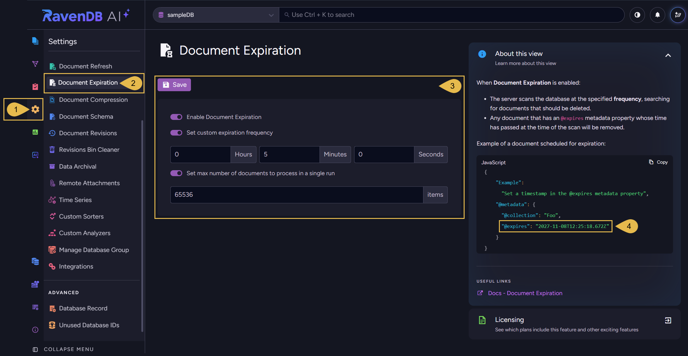
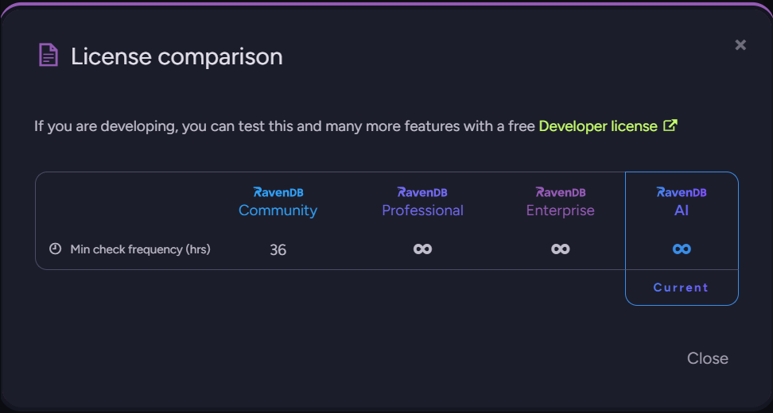
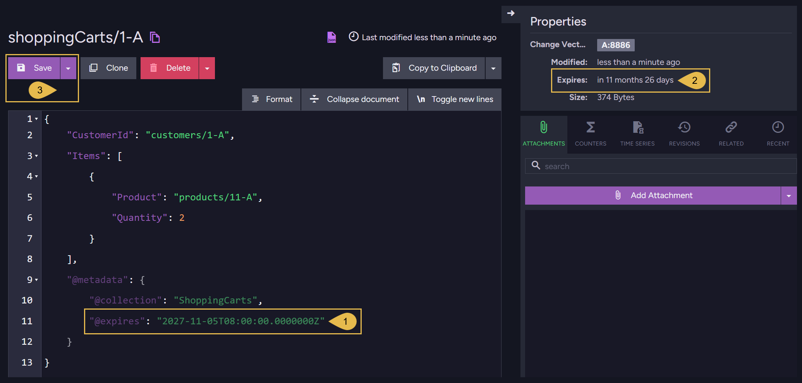

import Admonition from '@theme/Admonition';
import Panel from "@site/src/components/Panel";
import ContentFrame from "@site/src/components/ContentFrame";

# Document Expiration: Studio View
<Admonition type="note" title="">

* The **document expiration** feature deletes a document once the time you schedule for it has passed.  
  Use *document expiration* for documents that are needed only for a limited time, like documents that hold shopping
  carts, login sessions, or cached data.  
  Deleting the document triggers features that react to the deletion of documents, like indexing, replication, and ETL tasks.

* To schedule a document's expiration, set the `@expires` metadata property of the document to the intended expiration time.

* Use Studio's **Document Expiration** view to enable *document expiration* for a database, set the interval between
  checks for documents whose expiration time has passed, and limit the number of documents the feature processes in a
  single run.

* To enable and configure *document expiration* using the client API, and to learn how the feature deletes documents, see
  [Document Expiration: Client API](../../documents/document-expiration/client-api.mdx).

* In this article:
   * [The Document Expiration view](../../documents/document-expiration/document-expiration-view.mdx#the-document-expiration-view)
   * [Scheduling a document's expiration](../../documents/document-expiration/document-expiration-view.mdx#scheduling-a-document-s-expiration)

</Admonition>

<Panel heading="The Document Expiration view">

The Document Expiration view can be opened by users with `Admin` access to the database,
or with an `Operator` or `Cluster Admin` [security clearance](../../server/security/authorization/security-clearance-and-permissions.mdx).  
**`Settings` > `Document Expiration`**

1. **Settings**  
   Open the Settings menu.

2. **Document Expiration**  
   Open the Document Expiration view.

3. **Document Expiration configuration**  
   * **Save**  
     Save the configuration.  
     Changes to the configuration take effect only after you save them.
   * **Enable Document Expiration**  
     Toggle this option **on** to enable *document expiration* for the database, or **off** to disable the feature.  
      - Turning this option on also turns on **Set max number of documents to process in a single run** (see below), with a
        value of 65536.
      - On a license that sets a minimum expiration frequency (e.g., a Community license), turning this option on also turns
        on **Set custom expiration frequency** (see below), with the minimum value.
      - Turning this option off also turns off the two options below it.
   * **Set custom expiration frequency**  
     Toggle this option **on** to set the interval at which the *document expiration* feature runs, in hours, minutes, and
     seconds.  
     The **Hours**, **Minutes**, and **Seconds** fields appear while this option is on.  
     Each time the feature runs, it checks the database for documents whose expiration time has passed and deletes these
     documents.  
     When this option is **off**, the default interval (60 seconds) applies.

     <Admonition type="note" title="">
     #### The allowed expiration frequency with a Community license:
     When using a [Community license](https://ravendb.net/buy), the *document expiration* feature cannot run more often
     than every 36 hours (129600 seconds).  
     Turning **Enable Document Expiration** on sets **Set custom expiration frequency** to this minimum (36 hours).
     * To see the minimum expiration interval (in hours) allowed for each license, click the **Licensing** box at the bottom
       right of the view to open the **License comparison** dialog.

       
     * While *document expiration* is enabled, a frequency lower than the allowed minimum displays a warning, and **Save** is
       disabled.  
       If you turn **Set custom expiration frequency** off, the warning will be displayed and **Save** will be disabled as well,
       since the 60-second default then applies.

     </Admonition>
   * #### Set max number of documents to process in a single run
     Toggle this option **on** to limit the number of documents the feature processes in a single run.  
     When this option is **off**, any number of documents can be processed during a single run.
      - Each run processes the documents due for deletion in the order of their expiration times, earliest first.  
        Documents that share an expiration time are processed in the order of their document IDs.
      - If the number of documents due for deletion exceeds the set limit, the documents will be processed over multiple
        consecutive runs.

4. **Example of a document scheduled for expiration**  
   **About this view** shows a sample document whose `@expires` metadata property is set to an expiration time one year
   from today.  
   See [Scheduling a document's expiration](../../documents/document-expiration/document-expiration-view.mdx#scheduling-a-document-s-expiration) below.

</Panel>

<Panel heading="Scheduling a document's expiration">

To schedule a document's expiration using Studio, open the document from the
[Documents view](../../studio/database/documents/documents-and-collections.mdx#the-documents-view), add an `@expires` property
to its metadata, and save the document.

1. **`@expires`**  
   Add an `@expires` property to the document's `@metadata`, and set the property's value to the intended expiration time.

   <Admonition type="note" title="">
   Add a **time zone designator** to the value (`Z` for UTC, or an offset from UTC) to specify the time zone of the
   expiration time.  
   An expiration time set without a time zone designator is read in the server machine's time zone. If this time zone
   differs from the one you meant, the document will be deleted earlier or later than you intended.

   Examples:
   * `"@expires": "2027-11-05T08:00:00.0000000Z"` sets the expiration time to 08:00 UTC.
   * `"@expires": "2027-11-05T10:00:00.0000000+02:00"` sets the expiration time to 10:00 in a time zone two hours ahead of
     UTC, which is 08:00 UTC.
   * `"@expires": "2027-11-05T08:00:00.0000000"` sets the expiration time to 08:00 in the server machine's time zone.
   </Admonition>

2. **Expires**  
   Once the document is saved, the **Properties** panel, on the right side of the document view, shows the time left until
   the document's expiration.  
   Hovering over the time left until the expiration shows the expiration date and time in UTC.

   <Admonition type="note" title="">
   If *document expiration* **is disabled for the database**, a warning icon is displayed next to the time left until the
   expiration:
   

   The expiration is **still scheduled**:
   * If you enable the feature before the expiration time, the document will be deleted in the feature's first run after
     the expiration time.
   * If the expiration time passes while the feature is disabled, the document will be deleted after the feature is
     enabled, during its first run.
   * In both cases, the document may be deleted in a later run if the number of documents due for deletion exceeds the
     maximum set for a single run using the
     [Set max number of documents to process in a single run](../../documents/document-expiration/document-expiration-view.mdx#set-max-number-of-documents-to-process-in-a-single-run)
     option above.
   </Admonition>

3. **Save**  
   Save the document.  
   The expiration is scheduled once you save the document.

</Panel>
