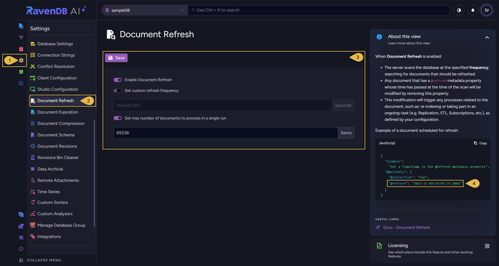
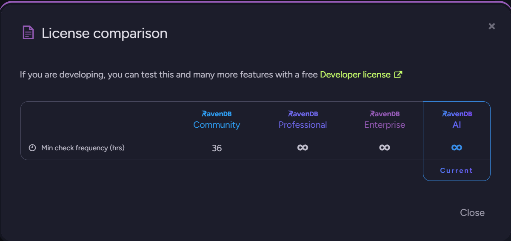
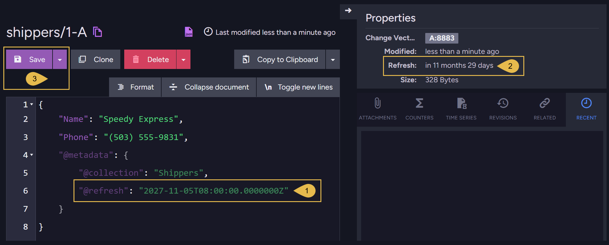

import Admonition from '@theme/Admonition';
import Panel from "@site/src/components/Panel";
import ContentFrame from "@site/src/components/ContentFrame";

# Document Refresh: Studio View
<Admonition type="note" title="">

* The **document refresh** feature re-saves an existing document once the time you schedule for it has passed,
  without changing the document's data.  
  Re-saving the document triggers features that react to document updates, like indexing, ETL tasks, and data
  subscriptions.  
  Use *document refresh* for documents that need to be processed at a later time, like documents that hold emails to send
  on a set date, room reservations to release once they expire, or reminders to raise when they are due.

* To schedule a document's refresh, set the `@refresh` metadata property of the document to the intended refresh time.  
  The `@refresh` property is removed when the document is re-saved.

* Use Studio's **Document Refresh** view to enable *document refresh* for a database, set the interval between 
  checks for documents to refresh, and limit the number of documents the feature processes in a single run.

* To enable and configure *document refresh* using the client API, and to learn how the feature refreshes documents, see
  [Document Refresh: Client API](../../documents/document-refresh/client-api.mdx).

* In this article:
   * [The Document Refresh view](../../documents/document-refresh/document-refresh-view.mdx#the-document-refresh-view)
   * [Scheduling a document refresh](../../documents/document-refresh/document-refresh-view.mdx#scheduling-a-document-refresh)

</Admonition>

<Panel heading="The Document Refresh view">

The Document Refresh view can be opened by users with `Admin` access to the database, 
or with an `Operator` or `Cluster Admin` [security clearance](../../server/security/authorization/security-clearance-and-permissions.mdx).  
**`Settings` > `Document Refresh`**

1. **Settings**  
   Open the Settings menu.

2. **Document Refresh**  
   Open the Document Refresh view.

3. **Document Refresh configuration**  
   * **Save**  
     Save the configuration.  
     Changes to the configuration take effect only after you save them.
   * **Enable Document Refresh**  
     Toggle this option **on** to enable *document refresh* for the database, or **off** to disable the feature.  
      - Turning this option on also turns on **Set max number of documents to process in a single run** (see below), with a value of 65536.  
      - Turning this option off also turns off the two options below it.
   * **Set custom refresh frequency**  
     Toggle this option **on** to set the interval (in seconds) at which the *document refresh* feature runs.  
     Each time the feature runs, it checks for documents to refresh and processes documents whose refresh time has passed.  
     When this option is **off**, the default interval (60 seconds) applies.

     <Admonition type="note" title="">
     #### The allowed refresh frequency with a Community license:
     When using a [Community license](https://ravendb.net/buy), the *document refresh* feature cannot run more often than 
     every 36 hours (129600 seconds).  
     To enable *document refresh* on a Community license, toggle **Set custom refresh frequency** on and set a frequency of
     at least `129600` seconds.
     * To see the minimum refresh interval (in hours) allowed for each license, click the **Licensing** box at the bottom right of the view to open the **License comparison** dialog.

       
     * The **Set custom refresh frequency** input displays the minimum value (`Default (129600)`), but Studio does not send 
       this value unless you explicitly type it in.
     * Saving the configuration with **Enable Document Refresh** toggled on and **Set custom refresh frequency** toggled off
       will fail, since Studio sends no 
       frequency, and the server then applies the 60-second default, which the license does not allow.  
     * A custom frequency lower than the allowed minimum value displays a warning, and **Save** is disabled.

     </Admonition>
   * #### Set max number of documents to process in a single run
     Toggle this option **on** to limit the number of documents the feature processes in a single run.  
     When this option is **off**, any number of documents can be processed during a single run.
      - Each run processes the documents due for refresh in the order of their refresh times, earliest first.  
        Documents that share a refresh time are processed in the order of their document IDs.
      - If the number of documents due for refresh exceeds the set limit, the documents will be processed over multiple
        consecutive runs.

4. **Example of a document scheduled for refresh**  
   **About this view** shows a sample document whose `@refresh` metadata property is set to a refresh time one year from
   today.  
   See [Scheduling a document refresh](../../documents/document-refresh/document-refresh-view.mdx#scheduling-a-document-refresh) below.

</Panel>

<Panel heading="Scheduling a document refresh">

To schedule a document's refresh using Studio, open the document from the [Documents view](../../studio/database/documents/documents-and-collections.mdx#the-documents-view), add a `@refresh` property 
to its metadata, and save the document.

1. **`@refresh`**  
   Add a `@refresh` property to the document's `@metadata`, and set the property's value to the intended refresh time.
   * Add a **time zone designator** to the value (`Z` for UTC, or an offset from UTC), so the document is refreshed at the moment
     you intend.  
     A refresh time set without a time zone designator is read in the server machine's time zone.  
     If this time zone differs from the one you meant, the document will be refreshed earlier or later than you intended.

     Examples:
     - `"@refresh": "2027-11-05T08:00:00.0000000Z"` sets the refresh time to 08:00 UTC.
     - `"@refresh": "2027-11-05T10:00:00.0000000+02:00"` sets the refresh time to 10:00 in a time zone two hours ahead of
       UTC, which is 08:00 UTC.
     - `"@refresh": "2027-11-05T08:00:00.0000000"` sets the refresh time to 08:00 in the server machine's time zone.
   * When the document is refreshed, the `@refresh` property is **removed from its metadata**, so the document is refreshed
     only once.  
     To refresh the document again, set its `@refresh` property to a new time.
   * Reverting a document to a [revision](../../document-extensions/revisions/overview.mdx) also **removes the `@refresh`
     property from the reverted document**.  
     See [Reverting documents to revisions](../../documents/document-refresh/client-api.mdx#reverting-documents-to-revisions)

2. **Refresh**  
   Once the document is saved, the **Properties** panel, on the right side of the document view, shows the time left until
   the document's refresh.  
   Hovering over the time left until the refresh shows the refresh date and time in UTC.
   * If *document refresh* **is disabled for the database**, a warning icon is displayed next to the time left until the refresh:
     

     The refresh is **still scheduled**:
     - If you enable the feature before the refresh time, the document will be refreshed in the feature's first run after
       the refresh time.
     - If the refresh time passes while the feature is disabled, the document will be refreshed in the feature's first run
       after you enable the feature.
     - In both cases, the document may be refreshed in a later run if the number of documents due for refresh exceeds the
       maximum set for a single run using the
       [Set max number of documents to process in a single run](../../documents/document-refresh/document-refresh-view.mdx#set-max-number-of-documents-to-process-in-a-single-run)
       option above.
   * A document that is **in conflict** is not refreshed while the conflict remains, even after its refresh time passes.  
     See [Conflicted documents](../../documents/document-refresh/client-api.mdx#conflicted-documents)

3. **Save**  
   Save the document.  
   The refresh is scheduled once you save the document.

</Panel>
