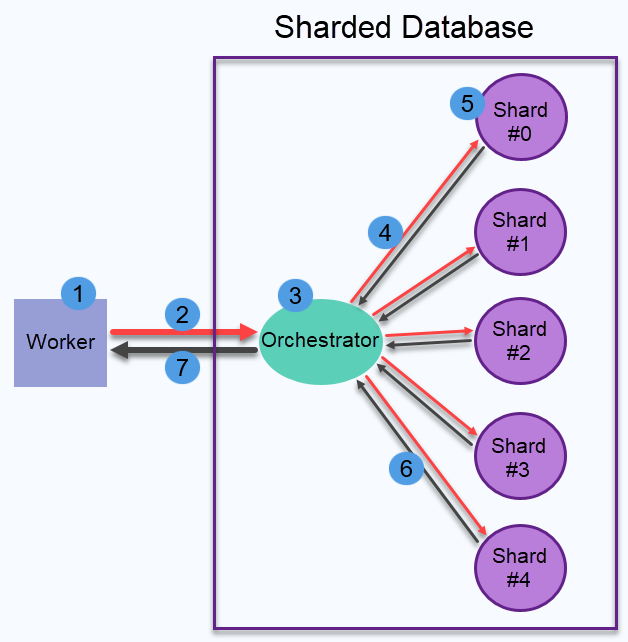

import Admonition from '@theme/Admonition';
import Panel from "@site/src/components/Panel";

<Admonition type="note" title="">

* From a user's point of view, [data subscriptions](../data-subscriptions/overview.mdx) 
  are created and [consumed](../data-subscriptions/consuming-subscription.mdx) 
  in the exact same way when the database is sharded and when it is not.  
  
* Old clients are supported and can continue communicating with RavenDB 
  without knowing whether the database is sharded or not.  
  Subscription workers of a non-sharded database are not required to change 
  anything to connect to a sharded database.  

* Data subscriptions in a sharded database are managed by orchestrators 
  that serve the workers, and shards that serve the orchestrators.  

* In this article:  
  * [Data subscriptions in a sharded database](../sharding/subscriptions.mdx#data-subscriptions-in-a-sharded-database)  
  * [Unsupported features](../sharding/subscriptions.mdx#unsupported-features)  

</Admonition>

<Panel heading="Data subscriptions in a sharded database">

* A data subscription is created in a sharded database once,
  [as in a non-sharded database](../data-subscriptions/creating-subscription/creating-subscription_api.mdx).  
* Behind the scenes, when a worker connects to the subscription, the [orchestrator](../sharding/overview.mdx#client-server-communication)
  in charge of the subscription opens a connection to every [shard](../sharding/overview.mdx#shards).  
  Each shard independently organizes available data in batches 
  and sends the batches to the orchestrator in response to data 
  requests.  
* The orchestrator collects the batches sent by the shards and handles the documents in these batches.  
  e.g., included documents are added to a batch even when a document arrives from one shard and the document
  it includes from another.  
* The orchestrator keeps track of the worker's progress.  
  When the worker consumes its current document batch and requests 
  another, the orchestrator sends the worker the next available batch.  

Distributing the work between all shards this way 
allows RavenDB to serve the subscription's workers efficiently no matter 
how large the overall database gets.  

1. **Data Subscription Worker**  
2. **Worker Subscription and Data Requests**  
    * The worker subscribes with the orchestrator.  
      The worker is unaware that the destination database is sharded.  
      No special syntax or preparation is needed.  
    * The worker informs the orchestrator when all data was consumed.  
3. **Orchestrator**  
   The orchestrator registers the data that the worker has consumed 
   and the data still to be delivered.  
4. **Orchestrator Subscription and Data Requests**  
    * The orchestrator subscribes with all shards.  
    * The orchestrator informs a shard when the shard's batch has been consumed.  
5. **Shard**  
   Relevant data is organized in consumable batches.  
   The shard registers the data that has been consumed 
   and the data still to be delivered.  
6. **Data Delivery to Orchestrator**  
   When the orchestrator informs the shard that all data has been consumed 
   and the shard has an available batch, the batch is delivered to the orchestrator.  
7. **Data Delivery to Worker**  
   When the worker informs the orchestrator that all data has been consumed 
   and the orchestrator has an available batch, the batch is delivered to the worker.  

</Panel>

<Panel heading="Unsupported features">

Data subscription features that are not supported yet in a sharded database:  

* [Concurrent subscriptions](../data-subscriptions/concurrent-subscriptions.mdx)  
  Allowing multiple workers to connect to a common subscription simultaneously.  
* [Revisions support](../data-subscriptions/revisions-support.mdx)  
  Subscribing to document revisions.  
* [SubscriptionCreationOptions.ChangeVector](../data-subscriptions/creating-subscription/creating-subscription_api.mdx#classes)  
  Providing an arbitrary change vector from which the subscription would start processing 
  is currently not supported.  
  <Admonition type="note" title="">
  Setting `ChangeVector` to one of the following special values **is** supported:  
   
   * `"LastDocument"` (the latest change vector on the database)  
   * `"BeginningOfTime"` (the earliest change vector on the database)  
   * `"DoNotChange"` (keep the subscription's current change vector)  
  </Admonition>
* [Per-subscription handling of archived documents](../data-subscriptions/creating-subscription/creating-subscription_api.mdx#archived-documents)  
  * **In a non-sharded database**, each subscription can be set to send its workers *only non-archived documents* (the default),
    *both non-archived and archived documents*, or *only archived documents*.  
  * **In a sharded database**, this per-subscription setting has no effect.  
    All the subscriptions handle archived documents the same way, as set by the
    [Subscriptions.ArchivedDataProcessingBehavior](../data-subscriptions/configuration.mdx#subscriptionsarchiveddataprocessingbehavior) configuration key (`ExcludeArchived` by default).  

</Panel>
