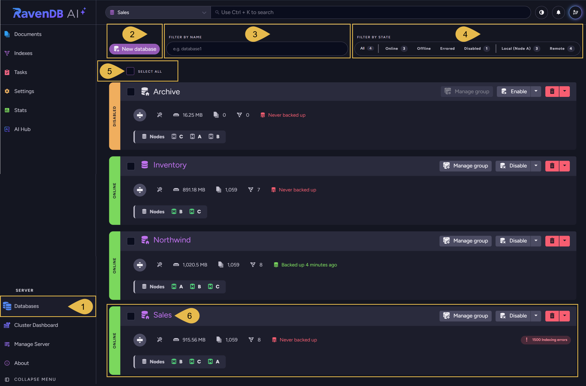
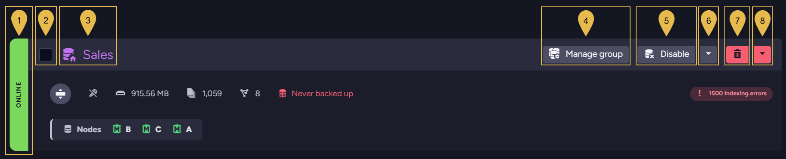
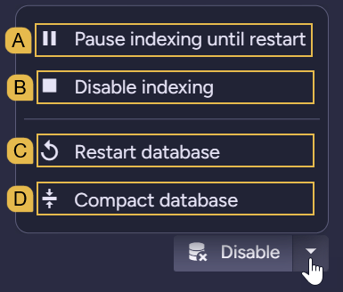
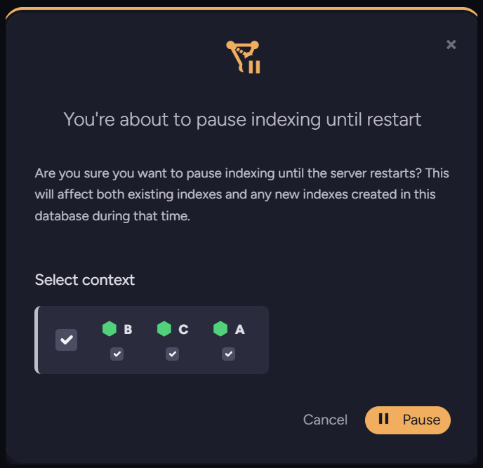
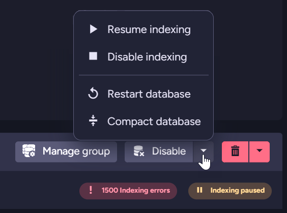
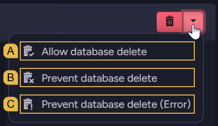
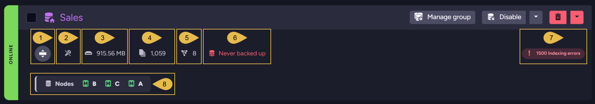
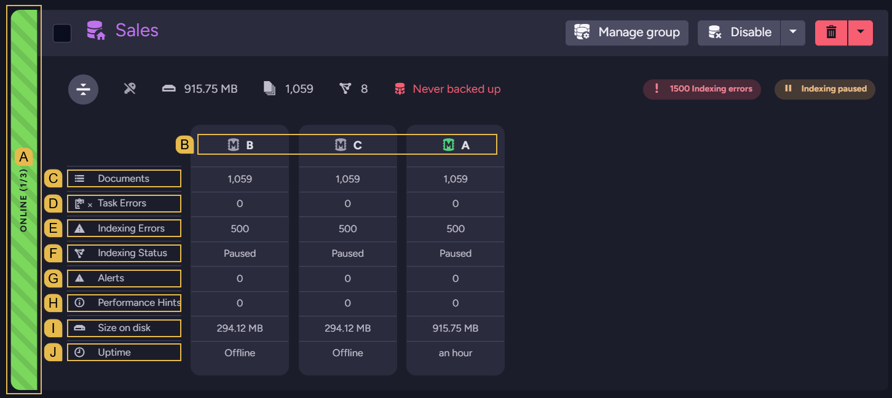
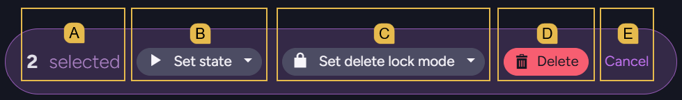

import Admonition from '@theme/Admonition';
import Panel from "@site/src/components/Panel";

# Studio: Database List View
<Admonition type="note" title="">

* Use Studio's **Database List view** to see the databases in your cluster, examine the state and statistics of each database,
  and manage the databases, e.g., disable a database or pause its indexing.  
  You can also select multiple databases and enable, disable, or delete them at once.  

* The database list includes databases that are not hosted by the node that Studio is connected to.  
  You can filter the list by database name, by database state, and by location (this node or other cluster nodes).  

* You can create new databases in this view, from scratch or by restoring a backup.  
  Creating a database from scratch is described in
  [Create a Database: General Flow](../../studio/database/create-new-database/general-flow.mdx),
  and restoring a database from a backup in
  [Restoring from backup using Studio](../../backup/restore.mdx#restoring-from-backup-using-studio).  

* In this article:
   * [Database list view](../../studio/database/databases-list-view.mdx#database-list-view)
   * [Database actions](../../studio/database/databases-list-view.mdx#database-actions)
   * [Database stats](../../studio/database/databases-list-view.mdx#database-stats)
   * [Actions on selected databases](../../studio/database/databases-list-view.mdx#actions-on-selected-databases)

</Admonition>

<Panel heading="Database list view">

The Database List view shows the databases in your cluster, with the state, statistics, and available actions of each database.  

1. **Databases**  
   Click **Databases**, in the **Server** section of Studio's main menu, to open the Database List view.  

2. **New database**  
   Open a dialog to create a new database.  
   Learn more in [Create a Database: General Flow](../../studio/database/create-new-database/general-flow.mdx)
   and [Restoring from backup using Studio](../../backup/restore.mdx#restoring-from-backup-using-studio).  
   * To restore a database from a backup, click **Restore from backup** at the bottom of the dialog's first step.  
   * This button is available only to users with `Operator` or `Cluster Admin`
     [security clearance](../../server/security/authorization/security-clearance-and-permissions.mdx).  

3. **Filter by name**  
   Enter text to list only the databases whose names contain the text.  

4. **Filter by state**  
   Select one or more states to list only the databases in the selected states.  
   Select **Local (Node A)** to list the databases hosted by the node that Studio is connected to (node A in this image),
   or **Remote** to list the databases hosted by other cluster nodes.  
   * The number next to each option counts the databases that match the option.  
   * A database that is online on only some of its nodes is counted as both **Online** and **Offline**.  

5. **Select All**  
   Select all the databases displayed in the view (that match the filters you set).  
   If any displayed databases are already selected, clicking **Select All** deselects them instead of selecting all displayed databases.  
   See [Actions on selected databases](../../studio/database/databases-list-view.mdx#actions-on-selected-databases)  
   * To select a single database, select the checkbox next to the database's name.  
   * The checkboxes are available only to users with `Operator` or `Cluster Admin` security clearance.  

6. **A database**  
   Each listed database is displayed with its state, statistics, and the actions you can perform on it.  
   See [Database actions](../../studio/database/databases-list-view.mdx#database-actions)
   and [Database stats](../../studio/database/databases-list-view.mdx#database-stats)

<Admonition type="note" title="">
In a browser window narrower than 1400 pixels, the name and state filters are hidden.  
To display the filters, click **Show Filtering Options** next to **New database**.  
</Admonition>

</Panel>

<Panel heading="Database actions">

The top line of each listed database shows the database's state and name, and buttons you can use to act on the database.  

1. **Database state**  
   The state of the database on the nodes of its [database group](../../server/clustering/distribution/distributed-database.mdx):  
   * **Online**: the database is loaded by all the nodes of the database group.  
   * **Online (x/y)**: the database is loaded by only some of the nodes of the database group (x of y nodes).  
   * **Offline**: the database is not loaded by any of the nodes of the database group.  
     RavenDB unloads a database that has not been accessed for a
     [set time](../../server/configuration/database-configuration.mdx#databasesmaxidletimeinsec) (15 minutes by default),
     and loads the database again when the database is accessed.  
   * **Disabled**: the database was disabled (see **Disable** below), and cannot be accessed.  
   * **Error**: at least one node of the database group failed to load the database.  
   * **Loading...**: Studio has not retrieved the database's state from the nodes yet.  

2. **Checkbox**  
   Select the database, to perform an action on this database and on other selected databases at once.  
   See [Actions on selected databases](../../studio/database/databases-list-view.mdx#actions-on-selected-databases)

3. **Database name**  
   Click the name to open the database's [Documents view](../../studio/database/documents/documents-and-collections.mdx#the-documents-view).  
   * A house symbol on the database icon marks a database hosted by the node that Studio is connected to.  
   * For a database that this node does not host, the Documents view opens in a new browser tab, on a node that hosts the database.  
   * The name of a disabled database cannot be clicked.  

4. **Manage group**  
   Open the [Manage Database Group](../../studio/database/settings/manage-database-group.mdx) view, to manage the database group
   (the nodes that host the database).  

5. **Disable**  
   Disable the database.  
   You will be asked to confirm.  
   A disabled database cannot be accessed, and its data is kept.  
   To enable a disabled database, click **Enable** (the label this button shows while the database is disabled).  

6. <a id="more-actions"/> **More actions**  
   Open a menu of additional actions.  

     

   * A. **Pause indexing until restart**  
     Pause the indexing of all the database's indexes, including indexes created while indexing is paused.  
     In the dialog that opens, click **Pause**.  
     When the database is hosted by more than one node or is [sharded](../../sharding/overview.mdx), the dialog also displays
     a **Select context** area, where you can select the nodes (and shards) to pause indexing on.  

       

     Indexing resumes when the server restarts, when the database is restarted (see **Restart database** below),
     or when you resume indexing.  
     While indexing is paused, an **Indexing paused** badge is displayed, and **Resume indexing** appears at the top of the menu.  

       

     To resume indexing, select **Resume indexing** and click **Resume** in the dialog that opens.  
     * When the database is hosted by more than one node or is sharded, the Resume dialog also displays a **Select context**
       area, where you can select the nodes (and shards) to resume indexing on.  
     * Indexing can also be paused and resumed using the client API.  
       See [Pause Indexing Operation](../../client-api/operations/maintenance/indexes/stop-indexing.mdx)
       and [Resume Indexing Operation](../../client-api/operations/maintenance/indexes/start-indexing.mdx)
   * B. **Disable indexing**  
     Disable the indexing of all the database's indexes, on all the nodes that host the database.  
     You will be asked to confirm.  
     * The change takes effect only after the database is reloaded.  
       To reload the database, restart it (see **Restart database** below), disable and enable it, or restart the server.  
     * Indexing stays disabled after the database is reloaded and after the server restarts, until you select **Enable indexing**
       (shown in place of **Disable indexing**) and reload the database.  
   * C. **Restart database**  
     Restart the database.  
     In the dialog that opens, click **Restart**.  
     When the database is hosted by more than one node or is sharded, the dialog also displays a **Select restart context**
     area, where you can select the nodes (and shards) to restart the database on.  
   * D. **Compact database**  
     Open a dialog to compact the database's documents and indexes, reducing the disk space the database uses.  
     The database is offline during compaction.  
     Learn more in [Compact Database Operation](../../client-api/operations/server-wide/compact-database.mdx).  

7. **Delete**  
   Delete the database.  
   In the dialog that opens, click **Delete & Keep Files** to delete the database from all the cluster nodes and keep the
   database's files on disk, or **Delete All Data** to delete the files as well.  
   * To delete the database from specific nodes only, use the
     [Manage Database Group](../../studio/database/settings/manage-database-group.mdx) view.  
   * The **Delete** button is disabled when the database's delete lock mode prevents deletion (see **Delete lock mode** below).  

8. **Delete lock mode**  
   Set the database's delete lock mode, to allow or prevent the deletion of the database.  
   You will be asked to confirm the change.  

     

   * A. **Allow database delete**  
     The database can be deleted.  
     This is the default mode.  
   * B. **Prevent database delete**  
     Requests to delete the database are ignored, and no error is returned.  
   * C. **Prevent database delete (Error)**  
     Requests to delete the database fail with an error.  

</Panel>

<Panel heading="Database stats">

The lower part of each listed database shows the database's statistics, and the nodes of its database group.  

1. **Expand distribution details**  
   Display the statistics of the database on each node of the database group, in place of the **Nodes** list.  
   Click the button again to collapse the distribution details.  

     

   * A. **Database state**  
     A striped label marks a database that is loaded by only some of the nodes of its database group
     (in this image, by one of three nodes).  
   * B. **Nodes**  
     The details include a column for each node of the database group.  
     The node icon is grayed out when the node has not loaded the database.  
   * C. **Documents**  
     The number of documents in the database on each node.  
   * D. **Task Errors**  
     The number of errors raised by the database's [ongoing tasks](../../monitoring/task-errors/studio-views.mdx) on each node.  
   * E. **Indexing Errors**  
     The number of indexing errors on each node.  
   * F. **Indexing Status**  
     The indexing status on each node (e.g., `Running`, `Paused`, or `Disabled`).  
   * G. **Alerts**  
     The number of alerts raised for the database on each node.  
   * H. **Performance Hints**  
     The number of performance hints raised for the database on each node.  
   * I. **Size on disk**  
     The disk space the database uses on each node.  
   * J. **Uptime**  
     The time that has passed since each node loaded the database, or `Offline` for a node that has not loaded the database.  

2. **Encryption**  
   An icon that shows whether the database is [encrypted](../../server/security/encryption/database-encryption.mdx).  
   Hovering over the icon displays `This database is encrypted` or `This database is not encrypted`.  

3. **Size**  
   The disk space the database uses, including temporary buffers.  
   Click the size to open the
   [Database Storage Report](../../monitoring/performance-views/storage-reports.mdx#database-storage-report) view.  

4. **Documents**  
   The number of documents in the database.  
   Click the number to open the database's
   [Documents view](../../studio/database/documents/documents-and-collections.mdx#the-documents-view).  

5. **Indexes**  
   The number of indexes in the database.  
   Click the number to open the [Indexes List view](../../studio/database/indexes/indexes-list-view.mdx).  

6. **Backup status**  
   The time of the database's latest backup, or `Never backed up` if the database has never been backed up.  
   The text is green when the latest backup was taken within the last 24 hours, yellow when the latest backup is older
   than 24 hours, and red when the database has never been backed up.  
   Click the text to open the database's **Backups** view.  

7. **Badges**  
   Badges call attention to issues requiring it, and are displayed only when there is an issue to report.  
   * **Indexing errors**: the number of indexing errors on all the nodes of the database group.  
     Click the badge to open the **Index Errors** view.  
     Learn about indexing errors in [Debugging Index Errors](../../indexes/troubleshooting/debugging-index-errors.mdx).  
   * **Task errors**: the number of errors raised by the database's ongoing tasks on all the nodes of the database group.  
     Click the badge to open the [Task Errors view](../../monitoring/task-errors/studio-views.mdx#task-errors-view).  
   * **Indexing paused** or **Indexing disabled**: indexing is paused or disabled on at least one node of the database group.  
     Click the badge to open the Indexes List view.  
   * **Alerts** or **Performance hints**: the number of alerts or performance hints raised for the database on the node that
     Studio is connected to.  
     When other nodes of the database group hold alerts or hints as well, a globe icon is added, with the total number
     reported by all the nodes of the database group.  
     Click the badge to open the [notification center](../../monitoring/alerts-and-notifications/notification-center.mdx).  
   * **Database has load errors!**: at least one node of the database group failed to load the database.  

8. **Nodes**  
   The nodes of the database group.  
   The icon next to each node tag shows the node's
   [state in the database group](../../server/clustering/distribution/distributed-database.mdx#database-topology)
   (Member, Promotable, or Rehab).  
   Hovering over the icon displays the state.  

<Admonition type="note" title="">
The database's size, number of documents, and backup status are read from the node that Studio is connected to.  
If this node does not host the database, the values are read from one of the nodes that do host it.  
</Admonition>

</Panel>

<Panel heading="Actions on selected databases">

To perform an action on several databases at once, select the databases
(see **Select All** in [Database list view](../../studio/database/databases-list-view.mdx#database-list-view)).  
When one or more databases are selected, a selection bar appears at the right end of the **Select All** line.  

* A. **Selected databases**  
  The number of selected databases.  
* B. **Set state**  
  Select **Enable** or **Disable** to enable or disable all the selected databases.  
  You will be asked to confirm.  
* C. **Set delete lock mode**  
  Set the delete lock mode of all the selected databases
  (see **Delete lock mode** in [Database actions](../../studio/database/databases-list-view.mdx#database-actions)).  
  You will be asked to confirm.  
* D. **Delete**  
  Delete the selected databases.  
  * Only the selected databases whose delete lock mode allows deletion are deleted.  
    The **Delete** button is disabled when the delete lock mode of every selected database prevents deletion.  
  * In the dialog that opens, click **Delete & Keep Files** or **Delete All Data**
    (see **Delete** in [Database actions](../../studio/database/databases-list-view.mdx#database-actions)).  
    The option you select applies to all the deleted databases.  
* E. **Cancel**  
  Deselect all the databases.  

</Panel>
