import Admonition from '@theme/Admonition';
import Panel from "@site/src/components/Panel";

# Studio: Query View
<Admonition type="note" title="">

* Use Studio's **Query view** to write and run [RQL](../../../querying/rql/what-is-rql.mdx) queries on a database,
  and to examine the query results.  

* Queries you save are kept in your browser's local storage, and can be loaded only in this browser.  

* You can set query options for the view, e.g., to prevent queries from creating
  [auto indexes](../../../studio/database/indexes/indexes-overview.mdx#index-types), or to display the index entries that match
  a query rather than the matching documents.  

* In the query results area, you can examine the index that served the query, view the query statistics,
  delete the documents that match the query, and export the results to a CSV or a JSON file.  
  The result columns can also be customized, and each result can be previewed and its values copied.  

* Time series query results can be displayed as a graph over time, and spatial query results on a world map.  
  These displays are described in [Querying Time Series](../../../studio/database/document-extensions/time-series.mdx#querying-time-series)
  and [Spatial Queries Map View](../../../studio/database/queries/spatial-queries-map-view.mdx).  

* In this article:
   * [Query view](../../../studio/database/queries/query-view.mdx#query-view)
   * [Query results](../../../studio/database/queries/query-view.mdx#query-results)
   * [Customizing the result columns](../../../studio/database/queries/query-view.mdx#customizing-the-result-columns)
   * [Inspecting result values](../../../studio/database/queries/query-view.mdx#inspecting-result-values)
   * [Additional query types](../../../studio/database/queries/query-view.mdx#additional-query-types)

</Admonition>

<Panel heading="Query view">

Use the Query view to write, save, and load queries, and to run queries with the options you set.  

**`Indexes` > `Query`**

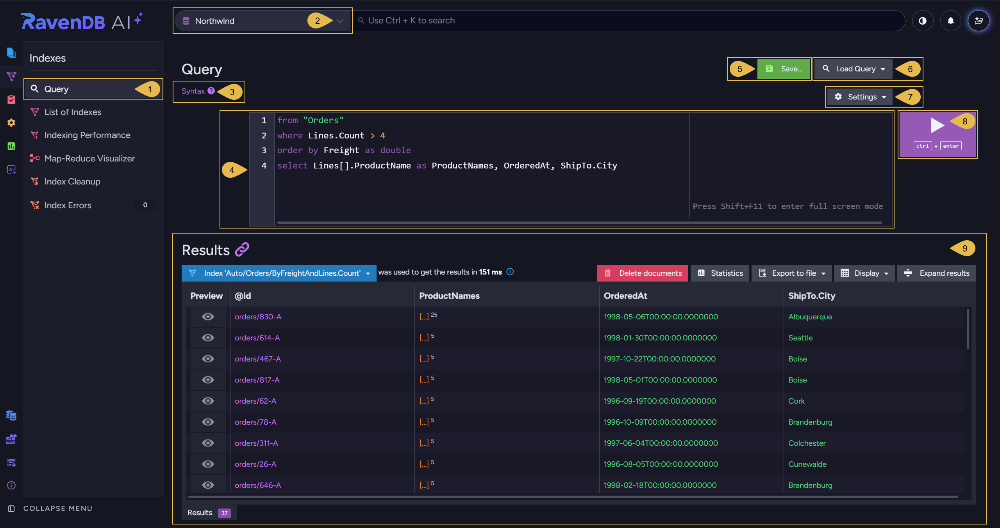

1. **Query**  
   Open the Query view.  

2. **Database selector**  
   Select the database to query.  

3. **Syntax**  
   Open a dialog with sample RQL queries.  

4. **Query editor**  
   Write your RQL query.  
   The editor offers auto-complete suggestions as you type.  

5. **Save...**  
   Save the query in your browser's local storage.  
   Click **Save...**, enter a name for the query, and click **Save**.  
   If a query with this name was already saved, you will be asked whether to overwrite the saved query.  

   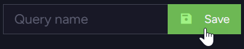  

6. **Load Query**  
   Open the list of saved queries.  
   In addition to queries you saved explicitly, the list holds the queries you recently ran, each named `Recent Query`
   and the name of the queried collection or index.  

   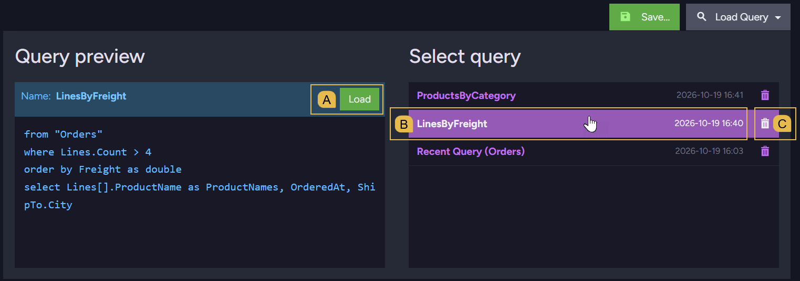  

   * A. **Load**  
     Load the query displayed in the **Query preview** area into the editor, and run it.  
   * B. **A saved query**  
     Hovering over a query name displays the query in the **Query preview** area.  
     Click the query name to load the query into the editor and run it.  
   * C. **Delete**  
     Delete the query.  
     You will be asked to confirm the deletion.  

7. <a id="query-settings"/> **Settings**  
   Set query options for this view.  

   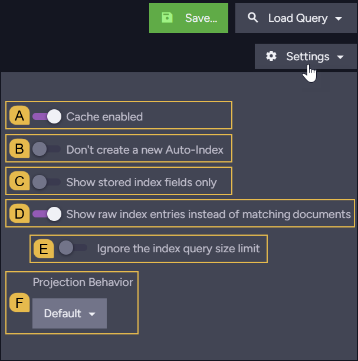  

   * A. **Cache enabled**  
     Enable or disable caching of query results.  
   * B. **Don't create a new Auto-Index**  
     Enable to prevent queries from creating auto indexes.  
     When this option is enabled and no existing auto index fits a query, the query will fail.  
     * The option's initial state is set in
       [Studio configuration](../../../studio/database/settings/studio-configuration.mdx#disabling-auto-index-creation-on-studio-queries-or-patches).  
   * C. **Show stored index fields only**  
     Enable to display only the fields stored in the queried index.  
     This option is disabled for queries executed over a collection (e.g., `from "Orders"`).  
   * D. **Show raw index entries instead of matching documents**  
     Enable to display the index entries that match the query, rather than the matching documents.  
     * This option is disabled for queries executed over a collection (e.g., `from "Orders"`).  
     * For [map-reduce indexes](../../../indexes/map-reduce-indexes.mdx) and for indexes of
       [counters](../../../indexes/indexing-counters.mdx) or [time series](../../../indexes/indexing-time-series.mdx),
       the option is named **Show raw index entries instead of index results**, since the results of these indexes are not documents.  
   * E. **Ignore the index query size limit**  
     Enable to read the raw entries regardless of the index size.  
     * This option appears while **Show raw index entries** is enabled.  
     * Each index uses one of RavenDB's two [search engines](../../../indexes/search-engine/corax.mdx), Lucene or Corax.  
       By default, a request to display the raw entries of a Lucene index that holds more than 524,288 entries will fail,
       since reading so many entries can take a long time and use a lot of memory.  
       Corax indexes have no such limit.  
   * F. **Projection Behavior**  
     Select the projection behavior, which determines whether the values of projected fields are retrieved from
     the index or from the documents.  
     Learn more in the "Projection behavior with a static-index" section of
     [Project Index Query Results](../../../indexes/querying/projections.mdx).  

8. **Run query**  
   Run the query (or press **Ctrl+Enter**).  
   If the query runs for longer than 5 seconds, an **Abort query** button appears below the run button.  

9. **Results**  
   The results of the query you ran.  
   See [Query results](../../../studio/database/queries/query-view.mdx#query-results)

</Panel>

<Panel heading="Query results">

The results area displays the items the query returned, along with information about the query and controls you can
use to work with these items.

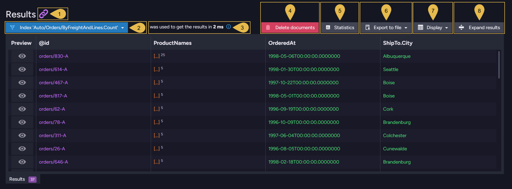

1. **Show raw output**  
   Open the query's raw JSON response in a new browser tab.  

2. **Index**  
   The name of the index that served the query.  
   Click the index name to open a menu of actions related to the index.  
   For a query that retrieves a collection's documents without an auto index (e.g., `from "Orders"`), the collection's
   name is displayed, with no menu.  
   Learn about the index used by each query type in [Query overview](../../../querying/overview.mdx).  

   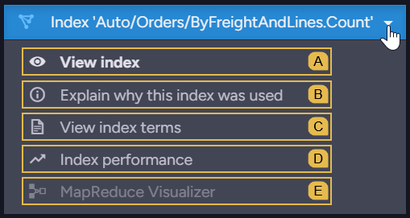  

   * A. **View index**  
     Open the index definition in the [Edit Index view](../../../studio/database/indexes/create-map-index.mdx#edit-index-view).  
     For a static index, the entry is named **Edit index**, and you can edit the index definition.  
   * B. **Explain why this index was used**  
     For a query executed over a collection, RavenDB selects the auto index that serves the query.  
     Open a dialog that shows the selected auto index, and the other auto indexes RavenDB considered with the reason
     each index was rejected.  
     This entry is disabled for queries that specify an index (e.g., `from index "Orders/Totals"`), since RavenDB uses
     the specified index and makes no selection.  
   * C. **View index terms**  
     Open the [Terms view](../../../studio/database/indexes/create-map-index.mdx#index-fields--terms),
     which lists the index fields and the terms the index stores for each field.  
   * D. **Index performance**  
     Open the [Indexing Performance view](../../../studio/database/indexes/indexing-performance.mdx).  
   * E. **MapReduce Visualizer**  
     Open the [Map-Reduce Visualizer](../../../studio/database/indexes/map-reduce-visualizer.mdx) view.  
     This entry is available only for [map-reduce indexes](../../../indexes/map-reduce-indexes.mdx).  

3. **Query duration**  
   The time it took to retrieve the query results.  

   <Admonition type="note" title="">
   To see a breakdown of the query duration, add `include timings()` to the query.  
   Learn more in [Include Query Timings](../../../client-api/session/querying/debugging/query-timings.mdx).  
   </Admonition>

4. **Delete documents**  
   Delete all the documents that match the query.  
   You will be asked to confirm the deletion.  
   This button is disabled when the query results are not documents (e.g., the results of a map-reduce index).  

5. **Statistics**  
   Open a dialog with the query statistics:  
   * **Total Results**: the number of results the query returned.  
   * **Status**: `Stale` if the index was [stale](../../../indexes/stale-indexes.mdx) when the query ran (some documents were
     not processed by the index yet), `Up to date` otherwise.  
   * **Duration**: the time, in milliseconds, it took to run the query.  
   * **Index**: the name of the index that served the query.  
   * **ETag**: the ETag of the query results, which RavenDB uses to tell whether the results have changed since
     the last retrieval.  

6. **Export to file**  
   Export the query results to a file.  

   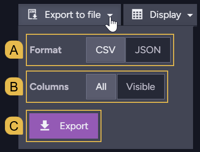  

   * A. **Format**  
     Select the file format: **CSV** or **JSON**.  
   * B. **Columns**  
     Select **All** to export all the result columns, or **Visible** to export only the columns currently displayed.  
     Custom columns are not exported.  
   * C. **Export**  
     Download the exported file.  

7. **Display**  
   Select the result columns to display, and add columns of your own.  
   See [Customizing the result columns](../../../studio/database/queries/query-view.mdx#customizing-the-result-columns)

8. **Expand results**  
   Hide the query editor, so the results take up the whole view.  
   Click **Collapse results** to display the query editor again.  

</Panel>

<Panel heading="Customizing the result columns">

Use the **Display** dialog to select the result columns to display, set the order of the columns, and add columns of your own.  
To open the dialog, click **Display** in the [results area](../../../studio/database/queries/query-view.mdx#query-results).

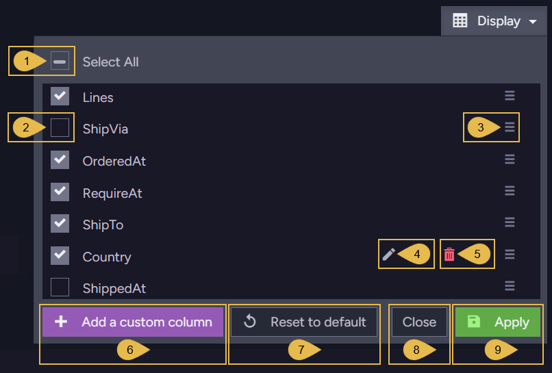

1. **Select All**  
   Clear all the column checkboxes, or select all the checkboxes when none is selected.  
   When only some of the columns are selected, the **Select All** checkbox is partially checked.  

2. **Column checkbox**  
   Select or clear the checkbox to display or hide the column.  

3. **Drag handle**  
   Drag the handle up or down to move the column to another position among the result columns.  

4. **Edit**  
   Edit the binding and alias of a custom column, using the custom column form (see **Add a custom column** below).  
   This icon appears only on custom columns.  

5. **Remove**  
   Remove a custom column.  
   This icon appears only on custom columns.  

6. **Add a custom column**  
   Open the custom column form, to add a column whose values are returned by a JavaScript expression you define.  

   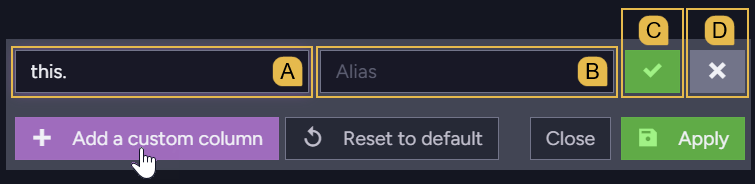  

   * A. **Binding**  
     Enter a JavaScript expression that returns the column's value for each result, using `this` to refer
     to the result. e.g.: `this.ShipTo.Country`
   * B. **Alias**  
     Enter the column's title.  
   * C. **Add**  
     Add the column to the results.  
     The column is displayed right away, without clicking **Apply**.  
   * D. **Cancel**  
     Close the form without adding the column.  

7. **Reset to default**  
   Restore the default result columns and their default order.  

   <Admonition type="warning" title="Custom columns are removed">
   Resetting the result columns to their default will remove any custom columns.
   </Admonition>

8. **Close**  
   Close the dialog without applying your changes.  

9. **Apply**  
   Apply your changes and close the dialog.  
   This button is enabled only when at least one column is selected.  

<Admonition type="warning" title="Running a query resets the result columns">
When you run a query, the default result columns will be restored and any custom columns will be removed.
</Admonition>

</Panel>

<Panel heading="Inspecting result values">

Use the results table to preview results, open result documents, and examine or copy the values in the table cells.

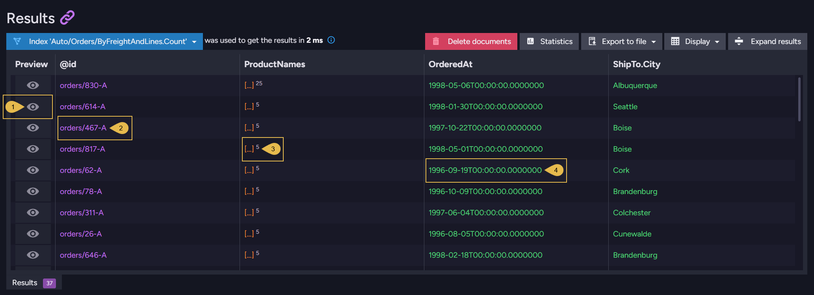

1. **Preview**  
   Open a dialog that displays the result in JSON format.  

2. **Document ID**  
   Click the document ID to open the document in the [Document view](../../../studio/database/documents/document-view.mdx).  
   Hovering over the ID displays the ID in a popup, with a **Copy to clipboard** button.  

   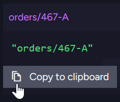  

3. **Array value**  
   An array is displayed as `[...]`, with the number of the array's items next to the brackets.  
   An object is displayed in a similar way, as `{...}` with the number of the object's properties.  
   Hovering over an array or an object displays the full value in a popup, with a **Copy to clipboard** button.  

   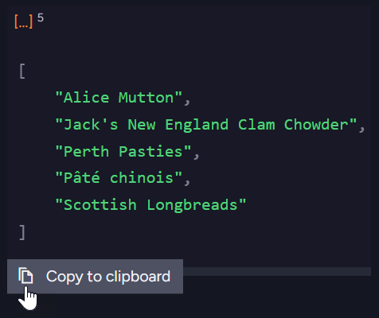  

4. **Text value**  
   Hovering over a value displays the full value in a popup, with a **Copy to clipboard** button.  

   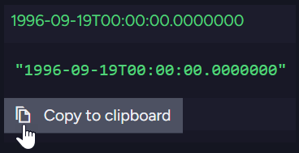  

</Panel>

<Panel heading="Additional query types">

The Query view also displays the results of these query types:

* **Time series queries**  
  The results of a [time series](../../../document-extensions/timeseries/overview.mdx) query can be viewed as a
  table or as a graph over time.  
  See [Querying Time Series](../../../studio/database/document-extensions/time-series.mdx#querying-time-series)
* **Spatial queries**  
  The results of a [spatial query](../../../studio/database/queries/spatial-queries-map-view.mdx) can be displayed
  on a world map, in the **Spatial Map** tab.  
  See [Spatial map view](../../../studio/database/queries/spatial-queries-map-view.mdx#spatial-map-view)
* **Counter queries**  
  A query can select [counter](../../../document-extensions/counters/counters-and-other-features.mdx) values, which are
  then displayed in the query results.

</Panel>
