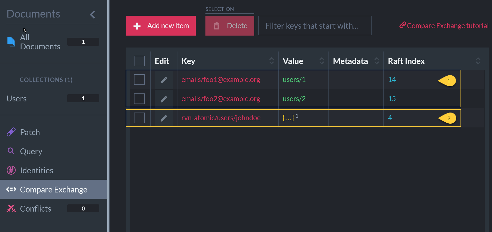

import Admonition from '@theme/Admonition';
import Tabs from '@theme/Tabs';
import TabItem from '@theme/TabItem';
import Panel from "@site/src/components/Panel";

<Admonition type="note" title="">

* **Atomic Guards** are [compare-exchange key/value items](../../compare-exchange/overview.mdx)
  that RavenDB creates and manages **automatically** to guarantee [ACID](../../server/clustering/cluster-transactions.mdx#cluster-transactions-properties) behavior in cluster-wide sessions.  
  
* When a document is created in a cluster-wide session, RavenDB associates it with a unique atomic guard item.  
  Atomic guards coordinate concurrent writes by different sessions to the same document.

* In this article:
   * [Atomic guard creation and update](../../compare-exchange/atomic-guards.mdx#atomic-guard-creation-and-update)
   * [Atomic guard usage example](../../compare-exchange/atomic-guards.mdx#atomic-guard-usage-example)
   * [Atomic guard database scope](../../compare-exchange/atomic-guards.mdx#atomic-guard-database-scope)  
   * [Disabling atomic guards](../../compare-exchange/atomic-guards.mdx#disabling-atomic-guards)  
   * [Atomic guard removal](../../compare-exchange/atomic-guards.mdx#atomic-guard-removal)  
   * [Best practice when storing a document in a cluster-wide transaction](../../compare-exchange/atomic-guards.mdx#best-practice-when-storing-a-document-in-a-cluster-wide-transaction)  

</Admonition>

<Panel heading="Atomic guard creation and update">

<Admonition type="info" title="">
Atomic guards are created and managed **only when the session's transaction mode is set to [CLUSTER_WIDE](../../client-api/session/cluster-transaction/overview.mdx#open-a-cluster-transaction)**.
</Admonition>

* **When creating a new document**:  
  A new atomic guard is created when a new document is successfully saved.

* **When modifying an existing document that already has an atomic guard**:  
  * The atomic guard’s Raft index is incremented when the document is successfully saved after being modified.  
    This allows RavenDB to detect that the document has changed.
  * If another session had loaded the document before the document's version changed, it will not be able to save its changes
    unless it first reloads the updated version. Otherwise, a `ConcurrencyException` is thrown.

* **When modifying an existing document that doesn't have an atomic guard**:  
  A document has no atomic guard if it was created outside a cluster-wide session (e.g., in a single-node session)
  or in a cluster-wide session with [atomic guards disabled](../../compare-exchange/atomic-guards.mdx#disabling-atomic-guards).
  * A new atomic guard is created when modifying an existing document that does not yet have one.
  * If the document's atomic guard was manually removed, saving the modified document will fail.  
    To learn how to restore the atomic guard, see [Atomic guard removal](../../compare-exchange/atomic-guards.mdx#atomic-guard-removal).

* **When saving a document fails**:  
  * If a session's `save_changes()` fails, the entire session is rolled back and the atomic guard is **not** created.  
  * Ensure your business logic is designed to re-execute the session in case saving changes fails for any reason.

</Panel>

<Panel heading="Atomic guard usage example">

In the code sample below, an atomic guard is automatically created when a new document is saved.  
It is then used to detect and prevent conflicting writes: when two sessions load and modify the same document,  
only the first save succeeds, and the second fails with a `ConcurrencyException`.

<Tabs groupId='languageSyntax'>
<TabItem value="Cluster_wide_session" label="Cluster_wide_session">
```python
with store.open_session(
    # Open a cluster-wide session:
    session_options=SessionOptions(transaction_mode=TransactionMode.CLUSTER_WIDE)
) as session:
    session.store(User(), "users/johndoe")
    session.save_changes()
    # An atomic guard is now automatically created for the new document "users/johndoe".

# Open two concurrent cluster-wide sessions:
with store.open_session(
    session_options=SessionOptions(transaction_mode=TransactionMode.CLUSTER_WIDE)
) as session1:
    with store.open_session(
        session_options=SessionOptions(transaction_mode=TransactionMode.CLUSTER_WIDE)
    ) as session2:
        # Both sessions load the same document:
        loaded_user_1 = session1.load("users/johndoe", User)
        loaded_user_1.name = "jindoe"
        loaded_user_2 = session2.load("users/johndoe", User)
        loaded_user_2.name = "jandoe"

        # session1 saves its changes first, incrementing the Raft index of the associated atomic guard.
        session1.save_changes()

        # session2 tries to save using an outdated atomic guard version
        # and fails with a ConcurrencyException.
        session2.save_changes()
```
</TabItem>
</Tabs>

---

After running the above example, you can view the automatically created atomic guard in Studio's **Compare Exchange** view.

<Admonition type="warning" title="">

Although this Studio view allows you to edit compare-exchange items, do **not** delete or modify atomic guard entries.
Doing so will interfere with RavenDB's ability to track document versioning through atomic guards.

</Admonition>

<br />



1. These are **custom compare-exchange items**, created by the user for any purpose,  
   as described in [Create compare-exchange items](../../compare-exchange/create-cmpxchg-items.mdx).
   They are **not** the automatically created atomic guards.

2. This is the **atomic guard** that was generated by running the example above.  
   The generated atomic guard **key** is: `rvn-atomic/users/johndoe`. It is composed of:  
     * The prefix `rvn-atomic/`.
     * The ID of the associated document (`users/johndoe`).

</Panel>

<Panel heading="Atomic guard database scope">

* Atomic guards are local to the database on which they were defined.

* Since atomic guards are implemented as compare-exchange items,  
  they are **not** externally replicated to other databases by any ongoing replication task.  
  Learn more in [why compare-exchange items are not replicated](../../compare-exchange/overview.mdx#why-compare-exchange-items-are-not-replicated-to-external-databases).

</Panel>

<Panel heading="Disabling atomic guards">

* Before atomic guards were introduced (in RavenDB 5.2), client code had to explicitly manage compare-exchange entries
  to ensure concurrency control and maintain ACID guarantees in cluster-wide transactions.

* You can still take this manual approach by disabling the automatic use of atomic guards in a cluster-wide session,
  and managing the required [compare-exchange key/value pairs](../../compare-exchange/overview.mdx) yourself,
  as shown in this [example](../../compare-exchange/overview.mdx#example-i-email-address-reservation).

* To disable the automatic creation and use of atomic guards in a cluster-wide session,
  set the session's `disable_atomic_document_writes_in_cluster_wide_transaction` configuration option to `True`.

<Tabs groupId='languageSyntax'>
<TabItem value="Cluster_wide_session" label="Cluster_wide_session">
```python
with store.open_session(
    # Open a cluster-wide session
    session_options=SessionOptions(
        transaction_mode=TransactionMode.CLUSTER_WIDE,
        # Disable atomic guards
        disable_atomic_document_writes_in_cluster_wide_transaction=True,
    )
) as session:
    session.store(User(), "users/johndoe")

    # No atomic guard will be created upon save_changes()
    session.save_changes()
```
</TabItem>
</Tabs>

</Panel>

<Panel heading="Atomic guard removal">

Atomic guards are removed **automatically** in the following scenarios:  
(you don't need to clean them up manually)

* **Document deleted via a cluster-wide session**:
  * Create a document using a cluster-wide session (an associated atomic guard is created).
  * Delete the document using a cluster-wide session - its atomic guard will be removed automatically.

* **Document expires via the expiration feature**:
  * Create a document using a cluster-wide session (an associated atomic guard is created).
  * Add the `@expires` metadata property to the document, as described in [Document expiration](../../studio/database/settings/document-expiration.mdx).
  * When the expiration time is reached, the document and its atomic guard will both be removed automatically.
  * Since different cleanup tasks handle the removal of **expired** documents and the removal of their associated atomic guards,
    atomic guards of removed documents may linger in the compare-exchange entries list a short while longer before they are removed.  
    You do **not** need to remove such atomic guards yourself: the cleanup task will remove them.

<Admonition type="warning" title="">

* **Do not delete or modify atomic guards manually**.  
  If a session attempts to save a document whose atomic guard was removed or modified, the save will fail with an error.
 
* **If you accidentally remove an atomic guard, you can restore it**.  
  To restore an atomic guard whose document still exists, store the document again in a cluster-wide session, without loading the document first.  
  The stored entity replaces the existing document, so make sure the entity holds the document's full content.  
  Saving the document will re-create the atomic guard.

  If you load the document before storing it, saving the document will fail,
  because the loaded document's [change vector](../../server/clustering/replication/change-vector.mdx) still holds the Raft index of the removed atomic guard.  
  If this happens, store the document again in a new cluster-wide session, this time without loading the document.

</Admonition>

</Panel>

<Panel heading="Best practice when storing a document in a cluster-wide transaction">

* When working with a cluster-wide session,  
  we recommend that you always **`load` the document into the session before storing it** -  
  even if the document is expected to be new.

* Note that a document originally created in a cluster-wide transaction may be deleted **outside** of a cluster-wide session,
  e.g., when you use a [single-node session](../../client-api/session/cluster-transaction/overview.mdx#cluster-wide-transaction-vs-single-node-transaction)
  or [DeleteByQueryOperation](../../client-api/operations/common/delete-by-query.mdx).  
  In these cases, the document is deleted, but the atomic guard remains (it is not automatically removed).  
  Re-creating the deleted document in a cluster-wide session will fail,
  even if you call `load` with the document's ID before storing it.
  
* In this example, the document is loaded into the session BEFORE creating or modifying it:
  <Tabs groupId='languageSyntax'>
  <TabItem value="Cluster_wide_session" label="Cluster_wide_session">
  ```python
  with store.open_session(
      session_options=SessionOptions(
          # Open a cluster-wide session
          transaction_mode=TransactionMode.CLUSTER_WIDE
      )
  ) as session:
      # Load "users/johndoe" BEFORE creating or modifying it,
      # even if you expect no document with this ID to exist
      user = session.load("users/johndoe", User)

      if user is None:
          # Document doesn't exist => create a new document:
          new_user = User()
          new_user.name = "John Doe"
          # ... initialize other properties

          # Store the new user document in the session
          session.store(new_user, "users/johndoe")
      else:
          # Document exists => apply your modifications:
          user.name = "New name"
          # ... make any other updates

          # No need to call store() again
          # RavenDB tracks changes on loaded entities

      # Commit your changes
      session.save_changes()
  ```
  </TabItem>
  </Tabs>

<br />

<Admonition type="note" title="">

When _loading_ a document in a cluster-wide session, RavenDB attempts to retrieve the document from the document store.

* **If the document is found**:  
  The document is loaded into the session, and modifications will be saved successfully as long as no other session has modified the document in the meantime.  
  * RavenDB checks whether the Raft index of the atomic guard associated with the document matches the version tracked by the current session.
    If another session has already updated the document (and incremented the atomic guard’s Raft index), the save will fail with a `ConcurrencyException`.

* **If no document is found**:  
  * **If an atomic guard exists** (e.g., when a document with this ID was deleted outside of a cluster-wide session),
    saving a new document with this ID will fail with a `ConcurrencyException`.
  * **If no atomic guard exists**,
    saving a new document with this ID will succeed.

</Admonition>

</Panel>
